2026-10-25 UI 整改：Candidate A/B/C/D 与历史方案同构等高、长字段内部滚动；中文枚举/完整英文对照、Hard Gate 贡献题目行及共享浮层统一，正式数据只读、Provider0。见[验收与截图](docs/UI_CONSISTENCY_ACCEPTANCE.md)。

2026-10-25 导航与候选池专项：侧栏常驻、页面快照后台重验、轻量初始化；当前Golden候选管理严格使用Medium50持久化成员，历史数据保留。Provider0，正式Baseline与A/B/C原始结果不变。[性能整改验收](outputs/page_performance_20261025/性能整改验收.md)。

2026-10-25 视觉统一：Baseline、Agent工作台、发布及问答验证的Tab/表格/卡片/Drawer继承Pipeline配置与Golden Dataset现有字体与Card规范；移除后台核对顶部提示，刷新与实际错误保持。Provider0、正式数据只读；见[逐页视觉验收](docs/VISUAL_SYSTEM_ACCEPTANCE.md)。


> Agent 已付费响应恢复：允许1–3个合法候选，逐项校验保留合法部分；缺少可选说明不再整批失败。零网络预检与追加恢复方式见 [响应合同](docs/AGENT_RESPONSE_CONTRACT.md)。

2026-10-25 页面加载性能修复：按当前页取必要数据，详情保留原入口；减少重复诊断和历史JSON解析，不改评分、策略、冻结数据或模型索引。[优化前后实测](outputs/page_loading_perf_20261025/页面加载验收.md)。

2026-10-24 手动Sandbox续跑：用户点击既有「继续 Sandbox」并确认费用，即明确接受历史未知请求可能重复计费，允许新Run重新请求缺失结果；不再以历史超时/未对账阻断手动续跑。原Run/历史Usage和未知标记只读保留，子Run记录本次授权及继承的未知审计，完整Case/已保存阶段结果复用；本次新Unknown仍停止，不自动重发。非手动路径、身份/配置、Judge、11 Gate、Regression及发布保护不变。无新费用/Token限制、表单或架构节点。 [零调用验收](outputs/manual_sandbox_resume_20261024/验收.md)。

2026-10-24 Sandbox稳定性整改：成功RPC随题目Checkpoint保存并按完整请求身份复用，DeepSeek明确拒绝与未知执行分开，HTTP响应头/正文超时分开留痕。A38/B48/C50保持；A/B未知请求仍须对账，不能自动续跑。模型、超时、Token、费用确认及Judge标准不改。本轮Provider0/费用0。[统一审计与离线验收](outputs/sandbox_stability_20261024/统一审计与验收.md)。

2026-10-23当前：已按Owner要求撤销额外Sandbox人民币累计硬上限、强制预算参数及附加费用限制，恢复原人工费用确认与运行/续跑。A历史未知费用仍需对账，点击明确显示原因；其他符合条件的按钮正常响应。本轮Provider0/费用0，历史数据不变。[验收记录](outputs/fee_confirmation_restore_20261023/验收记录.md)。

2026-10-23历史费用执行前检查（硬预算已撤销）：同Experiment的新授权请求已受后端人民币累计硬预算约束；A未知费用继续阻断，B从Q02、C从Q01可独立明确授权，已完成39题复用。仅零费用审计与离线验收，未启动Sandbox。[费用、上界、账单核对及按钮顺序](outputs/sandbox_cost_preflight_20261023/Sandbox费用与续跑执行前验收.md)。

2026-10-22 Sandbox中断保护：区分远程Embedding错误与本地索引故障，单请求有限恢复、未知费用先对账；同身份续跑复用已保存结果，未完成不显示最终成绩，重启/续跑须重新付费授权。[验收规则与离线审计](docs/SANDBOX_INTERRUPTION_RECOVERY.md)。

2026-10-22 Agent完整覆盖规划：按真实观察形成覆盖义务，优先复用模型方案，同轮零调用补齐合法B/C；实际保存目标计数，未完成规划阻止直接Sandbox。规则来源、逐目标根因、能力缺口与历史费用审计保留。[说明与离线入口](docs/AGENT_COVERAGE_PLANNING.md)。

> 2026-10-22 产品收口：正式业务 FAIL 均为 Bad Case，全部进入 Agent 处理；根因在诊断与受控实验中验证。前端保留原布局，内部审计默认折叠。运行版本、零调用离线验证与操作入口见 [验收报告](docs/BAD_CASE_UNIFICATION_ACCEPTANCE.md)。

# RAG Evolution

> 2026-10-22 `agent-closure-3`：10道业务FAIL全量承接，Unknown可基于真实阶段观察提出可证伪探索实验；缺材料/执行身份进入能力修复任务。10/10离线合法探索，50题Fixture闭环不代表真实优化效果，Provider0。原11 Gate/Regression/人工发布保持。详见[中文整改报告、复现命令与下一轮统一预算](docs/AGENT_EXPLORATION_E2E_REPORT.md)。

2026-10-22 零费用补证系统审计：Resolver3明确审查完成与回答完整的区别、冻结参考/来源引文及角色/原子事实合同；确定性解析仅恢复一个缺失fact闭合符，不改语义或资格门槛。9份旧响应仅2份恢复语法，仍0/9闭合；64项离线通过、56份保护哈希未变。本轮Provider0/费用0，未进入后续阶段。[逐题审计与限制](outputs/agent_diagnostic_system_audit_20261022/9题系统根因审计与最小修复.md)。只读回放：`python3 scripts/audit_saved_diagnostics.py`。

2026-10-22 Agent闭环代码与离线修复：全部真实业务FAIL交给同一Agent处理，补证与方案执行资格分开；批量补证独立冻结预算，已有证据复用后再关联新评分。增加仅原问题的候选BM25排序、有证据的必要联动与跨阶段D；Qualified后仍可处理剩余问题。原11 Gate/Regression/人工确认保持。正式Run仍40 PASS/10 FAIL，真实修复0题，未进行新Provider/Sandbox或正式服务重载。[验收单与下一步授权](docs/AGENT_CLOSED_LOOP_ACCEPTANCE.md)。只读核验：`python3 scripts/agent_diagnostics.py --run EVAL-20261021141811373593`。

2026-10-21 当前为V5.1：实质性Fact/Behavior检查阻止Scope-only PASS；独立Q18 Judge探针复用正式合同，但不会写Baseline成绩。数据仍50/50可复用；未通过同身份真实探针与人工业务复核，后端禁止正式Judge-only Replay。当前仅离线实施，Provider0。[V5.1验收/费用与启动说明](docs/V51_PREFLIGHT_CLOSEOUT_ACCEPTANCE.md)。只读预检：`python3 scripts/q18_judge_probe.py preflight`；隔离假HTTP验收：`python3 scripts/verify_q18_probe_offline.py`。真实探针、50Replay各需另行授权。原[V5第一阶段成果](docs/CONTRACT_RESOLVER_REPLAY_V5_ACCEPTANCE.md)保留；Resolver、Golden、Corpus及历史成绩不改。
Baseline复用预检现在会在刷新后自动重新查询；卡片完整显示资格、Identity及费用授权入口，最终确认前不启动评测。[前端交互修复验收](outputs/v51_replay_ui_fix_20261021/验收报告.md)。


2026-10-21 前轮诊断更新（V4历史）：既有评测Identity不变，通过独立审计记录的Case/Snapshot/Corpus/全阶段溯源校验解释已保存业务FAIL；部分Final支持不冒充完整规范、Critical不等于Safety。Ranking仅允许保存Trace验证可恢复且保留既有事实的上下文干预；无可用策略可零候选。Baseline主表保留全部业务FAIL，根因和完整证据在案例抽屉。当前最新Run仍Partial，Q18未恢复，本轮Provider0。[实现与验收](docs/BASELINE_DIAGNOSTIC_EVIDENCE_FIX_REPORT.md)，只读验证：`python3 scripts/verify_baseline_diagnostics.py`。

2026-10-20 Baseline中断修复：当前Parser `business-output-3-evidence-roles`，严格区分实际Final的回答证据与候选中遗漏要求的规范证据；旧V2 Partial不可直接续跑。已重载服务，刷新Baseline页使用“重新运行 Baseline（新版本）”，保留旧3题与检查点；本轮无Provider调用。[根因、验证及操作说明](docs/BASELINE50_INTERRUPTION_FIX_REPORT.md)。

2026-10-20 评测合同收口：保持Judge V3 Prompt与Safety Guard，新增Parser `business-output-2-scope`及新Evaluation Identity。严格必要事实/安全证据与可核清的辅助资料范围分开，原响应保留，技术异常不作业务Bad Case。统一离线验收及[Baseline50准备/预算](docs/RAG_EVALUATION_CONTRACT_CLOSEOUT_REPORT.md)完成后可直接申请正式运行授权；不默认追加单题付费测试，本轮Provider0。

2026-10-20 当前为VNext混合评测：有限来源绑定Safety Guard（`finite-safety-1`）+原Judge V3+统一风险裁决。原Judge结果保留，确认规则违规可覆盖为最终FAIL；无法可靠核验不伪造FAIL，但阻断自动资格/发布。不新增LLM调用或Gate。支持范围与离线Shadow证据见[混合评测实施报告](docs/RAG_HYBRID_EVALUATION_IMPLEMENTATION_REPORT.md)，只读复核：`python3 scripts/verify_hybrid_evaluation.py`。

2026-10-20 当前评测版本：**VNext**（judge-vnext-3-safety-consistency / evidence-vnext-1 / business-vnext-1）。业务仅PASS/FAIL，执行异常独立；同义与适用等价Final可接受，必要安全与型号条件不可放宽。旧Baseline/Candidate成绩只读，新实验须另行授权新版完整Baseline。Owner固定的200条离线基准为157P/43F；这不是新LLM成绩。

关键安全事实全答一致性：在独立定要求与操作适用性之后，逐项回扫整答所有相关表述，核对否定方向与内部矛盾，既有answer_quotes保留冲突双方；明确引用并纠正错误不机械判FAIL。仅升级同一次Judge的Prompt检查流程与版本，不新增Schema/语义规则引擎。本轮Provider0，真实Q42漏判是否闭环仍待新授权复验，见[一致性修复报告](docs/RAG_VNEXT_JUDGE_SAFETY_CONSISTENCY_FIX_REPORT.md)。

安全定向修复：先独立确定必要前提，再审整段回答的当前操作适用性；仅升级Judge Prompt与版本，Schema/Matcher/门槛保持。本轮真实Provider调用0，真实安全能力仍待另行授权的小样本复验，见[修复报告](docs/RAG_VNEXT_JUDGE_SAFETY_FIX_REPORT.md)。

验证：`python3 scripts/verify_evaluation_vnext.py`只读核200条与显式结构化Judge测试响应；`python3 scripts/verify_self_evolution.py test_judge_operation_safety test_evaluation_vnext`在临时库/知识副本、空.env与禁网下检查通用规则；`cd frontend && npm test && npm run build`。不自行启动付费评测。实现、完整验证与正式执行顺序见[实施报告](docs/RAG_EVALUATION_VNEXT_IMPLEMENTATION_REPORT.md)，唯一生效合同见[SPEC文首](docs/RAG_SELF_EVOLUTION_SPEC.md)。

以下按日期保留为历史阶段描述；“可直接复用旧Baseline”、旧Pending/Disputed通过合同与无限恢复不再生效。当前运行状态应读取Demo真实数据。

2026-10-15 UI V2：Baseline → 有据策略与候选实验 → Regression / Recommendation → 人工发布 → 实际问答反馈，四个导航按三大业务模块组织。复用现有视觉与接口，正式数据和资格不变；未运行正式问答或付费模型。当前真实 Golden 有限停止保持，UI 不代表前序真实链路已完成。[完整验收与截图](docs/UI_STORYTELLING_FINAL_ACCEPTANCE.md)。

2026-10-14当前收口：技术Bad Case与独立质量审计分离；当前95.80 Mini20核实Q03 Generation、Q10候选召回Retrieval，Q06不作为调参目标。仅诊断与Agent输入修复，Evaluation Identity不变，当前Baseline可直接复用，无须再次付费评测。本轮Provider0，等待用户在前端启动Agent。[A—H验收](docs/BAD_CASE_VALIDITY_ACCEPTANCE.md)。

历史阶段记录（已由上条覆盖）：Bad Case业务流程移除诊断可信度分类；全部问题按实际证据自动分析，评测范围核验问题不驱动RAG调参。普通Positive错误不因behavior=false归Safety。Judge/Matcher/Policy再次升级，正式实验须另行授权同新版Baseline；原始审计与三个Human Gate保持。[最终验收](docs/BAD_CASE_FINAL_MECHANISM_ACCEPTANCE.md)。

历史阶段记录：全部Bad Case自动分析，按实际回答/证据/Trace筛选可信优化目标；评测规则问题不进入RAG参数优化，不新增人工Gate。Matcher/Policy已升级，历史Mini20 Baseline仍保留原成绩，后续正式实验须另行授权新版Baseline。Baseline详情与Golden Candidate共享视觉规范，原始答案及审计保留。[本轮验收](docs/BAD_CASE_AUTOMATION_ACCEPTANCE.md)。

当前规则以[唯一SPEC文首](docs/RAG_SELF_EVOLUTION_SPEC.md)为准。2026-10-14已按用户授权清空历史实验，知识资产保持；当前问答使用保留参数的**初始配置（未评测、未发布）**。新Golden、Baseline与受控候选需重新治理，不自动恢复历史审计。

评估按答案质量/检索效果/安全鲁棒/性能体验组织；Pending及Disputed仍阻断资格，与已确认失败分开解释。Agent允许0–3个有真实Trace支持、单一干预的候选；D同样验证，11 Gate与正式Regression阈值不变。真实模型效果未由本轮离线测试确认。

后台每分钟按完整对象和依赖清理，历史实验/评测非引用对象各50；当前/活动/被Production引用的完整审计链保留，Full100不截成50题。历史列表每页最多50，详情保存完整Trace。维护清理工具默认只读：`python3 scripts/reset_experiment_history.py`；真正清理须停写入、明确`--execute --maintenance --backup <唯一新路径>`，不能把它用于普通启动或自动清理。唯一备份和旧审计仅外部保留。

本轮依据、实测性能与Mini20准备见[验收报告](docs/RAG_DIAGNOSTIC_RESET_ACCEPTANCE.md)。`./start.sh`及5174/8010入口不变；不要自行启动Provider实验。


面向企业知识问答的评测驱动 RAG 质量运营与版本决策 Demo。

**唯一当前有效规格：[V1.4 + Phase 1 + Baseline/Agent UI 恢复（2026-10-09）](docs/RAG_SELF_EVOLUTION_SPEC.md)**。当前合同以SPEC文首为准；[ChangeLog](docs/SPEC_CHANGELOG.md)追加历史，[Current Demo Truth](docs/CURRENT_DEMO_TRUTH.md)区分真实Current与Legacy。历史验收只代表其日期的运行状态。

Baseline 与 Agent 已恢复阶段、完整方案及证据报告；本轮 A/B/C 批执行复用既有单候选接口，运行失败保留结果，重启后须再次显式继续。所有实验/批准/发布仍需原有人工操作，资格与预算不变。[恢复验收、九图对照与演示脚本](docs/BASELINE_AGENT_RESTORATION.md)。

当前真实Knowledge：4 PDF / 157页、349 Parent / 368 Child、text-embedding-v4 1024d、368 Indexed、9 Topics。原Full 100（40/20/40，机器87/用户批准13）已由用户冻结为GD-20261008024214127995，保留原题、审批、历史质量记录及Legacy Production。新建独立Golden Dataset V2 Medium 50（20/10/20），角色/场景/意图与真实Child/Parent页码持久化，十维业务审计参与资格；当前真实机器结果与未解决项见[Medium V2验收](docs/MEDIUM_V2_POLISH_VERIFICATION.md)和[50题审阅报告](backend/reports/medium_v2_polish_review.md)。本轮不自动批准、冻结、Baseline或Agent。

Pipeline与Golden采用身份隔离的内存Cache/SWR；Current/Pool保留后端30条分页、前端滚动增量加载及详情懒加载。所有右侧Drawer共享单题详情母版 `--drawer-width:800px`，全高100dvh，小屏100vw。长期SPEC/图源同步规则见[AGENTS.md](AGENTS.md)。

候选池默认一行质量筛选与业务用例菜单；下载中文四列Excel，上传后在紧凑窗口预览并明确确认有效行。旧CSV/XLSX继续兼容，处理经验保留为待核验材料，不直接充当Golden答案。选题按Corpus会话暂存；智能补齐只复用现有候选，不调用模型，缺口保持真实。完整工作集仍受Profile、Evidence、Coverage及人工Gate约束。[本轮验收与真实统计](docs/CANDIDATE_POOL_IMPORT_VERIFICATION.md)。业务/技术架构关系及唯一图源不变。

## 产品闭环

`知识库 → Golden 规划与治理 → Gate 1 → Baseline / Bad Case → Optimization Agent → A/B/C → Sandbox / Regression → Gate 2 → 条件 D → Gate 3 人工发布 → Production → 问答验证 / Monitoring → 人工确认 Trigger → 下一轮优化`

只有 Optimization Agent 是主 Agent。Hard Gate 与 Regression 决定资格，Overall 仅用于比较；D 未通过或未优于 Winner 时保留 Winner。不自动改知识、调参、发布或回滚。

目标一级模块顺序：RAG 自进化项目概览、知识库、Pipeline 配置、Golden Dataset、Baseline、Agent 工作台、发布、问答验证。Monitoring 为问答验证二级 Tab；保留现有 Hash/兼容入口，目标名称与 H1 一致。

## V1.4 业务实施历史状态（截至 2026-10-02）

| 能力 | 当前证据与运行边界 |
| --- | --- |
| Current Baseline resolver、Experiment 绑定、Monitoring Confirm/首轮 | 共用身份解析、幂等 Confirm、Provider 锁外执行与 A/B/C 原子保存；P0 定向复审通过 |
| Golden V2、统一 Validator、Pool 匹配 | 现有 FAISS 向量规划、冻结 Plan/Slot、最大二分匹配；263 项阶段离线后端测试通过 |
| 双层 Probe、原解析全文、原子 bundle | CandidateK/Final Context 分层、失败与空召回分开；真实 4 PDF/157 页备份 Staging 兼容校验通过，真实 active 尚未升级 |
| Usage/Timing、价格版本与缺失原因 | 284 项阶段离线测试及复审通过；缺历史数据不补造，节假日计费不明时不报精确成本 |
| 八个模块与完整离线生命周期 | 296 项隔离后端、121 项前端、构建通过；Chromium 四尺寸 208 检查，54 ID 具名映射；最终复审通过，当时保留换材草案重新生成后关闭多一次提示的 Minor |

源码证据和需求 ID 对照见 [SPEC 第 3 节](docs/RAG_SELF_EVOLUTION_SPEC.md#3-需求追踪与当前实现证据)。当前冻结 Golden 不能因为文档更新而称为 V2 生成；历史未采集字段不回填。Snapshot、Baseline、Candidate 与 Production 分别保留自己的来源。

## Interview Demo 产品叙事（2026-10-03，Historical）

每个页面只回答当前阶段的问题：知识库技术选型 → Pipeline 的 Frozen / Agent Search Space → Golden 稳定评测基准 → Baseline 的 Hard Gate / Bad Case → 根因与受控 A/B/C 实验 → Sandbox / Regression 与条件 D → 人工发布 → 同题真实问答差异 → Monitoring 下一轮。只有概览保留全局闭环；其他页面删除重复 Stepper、流程图、大 KPI 与发布流水线。

主结论优先，文档/Evidence/Case/Search Space/完整配置/高级指标进入统一右侧 Drawer（当时标准560px/wide800px；已被当前唯一800px合同覆盖）。Sandbox 主表聚焦 Hard Gate、Bad Case、Regression、Qualification；A/B/C 统一 WHY / CHANGE / RESULT，D 独立说明组合失败为何保留 Winner。当前真实根因为 Generation 6 / Safety 1，不借示例虚构 Retrieval 失败。

方案对比固定正式 Baseline 对实际 active、人工已发布 Production，不提供任意方案选择器或 Qualified Candidate fallback，删除历史评测 UI/GET/缓存。Bad Case 选择后填入可编辑问题，只有主动点击才运行实时对比；答案双栏为重点。问答验证 Tab 顺序为问答验证 → 方案对比 → Monitoring。Input/Output Tokens 与费用分开；真实 0/false 保留，估算只使用完整 Usage 与冻结价格币种（当前 USD），缺历史计费依据不回算。

本轮业务与真实数据保护边界不变；唯一后端补充为现有 `GET /api/pipeline` 的实际索引 `dimension/indexed_count` 可空只读字段，不重建 FAISS、不调用真实 Provider。20–30 分钟完整讲解及现场手动调用边界见 [Runbook](docs/INTERVIEW_DEMO_RUNBOOK.md)。

## 当前正式架构（同源于项目概览）

以下图表达完整流程设计，当前运行结果仍由应用持久化对象决定；不代表Gate已批准或Baseline/Agent已运行。





唯一图源：[KnowledgeDiagrams.tsx](frontend/src/components/KnowledgeDiagrams.tsx) + [Shared CSS](frontend/src/styles.css)；[导出脚本](scripts/export_architecture.py)读取实际页面SVG和Computed Style，生成16:9 SVG/2560×1440 PNG与[校验Manifest](架构/architecture-manifest.json)。[平台说明](架构/RAG自进化平台架构说明.md)。旧HTML为Historical归档，不作为当前正式图。

## 本地启动与恢复

前置条件：Python 3.10+、Node.js 20+、npm。保留现有启动入口：

```bash
./start.sh
```

前端：[http://127.0.0.1:5174](http://127.0.0.1:5174)；API 文档：[http://127.0.0.1:8010/docs](http://127.0.0.1:8010/docs)。已有后台服务重启后先检查端口/PID/目录，避免另开重复进程。

手动启动方式仍为：

```bash
python3 -m pip install -r backend/requirements.txt
PYTHONPATH=backend python3 -m uvicorn app.main:app --port 8010
cd frontend && npm install && npm run dev
```

真实调用前在本地 `.env` 配置 `DEEPSEEK_API_KEY`。Key、真实 DB、备份和索引产物不提交 GitHub。Provider 不可用时返回明确状态，不创建模拟回答、评测或发布结果。相关 Chunk 会随显式回答/QC/Judge/Agent 请求发送给 Provider。

Golden 失败时保留已合格 Slot，使用现有补失败题入口；Probe/QC 中断使用现有重试入口，不重做已应用修订、不自动批准。历史 Snapshot 只读；历史详情与统一 Drawer 的最终验收见实施报告。

## Preview 与真实验证边界

**V1.4 Planner Preview 已实施**：Golden 当前测试集紧凑 Coverage 入口选择 Profile 后点击「预览当前 Corpus Coverage」，Legacy / 无 Run 页面也可使用；保存 Run 的冻结规划单独查看。`POST /api/governance/coverage-preview` 使用当前已存向量，返回动态 K、merge、Slot、材料与缺口；不调用生成/Judge/QC，不改变当前 Golden/Baseline/Production。Pool Preview 为 `POST /api/governance/generation-runs/from-pool/preview`。旧后台服务没有自动重启，使用新代码前须手动受控重启。

以下为Historical V1.4阶段手动验证清单，不能视为当前阶段授权；Baseline/Agent须后续单独授权：

1. 手动运行一次 Baseline vs Production 实时问答对比，查看真实回答、证据、Usage、Latency 与成本缺失原因。
2. Production QA → 人工判 Bad Case → Confirm Trigger → 手动启动首轮 Agent；可能创建实验并耗用 Provider/预算，不自动 Sandbox 或发布。
3. 运行 V2 Planner Preview，核对动态 K、小簇合并与 Slot，不接着自动生成 Golden。

若要将当前演示数据称为 V2，需要另行生成、人工审核并冻结 V2 Golden，然后在同一新 Snapshot 上执行 Baseline/实验与验证。未批准的 Seed / Legacy 候选不能冒充正式 Golden；当前正式 Legacy Snapshot 保留已有的人审资格与历史实测结果。Fixture / 离线 Stub 不能冒充真实 Provider 结果。

## 验证入口

隔离后端测试：`python3 scripts/test_v14_offline.py`；`cd frontend && npm test && npm run build`。测试必须使用隔离 DB/Stub，不消耗真实 Provider 配额；`scripts/test_phase1_ui.mjs` 仅允许隔离 :5180/:8011。

本轮 UI 与只读数据保护结果见 [Interview Demo 验收](docs/INTERVIEW_DEMO_VERIFICATION.md)；前轮业务代码结果见 [V1.4 实施验收](docs/V1_4_IMPLEMENTATION_VERIFICATION.md)，之前的文档/图交付记录见 [同步验收](docs/V1_4_DOCS_SYNC_VERIFICATION.md)。历史或 Stub 结果不代表真实 Provider 重跑。

## Phase 1 Knowledge Pipeline

本轮仅重构项目概览和知识库，新增真实 MinerU VLM → Table KV Normalize → Parent-Child → text-embedding-v4 → FAISS 与 qwen3-rerank / Parent Expand 检索。唯一规则源仍为 `docs/RAG_SELF_EVOLUTION_SPEC.md`，运行证据见 `docs/PHASE1_KNOWLEDGE_VERIFICATION.md`。

在本地 `.env` 配置独立 `MINERU_API_KEY`、`DASHSCOPE_API_KEY` 和与 Key 匹配的业务空间根地址 `DASHSCOPE_BASE_URL`。不把 Key 发到聊天或提交 Git。知识库点击“重建 Knowledge Pipeline”后展示持久化阶段；失败保留旧有效资产，成功激活后自动以 Full Profile 构建 Golden，并停在真实 Human Gate 1。新激活不迁移 Legacy Production，不自动评测或发布。


## 2026-10-11 统一评测与受控优化

当前产品合同见 docs/RAG_SELF_EVOLUTION_SPEC.md 文首。Child命中指标与最终Parent证据充分性分开；统一Judge读取完整证据，Baseline/A/B/C/D冻结同评测身份。旧实验保留只读，历史答案回放不成为正式Baseline或发布依据。新目标修复/附带改善/新增失败分开，程序推荐Winner，Gate2人工确认；有效来源下D最多一次授权LLM建议，经程序校验后另行授权Sandbox。Gate3及兼容配置回滚仍由人工执行。图形表达设计，离线验收不证明真实Provider效果。

评测规则V1.2通用缺陷修复、16题离线回归及真实验证边界见 [EVALUATION_POLICY_V12](docs/EVALUATION_POLICY_V12.md)。本次未重新运行真实Baseline。

## Baseline请求超时与手动续跑

DeepSeek请求/socket等待默认240秒，可用DEEPSEEK_TIMEOUT_SECONDS覆盖；不等于整题/50题限时，也不改性能Gate。Baseline按钮先读取GET /api/evaluation/preflight的完整资格；同身份可恢复时显式提交 `{"resume_source_id":"EVAL-..."}`，否则新建须显式 `{"fresh":true}`。POST /api/evaluations/run不再默认挑选旧失败Run；空请求返回409。新建/恢复与预检共用原严格事务校验，Golden/Corpus不满足则禁用并显示原因；完成题及保存回答仍复用，旧Run/Checkpoint只读保留。两者互斥，调用仍需用户费用授权，单题受控恢复沿用既有额度。旧partial未保存的中间答案/用量无法补回。详见[中文验收报告](docs/BASELINE_STABILITY.md)。


Golden 50题前轮离线修复过程：见[最终索引离线验收](docs/GOLDEN_FINAL_INDEX_OFFLINE.md)。最新真实隔离构建结果见下方第一阶段验收；正式49/50，不可启动完整Probe/QC。

按[正式索引最小执行计划](docs/superpowers/plans/2026-10-12-golden-controlled-index-update.md)，[Q02第一阶段](docs/GOLDEN_Q02_STAGE1_ACCEPTANCE.md)已获授权并通过：真实2请求/1749 Tokens，隔离新Corpus下50/50，367向量逐位复用；正式Corpus及Golden绑定未切换，正式仍49/50。下一阶段切换须明确授权及联动/中断恢复验证，Probe/QC未运行。

[Stage3切换前隔离验证](docs/GOLDEN_Q02_STAGE3_VERIFICATION.md)已通过：11个联动/中断场景、51项回归及启动守卫；本轮Provider0，正式仍未切换。新Corpus会使旧Baseline失去当前身份资格，历史成绩和Production原Legacy索引保留。正式切换须下一次明确授权及维护窗口重验。
# 2026-10-12 夜间受控验收

本轮因保持DeepSeek请求配置下的20元预算预检阻断，未切换正式Corpus、未调用付费Provider。完整状态见[中文执行报告](docs/GOLDEN_OVERNIGHT_ACCEPTANCE.md)。只读复核入口为 `python3 scripts/preflight_golden_overnight.py --output <全新本地审计目录>`；不导入API、不联网、不激活。

受控质量Worker内部可显式传入 `paid_run`，使用 `app.paid_run.PaidRun` 的全新账本、经核实的人民币保守费率/模型输出范围及实时身份校验函数。该上下文必须传至线程入口；它不改变请求参数、不自动重试或续跑，也不替代维护切换、预算预检或人工Gate。现有公共API没有新增执行入口，普通任务不自动使用本轮账本。正式执行前仍须重新核价、完成预算校验及按Stage3要求停服备份。
# 2026-10-12/13 所有者授权连续运行

新授权允许分任务输出上限和累计50元预算；正式Corpus已按Stage3切换，新工作集正式Hard Validation50/50。既有20元预检报告为历史记录。当前请求上限见`app.paid_run.REQUEST_LIMITS`，不改变模型/评分；Baseline和Candidate须冻结相同限制。

本次受控入口为`scripts/run_golden_owner_night.py`，必须具备本轮原始用户授权，使用原持久化账本逐阶段显式继续，禁止重复阶段/未知费用续跑。`--stage repair-1/repair-2`只按审核过的局部变更走真实Revision接口；Baseline/Agent/Candidate通过真实应用ASGI接口写正式DB并调用真实Provider，不使用Fixture替代。Owner委托接口另核服务器授权文件、50题真实机器资格、逐题内容/风险/PDF依据；审批来源标记AI代理，不能冒充人工专家。普通人工审核和发布Gate保持。所有私有授权、账本、原始响应及回滚资产不入Git。

真实结果见[本轮中文验收报告](docs/GOLDEN_OWNER_DELEGATED_ACCEPTANCE.md)：已冻结Owner委托Snapshot；Baseline因Judge超时停于8/50 Partial，未知Usage禁止自动续跑，Agent/ABC未启动。重启服务不会恢复付费任务。对已有人工路径允许复核的检索不连贯，可通过具名独立PDF审核显式接受；同一召回问题的QC P1须逐条处置并绑定当次质量记录，不豁免P0/失败/安全风险。

Candidate启动前可调用 `GET /api/candidates/{id}/preflight` 只读核对绑定Baseline、冻结身份/限制及优化配置，不预约或调用Provider。旧Dataset/旧Baseline实验不会重绑当前Baseline。

评测运行窗口支持“停止运行”：等待当前请求结束并保存断点后停止，已完成题目保留；窗口×仅隐藏状态。手动停止后不自动恢复，需明确续跑。见[验收说明](docs/EVALUATION_STOP_ACCEPTANCE.md)。

Q38 Judge结构异常修复：完整输出示例与原Parser一致，错误显示具体字段；显式Resume保留原审计、使用新Run的有限重试窗口。同Run重启不重置计数。见[Q38验收](docs/Q38_JUDGE_ACCEPTANCE.md)。

Optimization Agent请求和HTTP错误审计保存模型/参数/大小/SHA及脱敏Provider错误码、正文、阶段和重试判断；Token估算仅为观测，不当作精确Tokenizer结果或费用阻断。见[离线验收](docs/AGENT_HTTP400_ACCEPTANCE.md)。

Agent上下文超限已通过传输去重修复：省去重复的result_json字符串，完整result及证据仍保留，数据库历史不变。见[验收](docs/AGENT_CONTEXT_LIMIT_ACCEPTANCE.md)。

Mini20支持显式Business V2业务出题与十维审计，保留原Coverage/Construction约束。所有者委托AI审核必须绑定唯一Run、当前Corpus/Plan、明确Profile及实际授权来源，不冒充真人。具体本次结果见[Mini20收口验收](docs/MINI20_QUALITY_CLOSURE_ACCEPTANCE.md)。

2026-10-14新Medium50采用问题设计先于证据核验，设计阶段不传PDF正文/答案；独立审计检查单核心意图及设计谱系。仅本次授权CLI `scripts/run_medium50_full_evolution.py` 复用正式Generation/治理/委托审核/Baseline/Agent/Sandbox链路；账本不设本轮金额上限，实际有限失败结果见[验收](docs/MEDIUM50_FULL_EVOLUTION_ACCEPTANCE.md)：当前32/50机器合格，Q07实际PDF歧义且两次新替换耗尽，未冻结、未执行新Baseline/Agent/A/B/C；检查点与未知Usage保留。

2026-10-15 Baseline 与 Agent 工作台完成前端产品表达重构；现有规则与数据保持。见[验收报告](docs/WORKBENCH_PRODUCT_EXPRESSION_ACCEPTANCE.md)及[最终截图图库](docs/screenshots/workbench-20261015/index.html)。截图中的Mini20是既有结果，不代表前序Medium50已完成。

2026-10-15 Medium50本轮有限治理结束：沿用原Run，50题独立审核已记录，21/50机器合格；实际难度、题型边界及Q50 P0仍阻断冻结，未执行新Baseline/Agent/A/B/C。DNS和Q09连接中断分别获一次精确重试，三笔Unknown及早期38次成功请求重发完整记账。逐题结果、费用与验证见[最终验收](docs/MEDIUM50_FINAL_ACCEPTANCE.md)。

2026-10-15后续Golden专项允许重新规划独立Plan/Run；完整核查四PDF157页及三轮106份业务设计/版本后，尚未独立证实15个合法复杂意图。未创建凑标签的新Plan/Run、未新增Provider调用或冻结；新质量合同补齐冻结目标/实际难度与当前独立审核校验，历史数据只读保留。详见[Golden专项验收](docs/MEDIUM50_GOLDEN_FINAL_ACCEPTANCE.md)。

2026-10-15最新Medium50质量收口取消全部难度配额及15个复杂意图前置，只保留20/10/20题型与真实业务/证据/安全质量门槛；旧失败记录不回填。逐题治理、Owner Delegated审核与正式冻结的真实状态见[质量收口报告](docs/MEDIUM50_GOLDEN_CLOSURE_REPORT.md)。

本轮Medium50已完成50/50真实质量检查与独立审核，通过Owner Delegated Gate1冻结`GD-20261015135415953347`；12项检索风险依既有合同具名接受并保留未修复记录。159次请求均成功，费用均为Unknown；本轮停止于Golden，未启动Baseline/Agent/Sandbox。详见上述质量收口报告。

Baseline框架稳定性：Judge V4明确必要Final事实与非必要行为审查的输出边界；非法响应不改判。单题已知可恢复错误耗尽保留Checkpoint后继续，连续两题耗尽熔断；Partial禁止形成正式Overall/Gate，显式恢复复用成功结果。运行版本可由`GET /api/evaluation`的`runtime_contract`核对。详见[修复与离线验证报告](docs/BASELINE_RESILIENCE_FIX_REPORT.md)。

V4最终合同：`check_type`默认`fact`，Negative附加事实同样必须有真实适用Final；仅显式`negative_behavior`纯拒答/澄清免support。Parser `business-output-4-negative-facts`进入身份。历史回放Partial/Failed与Baseline共用未完成聚合屏蔽。三题Q01/Q21/Q40已准备，真实Judge仍待授权。


### Golden内容VNext（离线草案，未启用）

[50题旧新对照](docs/GOLDEN_VNEXT_50_REVIEW.md)、[机器草案](docs/GOLDEN_VNEXT_50_DRAFT.json)、[实施与验证报告](docs/GOLDEN_VNEXT_IMPLEMENTATION_REPORT.md)。这些文件不会替代Frozen Snapshot，也不被当前Judge读取。原逐字Anchor校验不接受语义改写，正式冻结前需另行审查证据验证衔接与人工批准。

`AiService(..., generation_prompt_version="generation-vnext-2")`用于后续明确采用新版表达的独立执行环境；默认仍为`generation-vnext-1`。Baseline和Candidate共用该运行时与基础规则，生成合同纳入既有Evaluation Identity；禁止跨版本混合。当前服务未切换，本轮不调用Provider或执行正式评测。

只读离线核验：`python3 scripts/verify_golden_vnext.py --source-database backend/data/demo.db --self-test`。加`--render-review`可从JSON重建逐题阅读文件，不写数据库。
