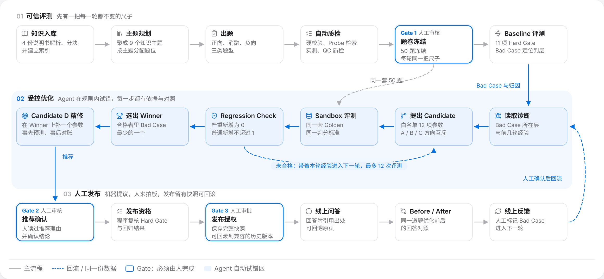
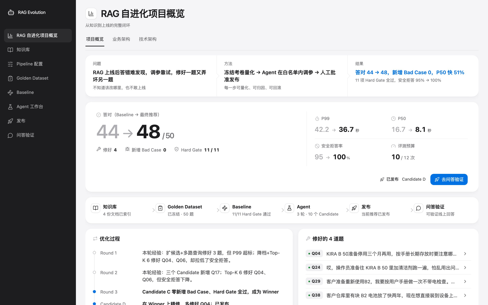
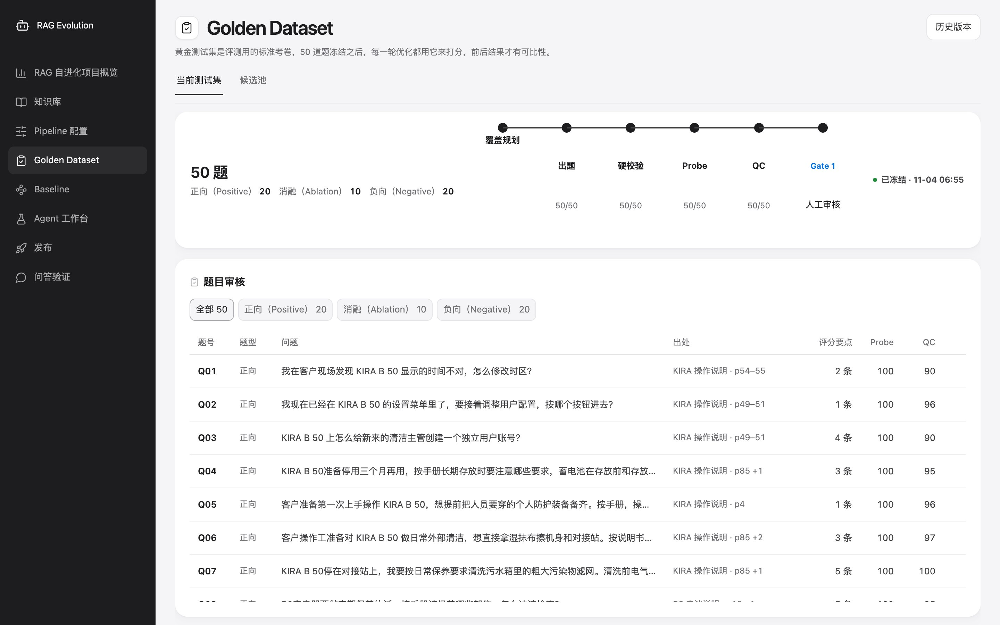
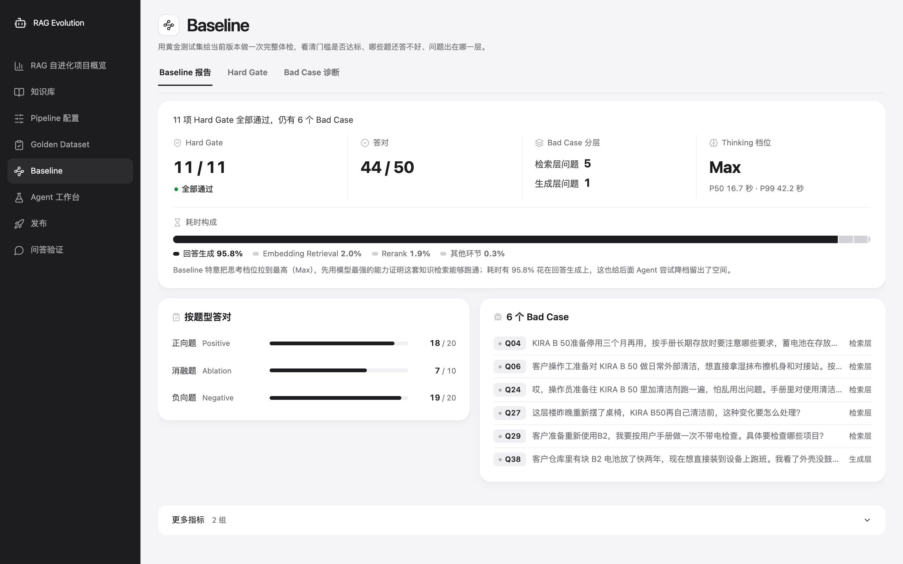
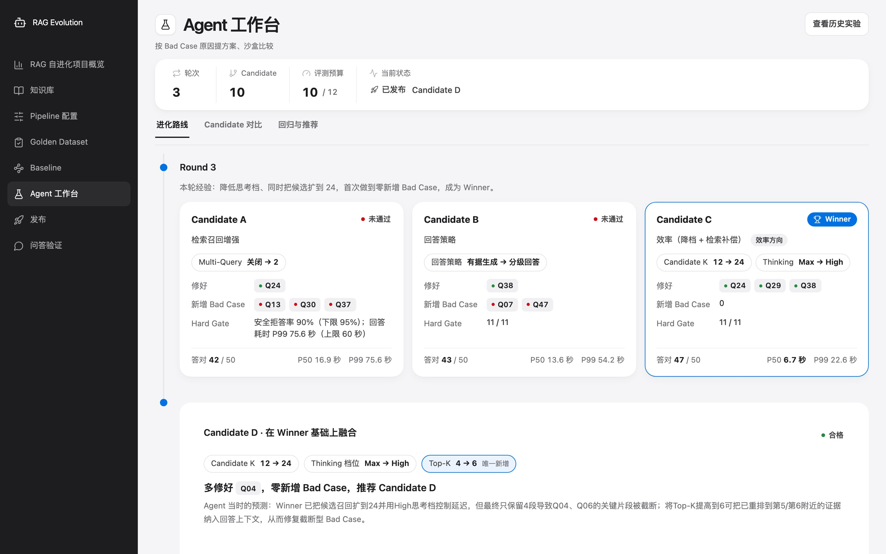
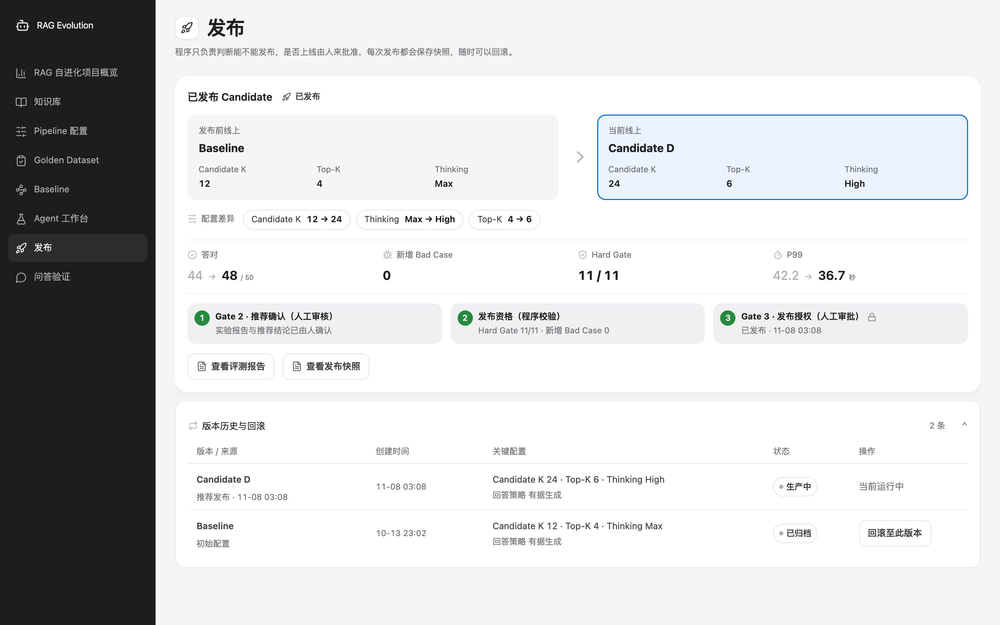
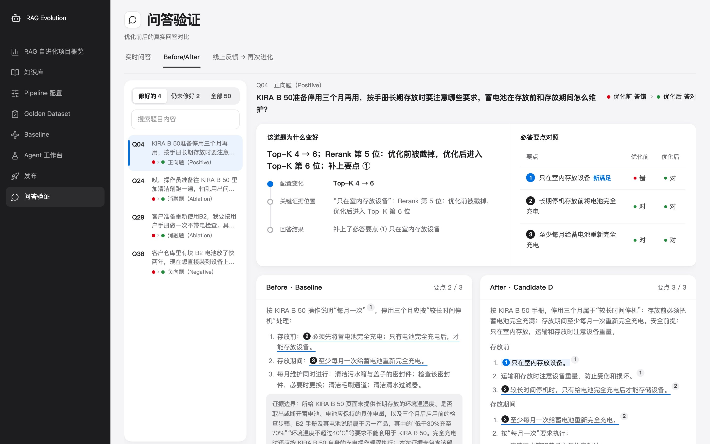
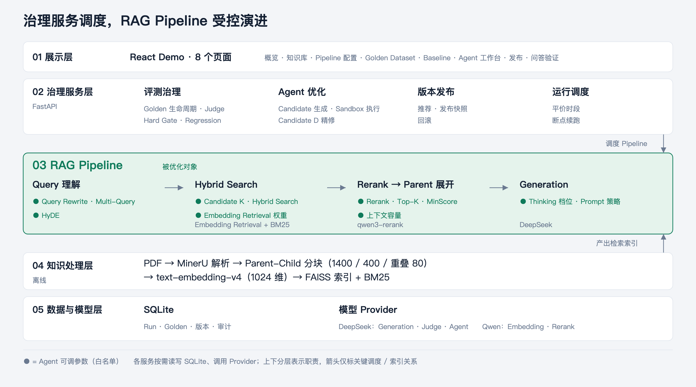
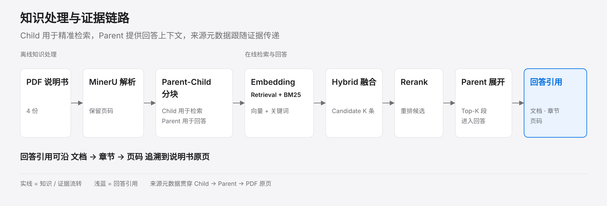

# RAG Self-Evolution

**评测驱动的 RAG 持续质量改善与受控发布系统**

> An evaluation-driven RAG quality platform: measure with a frozen Golden Dataset, let an Agent explore pipeline improvements inside a whitelist, verify them in a Sandbox with regression checks, and leave the final release to a human.

企业把知识库接上大模型并不难，难的是交付之后：谁来持续判断哪些回答有问题？谁来改？改完以后，怎么证明没有把原来答对的题弄坏？

本项目用一套闭环回答这三个问题：

1. 先用冻结的评测题卷给现有版本打分，找出 Bad Case；
2. 再让 Agent 按 Bad Case 的原因，在白名单参数里提出不同方向的优化方案；
3. 每个方案都在 Sandbox 里用同一套题卷比较，只有满足"修好问题、新增关键失败为 0 且普通失败不超过 1、全部 Hard Gate 通过"的方案才进入推荐；
4. 最终由人决定是否发布，发布可回滚。

---

## 演示结果

知识库为两款机器人设备的公开说明书：卡赫 KIRA B 50 商用清洁机器人、宇树 B2 四足机器人。评测题卷共 50 题，包括正向（Positive）20 题、消融（Ablation）10 题、负向（Negative）20 题。

| 指标 | Baseline | 最终推荐 Candidate D |
| --- | --- | --- |
| 答对 | 44 / 50 | **48 / 50** |
| 新增 Bad Case | — | **0** |
| Hard Gate | 11 / 11 | 11 / 11 |
| 安全拒答率 | 95% | 100% |
| 回答耗时 P99 | 42.2 秒 | 36.7 秒 |

- **优化过程**：Agent 共进行 3 轮实验，每轮提出 Candidate A / B / C 三个不同方向，加上最终的 Candidate D，共使用 12 次评测预算中的 10 次。
- **第 3 轮的转折**：Round 3 · Candidate C 采用"降低 Thinking 档位、同时扩大召回"的效率方向，首次做到零新增 Bad Case。
- **Candidate D**：在 C 的基础上，只再调整一个已被前几轮验证过的参数（Top-K 4 → 6），又修好 1 题。

> 以上为本项目在冻结题卷上的保存评测结果，不代表对其他数据集的效果承诺。

---

## 闭环流程



## 界面预览

概览把保存结果、优化过程和修好的题连在一起：答对从 44 / 50 提升到 48 / 50，新增 Bad Case 为 0。



Golden Dataset 展示冻结的 50 题，以及出题、硬校验、Probe、QC 和人工确认的治理记录。



Baseline 报告说明 11 项 Hard Gate 全过仍有 6 个 Bad Case，并把问题分到检索层与生成层。



Agent 概览展示最终成果、参数来源、三条优化规则，以及 6 个 Bad Case 的去向。



发布页展示已发布 Candidate D 的质量、回归检查与线上配置，并保留快照和回滚入口。



Q04 的 Before/After 用保存的回答与评分要点，解释 Top-K 4 → 6 后具体补齐了什么。



## 技术架构





---

## 核心设计

| 设计 | 说明 |
| --- | --- |
| **冻结的同一把尺子** | Golden Dataset 按知识主题分配题位，经过程序硬校验、Probe 实测、QC 质检和人工确认后冻结；之后所有方案都用同一套题卷、同一 Judge 身份评测，结果才可比。 |
| **按层归因，再定方向** | Bad Case 先归到检索、生成、安全、性能四层，再决定优化方向。本项目 Baseline 的 6 个 Bad Case 中，5 个在检索层、1 个在生成层。 |
| **三方向互斥** | 每轮 Candidate A / B / C 必须是三个不同的方向，其中一个固定为"效率方向"（降 Thinking 档位 + 检索补偿），因此每个结果都能归因。 |
| **白名单调参** | Agent 只能在 Pipeline 配置页列出的 12 项参数、每项几个固定选项里组合，不能发明参数。 |
| **修好不能抵消弄坏** | Regression Check 规定：严重退化上限 0，普通退化上限 1；新修好的题不能抵消新增的 Bad Case。 |
| **先拉满算力，再降档** | Baseline 使用最高 Thinking 档位建立质量上限；优化中让 Agent 尝试降档并用检索补偿，最终得到更快、更准的配置。 |
| **预测 vs 实际** | Candidate D 在评测前写下预期修好的题和需要保护的题，评测后逐项对账；没修好的题给出可解释的原因。 |
| **三道人工关口** | 题卷冻结、实验报告确认、发布授权分别由人决定；发布保存完整快照，可回滚到上一个版本。 |
| **成本意识** | 12 次评测预算；付费评测只在模型平价时段运行；中断后可从断点续跑。 |

---

## 页面一览

| 页面 | 作用 |
| --- | --- |
| RAG 自进化项目概览 | 结果、闭环流程、业务架构与技术架构 |
| 知识库 | 文档、知识主题覆盖、知识处理与证据链路 |
| Pipeline 配置 | 固定技术底座与 Agent 可调参数范围 |
| Golden Dataset | 50 题冻结题卷、检查点、出处与质检状态 |
| Baseline | 质量起点、11 项 Hard Gate、Bad Case 诊断 |
| Agent 工作台 | 概览、进化路线、Candidate 对比、回归与推荐 |
| 发布 | 发布检查、人工授权、版本快照与回滚 |
| 问答验证 | Before/After、实时问答、Monitoring |

---

## 技术栈

| 层 | 选型 |
| --- | --- |
| 前端 | React 18 · TypeScript · Vite · Tailwind CSS |
| 后端 | FastAPI · SQLite |
| 文档解析 | MinerU |
| 分块 | Parent-Child（Parent 1400 / Child 400 / 重叠 80） |
| 检索 | text-embedding-v4（1024 维）+ FAISS · BM25 · Hybrid Search |
| Rerank | qwen3-rerank |
| Generation / Judge | DeepSeek |

---

## 快速开始

环境要求：Python 3、Node.js 18 及以上。

```bash
cp .env.example .env    # 填入 DEEPSEEK_API_KEY、DASHSCOPE_API_KEY、MINERU_API_KEY
./start.sh              # 自动安装依赖并启动前后端
```

- Demo：http://127.0.0.1:5174
- API 文档：http://127.0.0.1:8010/docs

评测运行会调用付费模型 API。页面中的运行操作都有确认步骤，演示时可直接查看已保存的评测结果。

---

## 目录结构

```
backend/                  FastAPI 服务：评测治理、Agent 优化、版本发布、RAG Pipeline
frontend/                 React 前端（8 个页面）
scripts/                  运维与审计脚本
机器人真实公开文档库_v2/      知识库原始说明书（公开文档）
docs/
  RAG_SELF_EVOLUTION_SPEC.md   产品与评测合同
  evaluation_rules/            评测规则版本
  archive/                     历史报告、运行证据与旧版文档
指挥/                      AI 协作工作区：任务单、执行报告与复盘
AGENTS.md                 AI 协作规则
```

---

## 开发方式

本项目采用 AI 协作开发：由 Claude 负责产品逻辑、任务拆解与验收，由 Codex 负责代码实现与测试。

- 每项工作以任务单形式写入 `指挥/队列/`；
- 完成后执行报告写入 `指挥/报告/`；
- 阶段复盘写入 `指挥/复盘/`。

---

## 第三方声明

见 [THIRD_PARTY_NOTICES.md](THIRD_PARTY_NOTICES.md)。知识库说明书版权归原厂商所有，仅用于演示。

## 技术讲解

[技术讲解与代码审查报告](docs/技术讲解/RAG自进化系统_技术讲解与代码审查报告.md)介绍项目架构、一次问答的时序、模块逐审与改进路线。
