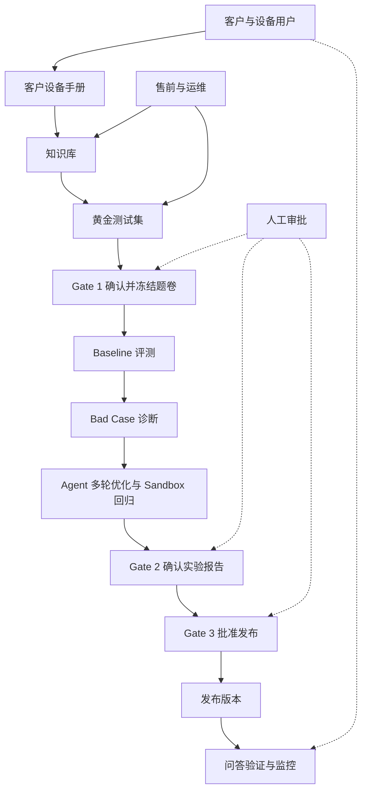
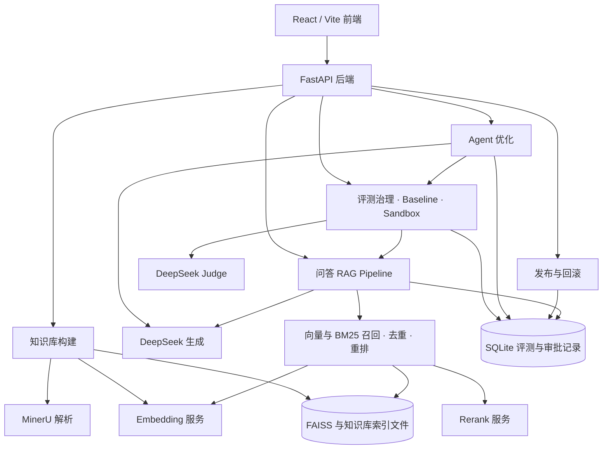
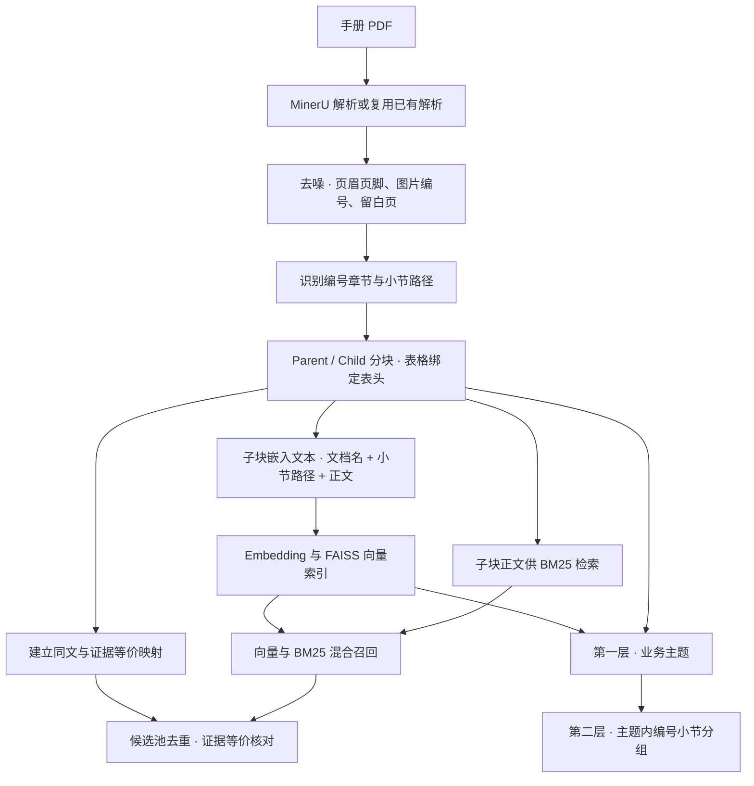
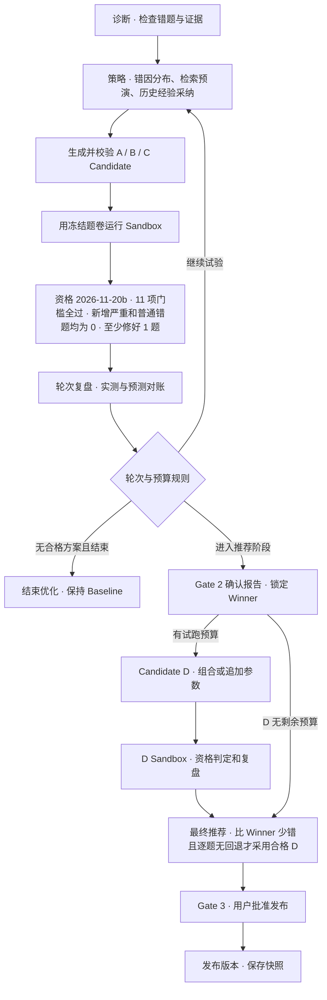

# RAG 自进化平台架构

[返回仓库首页](../README.md)

## 业务架构

## 技术架构

## 知识库流程

向量和子块同时支持检索与主题分组。候选池按查询融合分选同文代表，逐题证据等价还核对编号小节、型号和版本。主题分组使用索引中保存的子块和向量。 [检索规则与证据等价](../指挥/规则总表.md#四生成与-baseline-配置) · [业务主题实现](../backend/app/business_topics.py)

## Agent 优化循环

当剩余预算无法试跑 D 时，保留合格 Winner 进入发布前审核。 [轮次和 D 的规则](../指挥/规则总表.md#六agent-与-sandbox) · [优化循环实现](../backend/app/optimization_cycle.py)
