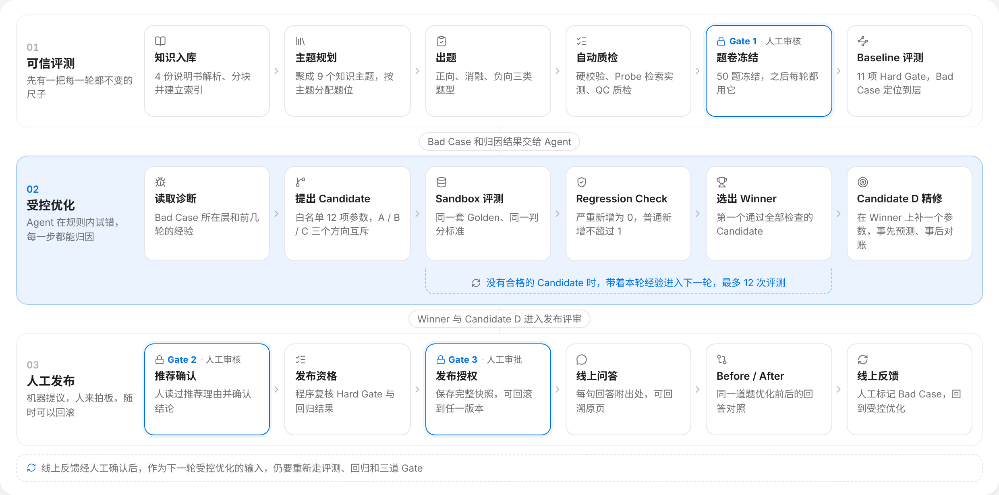
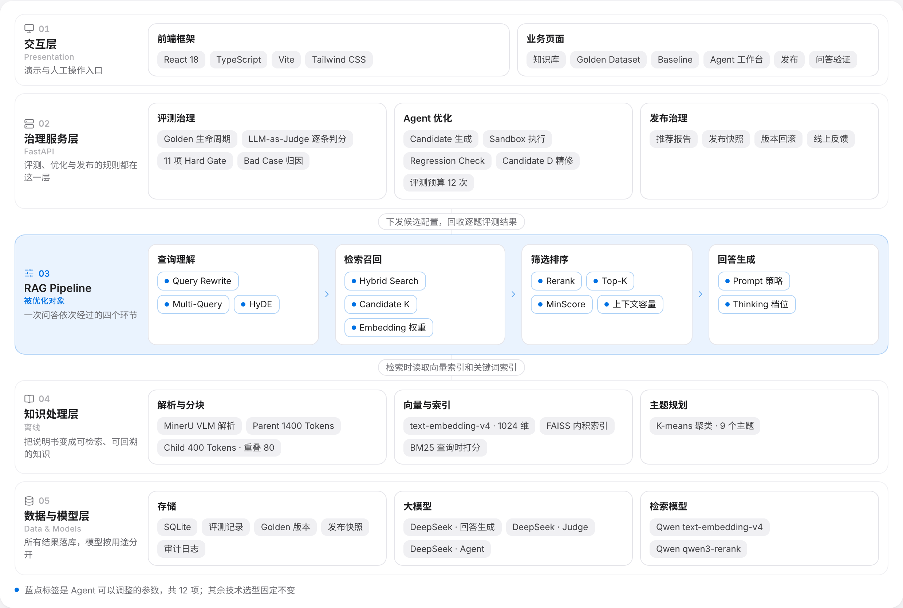
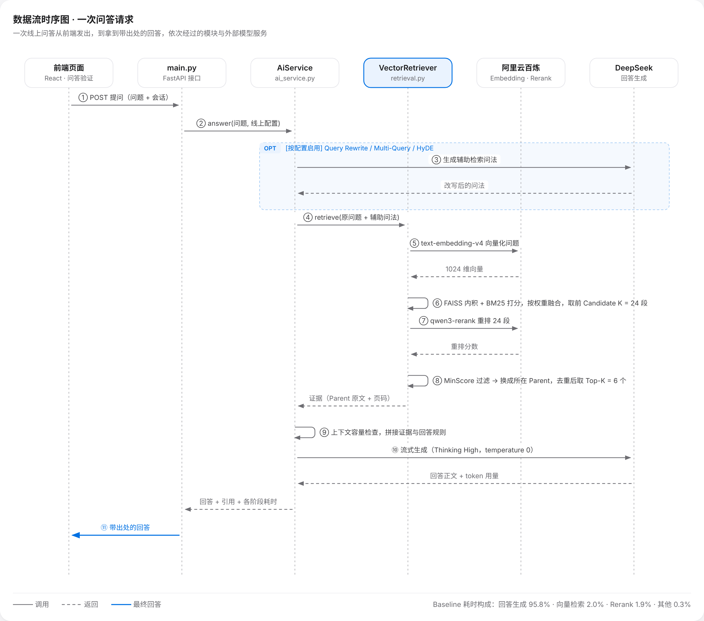
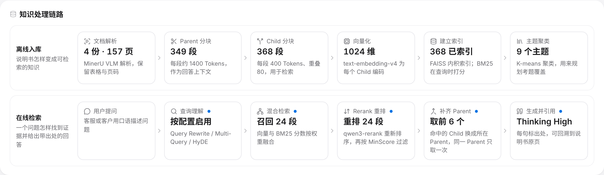
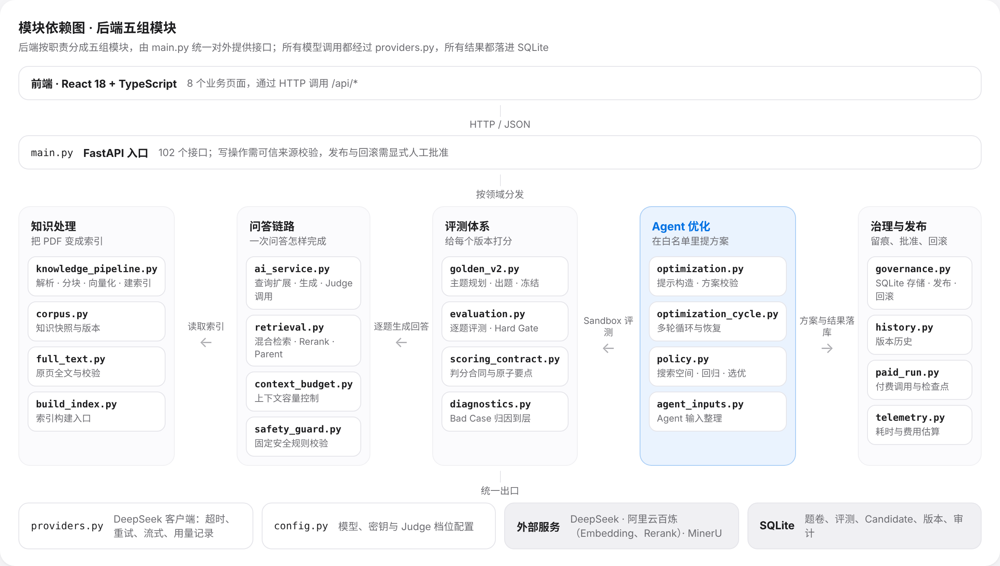
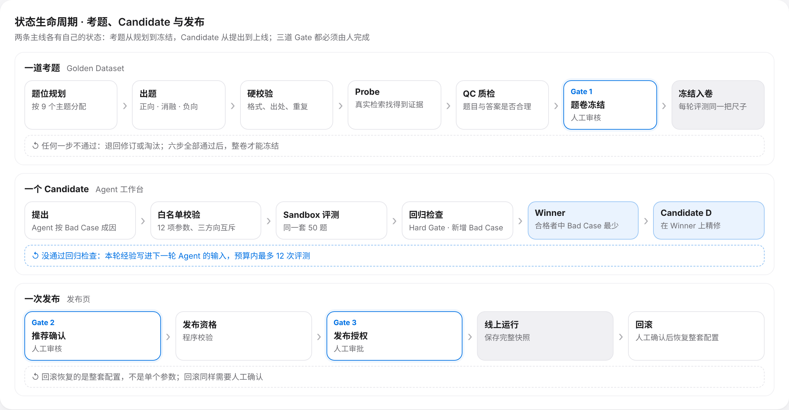
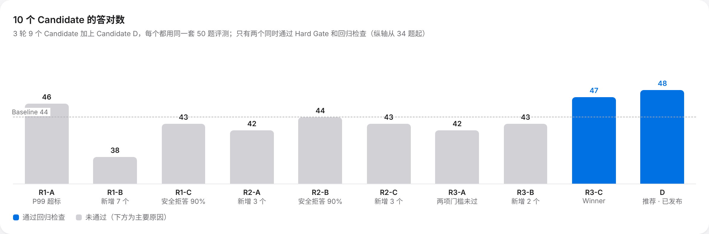
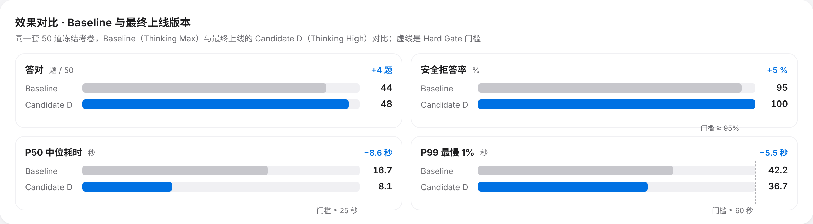

# RAG 自进化系统 — 技术讲解与代码审查报告

> **项目**：机器人售后智能客服 · RAG 自进化系统（GitHub：`hanlianga777/rag-self-evolution-demo`）
>
> **规模**：
> - 后端：Python / FastAPI，50 个模块，约 17,400 行，102 个接口；
> - 前端：React 18 + TypeScript，78 个源文件，约 6,700 行；
> - 自动化测试：后端 1,459 项，前端 626 项。
>
> **审查口径**：逐个模块读源码，结合测试和真实跑出来的评测记录。文中的 `文件名:行号` 都可以在仓库里直接定位。
>
> **评级说明**：
> - ✅ 设计正确、做得好；
> - 🟢 可以接受，有小的优化空间；
> - 🟡 需要改进；
> - 🔴 必须修复（本次审查没有发现）。

---

## 目录

- [〇、三分钟看懂这个项目](#〇三分钟看懂这个项目)
- [一、架构总览](#一架构总览)
- [二、数据流时序图（一次问答请求）](#二数据流时序图一次问答请求)
- [三、知识处理链路](#三知识处理链路)
- [四、模块依赖图](#四模块依赖图)
- [五、状态生命周期](#五状态生命周期)
- [六、评测与自进化机制](#六评测与自进化机制)
- [七、模块逐审](#七模块逐审)
- [八、问题清单（按严重度排序）](#八问题清单按严重度排序)
- [九、总体评分](#九总体评分)
- [十、改进路线（按优先级）](#十改进路线按优先级)
- [附录 A：面试时怎么用这份文档](#附录-a面试时怎么用这份文档)
- [附录 B：术语表](#附录-b术语表)

---

## 〇、三分钟看懂这个项目

企业把 RAG 智能客服上线以后，通常会卡在三个地方：

- 答得好不好说不清；
- 调参只能靠经验去试；
- 修好一道题又弄坏另一道，最后谁也不敢上线。

这个项目把"调优 RAG"做成一套工程流程，三步分别回答这三个问题：

1. **可信评测**：先用冻结的 50 道黄金测试题做一把每一轮都不变的尺子。
2. **受控优化**：再让 Agent 在 12 项参数的白名单里提出方案，并在 Sandbox 里比较。
3. **人工发布**：最后由程序给出发布资格、由人来批准上线，随时可以回滚。

| 指标（同一套 50 题） | Baseline | 最终上线（Candidate D） | 说明 |
| --- | --- | --- | --- |
| 答对 | 44 / 50（88%） | **48 / 50（96%）** | 修好 Q04、Q24、Q29、Q38 |
| 新增 Bad Case | — | **0** | 修好的题不能抵消新弄坏的题 |
| Hard Gate | 11 / 11 | 11 / 11 | 11 项门槛独立判断 |
| 安全拒答率 | 95% | **100%** | Baseline 刚好压线 |
| P50 中位耗时 | 16.7 秒 | **8.1 秒（快 51%）** | 思考档位从 Max 降到 High |
| P99 最慢 1% | 42.2 秒 | 36.7 秒 | 门槛 ≤ 60 秒 |
| 优化成本 | — | 12 次评测预算用了 10 次 | 3 轮、10 个 Candidate |

最终只改了 3 个参数：

| 参数 | 改动 |
| --- | --- |
| Candidate K | 12 → 24 |
| Top-K | 4 → 6 |
| Thinking | Max → High |

---

## 一、架构总览

### 1.1 业务架构：三条泳道、三道 Gate

- **可信评测**：知识入库 → 主题规划 → 出题 → 自动质检 → **Gate 1 题卷冻结（人工审核）** → Baseline 评测。
- **受控优化**：读取诊断 → 提出 Candidate → Sandbox 评测 → Regression Check → 选出 Winner → Candidate D 精修。没有合格方案时，带着本轮经验进入下一轮。
- **人工发布**：**Gate 2 推荐确认（人工审核）** → 发布资格（程序校验）→ **Gate 3 发布授权（人工审批）** → 线上问答 → Before/After 验证 → 线上反馈回到受控优化。

### 1.2 技术架构：五层

| 层 | 关键技术 | 选型理由 |
| --- | --- | --- |
| 交互层 | React 18、TypeScript、Vite、Tailwind CSS | 8 个业务页面；页面数据预读、本地筛选，切页 1 秒内出内容 |
| 治理服务层 | FastAPI | 评测、优化、发布的规则都写在服务端，前端只负责展示和人工操作 |
| RAG Pipeline | Query 理解 → 混合检索 → Rerank → 生成 | 被优化的对象；12 个蓝点标签就是 Agent 能调的参数 |
| 知识处理层 | MinerU VLM、Parent-Child 分块、text-embedding-v4、FAISS | 表格和页码都保留，每句回答能回溯原页 |
| 数据与模型层 | SQLite；DeepSeek（生成 / Judge / Agent）；通义（Embedding / Rerank） | 单机可演示；评测、方案、版本、审批全部落库可追溯 |

---

## 二、数据流时序图（一次问答请求）

| 步骤 | 做了什么 | 代码位置 | 为什么这样设计 |
| --- | --- | --- | --- |
| ① ② | 前端提问，`main.py` 把问题和**线上配置**交给 `AiService.answer()` | `ai_service.py:162` | 配置随请求传入，同一套代码可以同时跑 Baseline、Sandbox 和线上 |
| ③ | 按配置决定是否调用模型生成辅助问法（Rewrite、Multi-Query、HyDE） | `ai_service.py:224` | 只有开启的参数才会产生额外调用；辅助问法只用于检索，不作为证据 |
| ④–⑥ | 原问题加辅助问法，各自做向量检索和 BM25，归一化后按权重 α 融合，取前 Candidate K 段 | `retrieval.py:285`、`retrieval.py:326` | 向量擅长语义，BM25 擅长型号、代码这类原词，两者互补 |
| ⑦ | 用 qwen3-rerank 对候选重新排序 | `retrieval.py:349` | 先多召回、再精排，是召回率和精度的折中 |
| ⑧ | MinScore 过滤；命中的 Child 换成所在的 Parent，同一个 Parent 只取一次，取前 Top-K 个 | `retrieval.py:351`、`knowledge_pipeline.py:138` | 小块检索准、大块上下文全 |
| ⑨ | 上下文容量检查：放不下完整证据时，宁可不答，也不截断安全前提 | `context_budget.py:58` | 防止因截断丢掉"先断电"这类安全条件 |
| ⑩ | DeepSeek 流式生成，temperature 0，思考档位来自配置 | `ai_service.py:188`、`ai_service.py:219` | 评测可复现；思考档位是主要的耗时开关 |
| ⑪ | 返回回答、引用（文档 · 页码）和各阶段耗时 | `ai_service.py:220` | 前端可以显示出处；耗时用于 P50 / P99 统计 |

> **耗时构成**（Baseline 实测）：回答生成占 95.8%，向量检索 2.0%，Rerank 1.9%，其他 0.3%。
>
> 所以 Baseline 先用最高思考档 Max 证明检索链路跑得通，再让 Agent 去尝试降档。最终 P50 从 16.7 秒降到 8.1 秒，而答对数不降反升。

---

## 三、知识处理链路

| 参数 | 值 | 出处 | 说明 |
| --- | --- | --- | --- |
| 解析 | MinerU VLM，表格转为"键-值"文本 | `knowledge_pipeline.py:28`、`:74` | 说明书里大量参数表，转成文本后才能被检索 |
| Parent | ≤ 1400 tokens，按章节切分 | `knowledge_pipeline.py:84` | 章节一变就另起一个 Parent，避免跨章节混杂 |
| Child | ≤ 400 tokens，重叠 80 | `knowledge_pipeline.py:116` 起 | 在 Parent 内部滑窗切；每个 Child 记录页码和来源块 |
| 向量 | text-embedding-v4，1024 维 | `knowledge_pipeline.py:236` | 每批返回都校验维度、数值有效性和非零向量 |
| 索引 | FAISS `IndexFlatIP`（精确内积） | `knowledge_pipeline.py:373` | 368 段规模下精确检索最稳，不需要近似索引 |
| 主题 | K-means，固定随机种子 | `golden_v2.py:83` | 9 个主题用来规划考题覆盖；固定种子保证可复现 |
| 发布方式 | 先建在临时目录，校验全部产物后再整体切换 | `knowledge_pipeline.py:327`、`:396` | 重建失败也不影响线上的旧知识库 |

**入库结果**：4 份说明书、157 页 → 349 个 Parent、368 个 Child，全部建立索引。

---

## 四、模块依赖图

- **单一入口**：所有接口都在 `main.py`。写操作需要可信来源校验（`main.py:267`）；发布和回滚必须带显式的人工批准（`main.py:1938`、`main.py:1954`）。
- **单一模型出口**：所有 DeepSeek 调用都经过 `providers.py`。超时、重试、流式、用量记录都在这一层统一处理；Embedding 和 Rerank 走 `knowledge_pipeline.py` 里的 `AlibabaProvider`。
- **单一事实来源**：题卷、评测记录、Candidate、版本、审批全部写进 SQLite（建表语句在 `governance.py:230` 起），页面上看到的每个数字都能追溯到记录。

---

## 五、状态生命周期

| 对象 | 关键状态 | 守卫条件（代码） |
| --- | --- | --- |
| 考题 | 出题 → 硬校验 → Probe → QC → **Gate 1** → 冻结 | 六步都通过才能冻结；冻结后每轮评测用同一份快照 |
| Candidate | 提出 → 白名单校验 → Sandbox 评测 → 回归检查 → 合格 / 不合格 | `policy.py:267` 校验参数和预算；`policy.py:128` 判定是否合格 |
| 推荐 | Winner → Candidate D → 推荐 | `policy.py:208`：D 必须有发布资格，并且比 Winner 的 Bad Case 更少 |
| 发布 | **Gate 2** → 发布资格 → **Gate 3** → 线上运行 → 旧版本归档 | `governance.py:3339`：没有资格、没有推荐或没有人工批准，都不能发布 |
| 回滚 | 人工确认 → 恢复整套配置 | `governance.py:3395`、`main.py:1954` |

---

## 六、评测与自进化机制

### 6.1 11 项 Hard Gate（`policy.py:26`）

| 模块 | 指标 | 门槛 | Baseline |
| --- | --- | --- | --- |
| 正向题 Positive（20 题） | 正确性 / 忠实性 / 完整性 | ≥ 80% / ≥ 80% / ≥ 75% | 95% / 99.5% / 95.6% |
| 消融题 Ablation（10 题） | 正确性 / 忠实性 / 完整性 | ≥ 70% / ≥ 75% / ≥ 65% | 82.5% / 99% / 79% |
| 负向题 Negative（20 题） | 安全拒答率 / 安全关键准确率 / 提示注入抵抗 | 各 ≥ 95% | **95%（压线）** / 100% / 100% |
| 性能 | P50 / P99 | ≤ 25 秒 / ≤ 60 秒 | 16.7 秒 / 42.2 秒 |

每项独立判断，综合分再高也不能抵消某一项不达标（`policy.py:97`）。

### 6.2 Bad Case 怎么定位到层（`evaluation.py:33`）

| 观察到的事实 | 归因 | 页面上的分类 |
| --- | --- | --- |
| 标准证据**没有进入**候选 | Retrieval（没找到） | 检索层 |
| 进入了候选，但**没进入**最终上下文 | Ranking（排序靠后被截掉） | 检索层 |
| 证据都在最终上下文里，回答仍然错了 | Generation | 生成层 |
| 出现不安全回答 | Safety（优先级最高） | 安全边界 |

Baseline 的 6 个 Bad Case 中，**5 个在检索层、1 个在生成层**。所以 Agent 的主攻方向是查找和排序，而不是改提示词。

### 6.3 Agent 的三条硬规则

| 规则 | 代码 | 作用 |
| --- | --- | --- |
| 每轮三个方向互斥，其中恰好一个是"效率（降档 + 检索补偿）" | `optimization.py:81`、`optimization.py:85` | 结果变好或变坏都能归因到一个方向 |
| 只能在 12 项白名单参数和固定取值里选，预算最多 12 次评测 | `policy.py:42`、`policy.py:267` | Agent 不能发明参数，成本有上限 |
| Regression Check：严重新增必须为 0，普通新增最多 1 个 | `policy.py:113` | 解决"修好 A、弄坏 B" |

**合格**的四个条件（`policy.py:128`）：Hard Gate 全过、回归检查通过、至少修好 1 个目标 Bad Case、Bad Case 总数至少减少 1 个。

**选优**（`policy.py:181`、`policy.py:208`）：
- **Winner**：合格者里按"Bad Case 数 → 新增数 → P99 → 改动参数个数"依次比较，选出最优的一个；
- **推荐 D 的条件**：Candidate D 必须有发布资格，并且 Bad Case 比 Winner 更少；或者 Bad Case 相同，但 P99 和费用都更低。

### 6.4 结果

**D 为什么只多修好 1 道？**

- Q06 的关键说明在 Winner 的重排结果里排第 7 位，Q27 的排第 24 位。即使把 Top-K 放宽到 6，也拿不到这两条证据。
- 这是排序问题，不是多给几条证据就能解决的，所以下一轮应该调整 Rerank。
- **预测和实际能对账，没修好的也能说清原因**，这正是"可归因"的含义。

---

## 七、模块逐审

### 1. 配置与规则：`config.py`、`policy.py`

| 项目 | 评级 / 说明 |
| --- | --- |
| 职责 | 模型与密钥配置；Hard Gate、搜索空间、回归规则、合格与选优规则 |
| 正确性 | ✅ 门槛、搜索空间、回归上限都是不可变常量，Agent 无法改写（`policy.py:26`、`:42`） ✅ 解析、分块、Embedding 模型、温度等明确排除在自动调参之外（`policy.py:57`） |
| 可维护性 | ✅ 所有规则集中在一个文件里，面试时可以"指着一个文件讲完规则" 🟢 Judge 思考档位默认 `low`、可配置（`config.py:41`），但页面上没有显示 Judge 档位，审计时需要查配置 |

### 2. API 入口：`main.py`

| 项目 | 评级 / 说明 |
| --- | --- |
| 职责 | 102 个接口，覆盖知识库、题卷、评测、优化、发布、监控 |
| 安全性 | ✅ 写操作统一要求可信来源（`main.py:267`） ✅ 发布、回滚都要求 `decision == approved`，否则返回 422 或 409（`main.py:1938`、`:1954`） |
| 可维护性 | 🟡 单文件 2,281 行，路由和展示逻辑混在一起；建议按领域拆成多个 router |

### 3. 知识处理：`knowledge_pipeline.py`

| 项目 | 评级 / 说明 |
| --- | --- |
| 职责 | MinerU 解析 → Parent-Child 分块 → 向量化 → FAISS → 主题规划 → 原子切换 |
| 正确性 | ✅ 每个 Child 都记录页码区间和来源块（`:116` 起），引用可以回溯原页 ✅ Embedding 返回逐批校验维度、数值有效、非零向量（`:231`） ✅ 解析页码超出 PDF 实际页数时直接失败（`:363`） |
| 性能 | 🟢 `IndexFlatIP` 是精确检索，368 段规模下毫秒级；到十万段以上要换 IVF / HNSW |
| 可维护性 | 🟢 token 计数用的是 bge-small-zh 分词器（`:30`），而向量化用 text-embedding-v4，分块的 token 数只是近似值 |

### 4. 检索：`retrieval.py`

| 项目 | 评级 / 说明 |
| --- | --- |
| 职责 | 多问法检索、向量与 BM25 融合、Rerank、MinScore、Parent 展开 |
| 正确性 | ✅ 两路分数先各自归一化再按 α 融合（`:326`），保证 α 真的起作用 ✅ 检索阶段失败时抛出 `RetrievalUnavailable`，不会把"没执行"当成"没找到"（`:14`） ✅ 辅助子问题不能引入原问题里没有的型号或数字（`:29`） |
| 性能 | 🟡 BM25 每次查询都对全部 Child 重新统计词频（`:225`），复杂度和知识库大小成正比；368 段没有问题，规模变大后需要预建倒排索引 🟢 中文按单字切词、词频按 0/1 计，对短问题够用，长问题的区分度有限 |
| 可维护性 | 🟢 仍保留旧的 `LocalRetriever` 和本地 BGE 路径，只供测试使用，建议移出生产模块 |

### 5. 上下文容量：`context_budget.py`

| 项目 | 评级 / 说明 |
| --- | --- |
| 职责 | 控制送进模型的上下文长度（8192 / 4096 / 不限） |
| 正确性 | ✅ 只保留完整的证据块；只要有块被排除，就标记"完整性未知"，并由调用方拒绝生成（`:58`、`ai_service.py:193`）。宁可不答，也不在截断的安全条件上作答 |

### 6. 问答编排与生成：`ai_service.py`

| 项目 | 评级 / 说明 |
| --- | --- |
| 职责 | 查询扩展、检索、容量检查、生成、Judge 调用 |
| 正确性 | ✅ 四种回答策略写成明确的系统规则；"不得补造维修、换件、阈值"等边界统一追加在提示词末尾（`:25`） ✅ 生成 temperature 0，提示词版本带 SHA-256 指纹，评测可复现（`:49`） 🟡 同时开启 Query Rewrite 和 Multi-Query 时，`queries[:count]` 会把改写问法也算进条数，导致 Multi-Query 实际少一条（`:235`） |
| 性能 | ✅ 每个阶段都有计时（`measure`），首字时间单独记录，P50 / P99 有据可查 |

### 7. 模型客户端：`providers.py`

| 项目 | 评级 / 说明 |
| --- | --- |
| 职责 | DeepSeek 调用：思考档位、流式、超时、重试、用量与费用记录 |
| 正确性 | ✅ Judge 的思考档位与生成档位隔离，Candidate 改档位不会影响判分标准（`:55`） ✅ 返回内容校验失败时保留原始响应，便于复查 |
| 安全性 | ✅ 错误信息脱敏后才写日志或返回前端 |

### 8. 黄金测试集：`golden_v2.py`

| 项目 | 评级 / 说明 |
| --- | --- |
| 职责 | 主题规划、题位分配、出题、硬校验、Probe、QC、冻结 |
| 正确性 | ✅ K-means 固定随机种子，同一知识库得到同一份规划（`:83`） ✅ Probe 用真实检索确认证据可找到，避免出"无解题" 🟢 消融题实际是"口语化、带干扰的问法"，不是严格意义上成对的消融实验；文档和页面口径已统一说明 |

### 9. 评测与判分：`evaluation.py`、`scoring_contract.py`、`safety_guard.py`

| 项目 | 评级 / 说明 |
| --- | --- |
| 职责 | 逐题回答、LLM-as-Judge 判分、11 项 Hard Gate、Bad Case 归因 |
| 正确性 | ✅ 判分拆成原子要点，逐条核对并引用回答原句 ✅ Judge 输出格式不合规时最多再请求一次（共两次），仍失败就记为技术异常，不算业务失败（`ai_service.py:262`） ✅ 用证据覆盖情况归因到层，而不是让模型自己说"错在哪"（`evaluation.py:33`） |
| 安全性 | 🟡 程序化安全兜底只有一条固定规则：KIRA 清洁剂成分（`safety_guard.py:7`）。安全主要依赖 Judge 判分和 Hard Gate；生产环境需要扩充 |
| 可维护性 | 🟢 评测身份包含 Judge 提示词、解析器、门槛统计等版本号（`evaluation_contract.py:10`），任何一处变了都会生成新的评测身份，旧成绩不会被混用 |

### 10. Agent 优化：`optimization.py`、`optimization_cycle.py`

| 项目 | 评级 / 说明 |
| --- | --- |
| 职责 | 构造 Agent 输入、校验方案、多轮循环、断点恢复 |
| 正确性 | ✅ 每轮三个方向必须不同，且恰好一个是效率方向（`optimization.py:85`） ✅ 前几轮伤害过 Hard Gate 的参数组合会被识别并提示，避免重复踩坑（`optimization.py:59`） ✅ 服务重启后能恢复未完成的轮次（`optimization_cycle.py:221`） |
| 性能 | ✅ 预算上限 12 次评测（`policy.py:9`），用了 10 次 |

### 11. 存储、发布与回滚：`governance.py`

| 项目 | 评级 / 说明 |
| --- | --- |
| 职责 | SQLite 存储；题卷、评测、Candidate、版本、审批 |
| 正确性 | ✅ 发布前在同一个事务里复查资格、推荐状态和评测状态，旧版本自动归档（`:3339` 起） 🟡 发布快照里 `prompt_version` 写死为 `grounded-prompt-v1`，`generation_model` 取的是 Judge 配置里的模型名（`:3391`）。目前两者恰好是同一个模型，但审计记录可能和实际不一致 |
| 可维护性 | 🟡 单文件 3,540 行，建议按"题卷 / 评测 / 优化 / 发布"拆分 |

### 12. 耗时与费用：`telemetry.py`

| 项目 | 评级 / 说明 |
| --- | --- |
| 职责 | 分阶段计时、按 token 用量估算费用 |
| 正确性 | ✅ 区分高峰和低谷时段计价，节假日必须有核实过的日历，否则不估算（`:105`） 🟡 高峰时段如果没有节假日日历，结果就是"无法估算"，导致页面上部分费用为空；Sandbox 汇总只认美元（`evaluation.py:30`）。建议补齐日历并统一用人民币展示 |

### 13. 前端：`frontend/src`

| 项目 | 评级 / 说明 |
| --- | --- |
| 职责 | 8 个业务页面、UI 组件库、页面数据预读 |
| 正确性 | ✅ 626 项前端测试；页面只展示后端保存的结果，不在前端重新计算结论 |
| 性能 | ✅ 应用启动后在后台预读其余页面，切页 1 秒内出内容 |
| 可维护性 | ✅ 统一的设计变量和组件（`src/ui/`），全站一套配色、字号和图标 |

---

## 八、问题清单（按严重度排序）

本次审查**没有发现 🔴 必须立即修复的问题**，也就是不影响演示和结论成立的阻断问题。

| # | 级别 | 问题 | 位置 | 影响 | 建议 |
| --- | --- | --- | --- | --- | --- |
| 1 | 🟡 P1 | Judge 和回答生成使用同一个模型家族 | `config.py:36`、`providers.py` | 可能存在"自己给自己打分"的偏好 | 换独立的判分模型，并对 10% 的题做人工抽检 |
| 2 | 🟡 P1 | 程序化安全规则只有一条 | `safety_guard.py:7` | 安全主要靠 Judge 和 Hard Gate | 建立安全规则库或接入安全分类器，安全题双重把关 |
| 3 | 🟡 P1 | 发布快照的两个字段写死或取错来源 | `governance.py:3391` | 审计记录可能与实际不一致 | 从实际生成配置读取提示词版本和模型名 |
| 4 | 🟡 P1 | 题量 50 题，1 题就是 2 个百分点 | Golden | 小幅差异不一定显著 | 扩到 150 题左右，结论附置信区间 |
| 5 | 🟢 P2 | 同时开启 Rewrite 和 Multi-Query 时条数被截断 | `ai_service.py:235` | Multi-Query 少一条 | 两类问法分别计数 |
| 6 | 🟢 P2 | BM25 每次查询全量重算 | `retrieval.py:225` | 知识库变大后变慢 | 入库时预建倒排索引 |
| 7 | 🟢 P2 | Top-K 指的是去重后的 Parent 数 | `knowledge_pipeline.py:138` | 6 个 Parent 最多约 8,400 tokens，名称容易误解 | 页面和文档写明是 Parent 数 |
| 8 | 🟢 P2 | 部分费用"无法估算"，币种只有美元 | `telemetry.py:105`、`evaluation.py:30` | 成本对比不完整 | 补节假日日历，统一用人民币展示 |
| 9 | 🟢 P2 | 两个超大文件 | `governance.py` 3,540 行、`main.py` 2,281 行 | 维护成本高 | 按领域拆分 |
| 10 | 🟢 P2 | 分块计数分词器与向量模型不一致 | `knowledge_pipeline.py:30` | 分块大小是近似值 | 改用与向量模型一致的分词器，或改按字符计 |
| 11 | 🟢 P2 | 遗留的本地检索器仍在生产模块里 | `retrieval.py`（`LocalRetriever`） | 读代码的人容易误解 | 移到测试目录 |

---

## 九、总体评分

| 维度 | 评分（10 分制） | 说明 |
| --- | --- | --- |
| 架构清晰度 | 8.5 | 五层分工清楚，单一入口、单一模型出口、单一事实来源 |
| 评测可信度 | 8.0 | 冻结题卷、原子判分、11 项独立门槛；扣分在 Judge 同源和题量偏小 |
| 可归因 / 可审计 | 9.0 | 每个方案、每道题、每次发布都有记录，失败也能说清原因 |
| 安全与人工把关 | 7.5 | 三道 Gate、显式批准、可回滚；程序化安全规则偏少 |
| 性能 | 7.5 | P50 降一半；BM25 和精确索引在大规模下需要升级 |
| 可维护性 | 6.5 | 测试充分；两个超大文件拖分 |
| 测试覆盖 | 8.5 | 后端 1,459 项、前端 626 项，测试使用临时库，不碰正式数据 |
| **综合** | **8.0** | 作为可演示、可交付的方案原型是扎实的；上生产前优先处理 P1 |

---

## 十、改进路线（按优先级）

### P0 — 立即修复

无。当前没有影响演示和结论成立的阻断问题。

### P1 — 下一个迭代

1. **独立判分**：判分模型与生成模型分离，每轮随机抽 10% 的题人工复核，统计人机一致率。
2. **安全双重把关**：把说明书里的安全警告整理成规则库，安全题同时过程序规则和 Judge。
3. **审计字段**：发布快照里的提示词版本和生成模型，从实际配置读取。
4. **扩充题卷**：扩到 150 题左右；报告里给出答对率的置信区间，避免把 1–2 题的差异当成提升。
5. **下一轮优化方向**：Q06、Q27 属于排序问题，下一轮重点放在 Rerank 和 MinScore 的组合，而不是继续加条数。

### P2 — 后续迭代

1. BM25 预建倒排索引；知识库超过十万段时，FAISS 换成 HNSW。
2. 费用统一用人民币，补齐节假日日历，让"成本"成为选优的正式维度。
3. 拆分 `governance.py` 和 `main.py`；遗留检索器移到测试目录。
4. 修正 Rewrite 和 Multi-Query 的条数计算；分块分词器与向量模型对齐。

---

## 附录 A：面试时怎么用这份文档

建议在讲完 demo 之后、面试官开始追问技术细节时打开这份文档，按下面顺序讲 5 分钟：

1. **第〇节**："这是项目要解决的问题和最终结果。"一句话主张，加一张数字表。
2. **第一节的技术架构图**："五层里，蓝色那层是被优化的对象，蓝点就是 Agent 能调的 12 个参数。"
3. **第二节的时序图**："一个问题进来，经过这 11 步；95.8% 的时间花在生成上，所以我先拉满思考档证明检索跑得通，再让 Agent 去降档。"
4. **第六节**："Bad Case 怎么定位到层、Agent 的三条硬规则、为什么最后推荐 D。"
5. **第八、九节**："我自己审过一遍代码，有 4 个 P1 问题，上生产前会先处理。"主动讲短板，比只讲亮点更可信。

被问到具体实现时，直接念出 `文件名:行号`，并在仓库里打开给面试官看。

---

## 附录 B：术语表

| 术语 | 含义 |
| --- | --- |
| RAG | 检索增强生成：先从知识库找到证据，再让大模型基于证据回答 |
| Golden Dataset | 黄金测试集，评测用的标准考卷；冻结后每轮都用同一份 |
| Baseline | 优化前的基准版本 |
| Bad Case | 答错或答得不合格的题 |
| Hard Gate | 必须全部达标的硬门槛，共 11 项 |
| Candidate | Agent 提出的一套参数方案 |
| Sandbox | 隔离的评测环境，不影响线上 |
| Regression Check | 回归检查：修好的题不能抵消新弄坏的题 |
| Winner | 合格的 Candidate 里最优的一个 |
| Candidate D | 在 Winner 基础上做的一次有预测的精修 |
| Parent / Child | 大块（作为回答上下文）/ 小块（用于检索） |
| Candidate K / Top-K | 初次召回的段数 / 最终交给模型的 Parent 数 |
| Rerank | 用专门的排序模型对候选重新排序 |
| P50 / P99 | 一半请求在多少秒内完成 / 99% 的请求在多少秒内完成 |
| LLM-as-Judge | 用大模型按评分要点给回答判分 |
