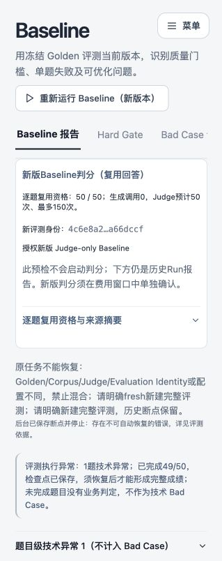

# V5.1 Baseline复用预检前端修复验收

本轮Provider0，没有新Replay Run或付费启动。正式库逐字节SHA相同，旧49/50及Q18技术异常保持历史原样；真实Q18审批没有变化。

## 根因

1. `frontend/src/styles.css:1006` 对 `.page-content .candidate-card` 统一应用 `height/min-height:var(--card-height)`（112px）及overflow:auto。Baseline预检误用此卡片，实测内容高213px、授权按钮top417px而卡片bottom339px；按钮在DOM/无障碍树存在，实际被卡片内部滚动区域藏住。此前DOM测试不能证明屏幕可见。
2. `EvaluationPage.tsx` 的replayPlan只在手动点击时查询，刷新回null，固定高度卡片只剩标题。缺少预检自身的加载/失败反馈。
3. 后端can_start_replay实际为true，不是审批门禁阻断。数据库没有新Replay，页面旧49/50属于真实历史记录，不能改成新结果或隐藏。

## 最小修改

- `frontend/src/pages/EvaluationPage.tsx:43`：增加预检loading/error/重查状态；`:128` 挂载/刷新、Run ID或状态变化后仅GET资格，旧回包取消更新，活动Run跳过查询；`:176` 完整展示资格/Identity/授权入口，并说明下方是历史报告。授权按钮放到逐题明细前。
- `frontend/src/pages/evaluation-workspaces.css`：仅对 `judge-replay-preflight` 覆盖固定高度及overflow，随内容展开；复用原Card视觉，不改全局候选卡片。
- `frontend/src/closure-authorization.test.tsx`：新增刷新重挂载自动恢复、网络错误提示与重查；保留费用窗口打开/取消零POST、严格can_start_replay门禁测试。
- 同步当前SPEC的UI行为说明、SPEC_CHANGELOG和README；正式Judge/Parser/Matcher/Identity及架构节点不变，没有改Provider费用组件或后端。

费用确认仍使用原ProviderAuthorization。预检和打开费用窗口只有GET；仅用户最终点击“授权并运行此操作”才沿既有路径重查当前Identity、源摘要与门禁后POST。真实验收只打开弹窗并取消。

## 验证

- 先红后绿：新增2项在旧实现均失败，修复后定向8项通过。
- 前端全量44文件253项通过，TypeScript/Vite构建通过；仅前端变化，无需重跑后端全量。
- 真实Demo已执行页面刷新，自动显示50/50和V5.1 Identity；卡片高度约272px、overflow:visible，授权按钮完整位于卡片内。
- 真实点击“授权新版 Judge-only Baseline”打开原“模型调用费用授权”窗口，然后取消；没有点击最终确认。
- [机器验收记录](verification.json)：数据库SHA不变、没有新Replay，Provider0。独立代码审查未发现阻断交付问题。
- V5.1 Identity仍为 `4c6e8a2da0f2e23deb6200551dc79f9894370ef01b15d4c914b1e78a1a66dccf`。

## 用户操作

刷新Baseline页面，等待只读预检显示50/50及Identity，点击“授权新版 Judge-only Baseline”。确认需要正式判分后，再由用户在费用窗口点击“授权并运行此操作”。不要使用页头“重新运行 Baseline（新版本）”代替Judge-only入口，前者是完整重新生成。

下方49/50历史异常继续保留；新Replay真正运行并保存结果后才会有新版报告。本轮没有启动它。

## 真实页面证据

刷新后可见的完整预检卡片：

原费用确认窗口已验证能打开（随后取消）：

