# 021d：代码与模块精简审计

审计日期：2026-11-06。源码基点：`0d73d79`。结论：**主链路模块均有源码引用；最确定的整文件精简对象是无人引用的 `seed.py`、`services.py`。前端没有整页或整组件文件脱离当前入口，但存在只剩测试引用的旧组件。**另有旧图片附件、离线实验、自检和停用接口可以另单评估。此次只出清单，没有删除或改动业务代码、测试，没有重启服务，没有调用模型。

## 我是这样理解的

1. “每个模块”按 `backend/app/*.py` 的 54 个源码文件逐个盘点；“页面和组件”覆盖 `frontend/src/pages/`、`components/` 全部 29 个 TSX 和 3 个 CSS，另查文件内导出的 React 组件。路由按 HTTP 方法 + 模板路径盘点 `main.py` 的 107 条显式 HTTP 注册，生命周期钩子、异常处理器和两个静态挂载单列，不混进 API 数量。
2. “被引用”用 Python AST import（含函数内延迟 import）、TS 编译器解析 import/路径表达式、调用点和全仓符号搜索核对；区分前端 HTTP、后端直接调函数/Store、脚本、测试和仅文档提及。import 说明代码依赖，不能证明本次生产执行过。没有 API 访问日志或外部客户端清单，因此“外部是否还用”统一为未知。
3. “建议删除”是未来删除任务的候选，不能视为现在已获准执行删除。把握中的“确定”仅指当前仓库调用范围的证据；外部兼容、未提交私有脚本不作保证。没有调用不等于已废弃；有专属测试也不等于应继续保留某个产品功能。
4. 不运行测试、构建、导入 main 或启动浏览器：本单没有代码变化，且 main 导入会实例化正式存储和服务。只解析文本/AST、读取 Git 状态和源码。没有读正式 DB、.env、模型 Key 或运行结果，也没有运行离线模型。当前业务可运行性与全量测试通过率均未验证。
5. 使用精简审计技能的检查方法，但输出以任务单要求的中文逐项清单、影响和 Mermaid 为准；不扩展为依赖裁剪、性能、安全或正确性整改。

## 断点与范围证据

开始时 `git status --short` 为空；只读 `git log --all --oneline --grep=021d` 只有入队 `e6fba32` 和开始 `0d73d79`，未见本单“已做部分”；报告与历史任务目录也没有本单成果。因此本次从首轮审计开始，没有重做模型题或其他任务。现有 018c 测试整理报告仅作为查找历史测试边界的线索，以下判断均回到当前源码核对，不沿用其旧测试成绩。

扫描结果：54 个后端模块；107 条显式 HTTP 路由；13 个页面文件、16 个组件文件、3 个配套 CSS；169 个 `test_*.py` 和 6 个测试辅助文件。没有发现测试直接 import 不存在的 `app.<模块>`。逐文件测试清单见后文，不将测试方法数冒充执行通过数。

源码引用简写：`app/` = `backend/app/`，`tests/` = `backend/tests/`，`src/` = `frontend/src/`。每个引用给出文件与行号；同一文件多处引用时表中列一个定位点。

## 主链路模块图

图中实线表示业务流，虚线表示共享依赖或反馈。所有 54 个后端模块均在图中归属；历史候选单独列出，不混入正式链。知识、问答、评测、发布数据均由 GovernanceStore/Corpus 身份连接，不是每页各做一套逻辑。

```mermaid
flowchart LR
  subgraph K[知识库]
    corpus["corpus / corpus_management"]
    build["build_index / knowledge_pipeline / full_text"]
    corpus --> build
  end
  subgraph P[Pipeline]
    pipe["ai_service / retrieval / context_budget"]
  end
  subgraph G[Golden]
    golden["golden_v2 / business_golden / business_import"]
    review["reviewed_import / delegated_review"]
    proj["golden_read / read_view"]
    golden --> review --> proj
  end
  subgraph B[Baseline 与 Judge]
    evaluate["evaluation / evaluation_contract / scoring_contract / safety_guard"]
    canon["canonical_evidence / scoring_revision"]
    replay["judge_replay / q18_probe"]
    diagnose["diagnostics / diagnostic_evidence / evidence_resolver / product_diagnostics / diagnostic_categories"]
    canon --> evaluate --> diagnose
    evaluate --> replay
  end
  subgraph A[Agent ABC]
    agent["optimization / agent_inputs / agent_coverage"]
    cycle["optimization_cycle"]
    agent --> cycle
  end
  subgraph D[方案 D]
    composite["composite / policy 的 D 校验"]
  end
  subgraph R[发布]
    release["governance 的发布与回滚 / policy 的资格规则"]
  end
  subgraph Q[问答验证与线上反馈]
    qa["main.preview 与 preview_scheme / ai_service"]
    feedback["governance 的监控记录、人工判定与触发"]
    qa --> feedback
  end
  build --> pipe --> golden
  proj --> canon
  pipe --> evaluate
  diagnose --> agent
  cycle -->|ABC Sandbox 复用评测| evaluate
  cycle --> composite
  composite -->|D Sandbox 复用评测| evaluate
  composite --> release --> qa
  feedback -. 人工确认后回流 .-> agent
  subgraph S[全链路支撑]
    api["main / __init__"]
    store["governance / sqlite_support / history"]
    pay["paid_run / paid_policy / paid_schedule / evaluation_stage / telemetry"]
    provider["config / providers"]
    recovery["agent_recovery / backup_retention / followups"]
    rules["policy 的 Pipeline 与门槛规则"]
  end
  api -.-> store
  store -.-> evaluate
  pay -.-> cycle
  provider -.-> pipe
  recovery -.-> cycle
  rules -.-> evaluate
  subgraph H[不在主链路的候选]
    dead["seed / services：无引用静态 Demo"]
    old["chunking_audit / retrieval_smoke_test：独立离线工具"]
    assets["architecture_assets：旧图片附件 API，当前 UI 无调用"]
  end
```

面试讲法：知识库把原文加工为带身份的知识资产；Pipeline 根据配置检索并生成；Golden 冻结题卷与评分要求；Baseline/Judge 保存回答、Final、Trace 与判定；诊断把保存事实送给 Agent，ABC 和 D 都复用同一评测机制；发布必须经资格校验与人工操作；线上问答保存反馈，再经人工确认回流。支撑层负责身份、持久化、费用、断点和恢复。图中的主链路是源码依赖关系，不表示正式实验每一阶段都已成功完成。

## 后端逐模块清单

“API／前端关联”按当前处理函数和共享调用链给出功能入口，全部路径与消费者可在后面的路由表复核。没有后端模块被 TS 直接 import。

|模块|归属|app 内直接 import 消费者|测试／脚本 import 消费者|API／前端关联|遗留判断|建议与理由|
|---|---|---|---|---|---|---|
|`__init__.py`（1行）|支撑／Python 包|未发现|未发现|app 包装载|包文件|保留（支撑：存储、身份、费用等）：包说明与 app 包入口；不是历史功能。|
|`agent_coverage.py`（150行）|Agent ABC|`app/main.py:1643`|`backend/scripts/preview_agent_input.py:10`、`backend/scripts/task004_agent_prompt.py:11`、`tests/test_agent_coverage.py:111`、`tests/test_agent_exploration_e2e.py:86`、`tests/test_task008b_agent_input.py:135`、`scripts/plan_agent_coverage.py:21`|complete-plan；Agent 工作台|仍有实际引用；不可认作一次性遗留|保留（主链路）：规划与补齐 A/B/C 逐题覆盖；main 的 complete-plan 与优化读取仍使用。|
|`agent_inputs.py`（105行）|Baseline → Agent ABC → D|`app/agent_coverage.py:10`、`app/composite.py:5`、`app/followups.py:14`、`app/governance.py:151`、`app/main.py:1592`、`app/optimization.py:16`、`app/policy.py:173`、`app/product_diagnostics.py:96`|`backend/data/task010b/write_report.py:8`、`backend/scripts/preview_agent_input.py:9`、`tests/test_task008b_agent_input.py:41`、`tests/test_task009_agent_rules.py:11`、`tests/test_task009b_acceptance.py:5`、`tests/test_task010b_failure_stop.py:39`、`tests/test_task010b_low_baseline.py:4`、`tests/test_task013_storage.py:147`、`tests/test_task014_core.py:10`、`tests/test_task019a_agent.py:95`|bad-cases / optimization；Baseline、Agent|仍有实际引用；不可认作一次性遗留|保留（主链路）：统一已保存错题、证据位置与复盘输入；策略、诊断、D 和接口共同使用。|
|`agent_recovery.py`（103行）|支撑／Agent 恢复|`app/agent_coverage.py:8`|`tests/test_agent_response_recovery.py:101`、`scripts/recover_agent_response.py:21`|恢复脚本；在线仅 digest 经 agent_coverage 间接使用|仍有实际引用；不可认作一次性遗留|保留（支撑：存储、身份、费用等）：recover_saved_response 有恢复脚本和测试；digest 又被 agent_coverage 直接使用，不能整文件删。|
|`ai_service.py`（1062行）|Pipeline／Golden／问答|`app/diagnostic_evidence.py:156`、`app/diagnostics.py:42`、`app/evaluation.py:302`、`app/evaluation_contract.py:357`、`app/evidence_resolver.py:121`、`app/governance.py:1495`、`app/judge_replay.py:67`、`app/main.py:23`、`app/optimization.py:625`|`tests/test_agent_exploration_e2e.py:12`、`tests/test_agent_http_error.py:13`、`tests/test_ai_service.py:7`、`tests/test_business_audit_clone_history.py:8`、`tests/test_business_audit_sources.py:8`、`tests/test_business_golden.py:147`、`tests/test_business_question_first.py:5`、`tests/test_candidate_review_export.py:14`、`tests/test_delegated_review.py:256`、`tests/test_diagnostic_response_parsing.py:5`、`tests/test_evaluation_vnext.py:126`、`tests/test_generation_partial_slots.py:9`、`tests/test_generation_vnext.py:6`、`tests/test_golden_closeout.py:224`、`tests/test_golden_qc_role_scope.py:22`、`tests/test_golden_unified_contract.py:19`、`tests/test_judge_replay_v5.py:6`、`tests/test_knowledge_pipeline.py:166`、`tests/test_machine_gate.py:201`、`tests/test_paid_run.py:11`、`tests/test_phase1_closure.py:8`、`tests/test_revision_workflow.py:11`、`tests/test_round0_identity.py:51`、`tests/test_round0_thinking.py:21`、`tests/test_scope_contract_v5.py:11`、`tests/test_source_context.py:24`、`tests/test_task004_judge_retry.py:5`、`tests/test_task006_transport_retry.py:132`、`tests/test_task007_baseline_review.py:77`、`tests/test_task007_baseline_thinking.py:8`、`tests/test_task009_agent_rules.py:20`、`tests/test_task010b_failure_stop.py:8`、`tests/test_task014_core.py:94`、`tests/test_v11_e2e.py:12`、`tests/test_v12_corpus_coverage.py:9`、`tests/test_v12_governance.py:7`、`tests/test_v13_profiles.py:10`、`tests/test_v14_api_lifecycle.py:14`、`tests/test_v14_golden_v2.py:13`、`tests/test_v14_identity.py:179`、`tests/test_v14_probe_cost.py:15`、`scripts/agent_diagnostics.py:36`、`scripts/audit_saved_diagnostics.py:10`、`scripts/internal_recheck.py:232`、`scripts/probe_generation_v2_saved_context_20261030.py:84`、`scripts/q18_judge_probe.py:23`、`scripts/task016b_trials.py:342`、`scripts/verify_agent_closed_loop.py:69`、`scripts/verify_baseline_diagnostics.py:24`、`scripts/verify_q18_probe_offline.py:23`|preview、Golden、诊断；多页面|仍有实际引用；不可认作一次性遗留|保留（主链路）：统一生成、质检、回答和语义诊断服务，多个主流程共同调用。|
|`architecture_assets.py`（46行）|项目概览图附件|`app/main.py:24`|`tests/test_architecture_assets.py:10`|overview/architecture 四路由；当前 UI 无调用|仅旧附件路由|建议删除：只由 main 的四条图片路由调用；当前概览与知识库用 KnowledgeDiagrams 内联图。D3 说明影响与不确定性。|
|`backup_retention.py`（18行）|支撑／备份保留|`app/agent_coverage.py:144`、`app/agent_recovery.py:81`|`tests/test_agent_coverage.py:25`、`scripts/reset_experiment_history.py:29`|complete-plan/恢复时备份；无单独 UI|仍有实际引用；不可认作一次性遗留|保留（支撑：存储、身份、费用等）：被 Agent 恢复与覆盖补齐调用，落实同类最近两份备份。|
|`build_index.py`（259行）|知识库|`app/chunking_audit.py:14`、`app/corpus_management.py:15`|`tests/test_corpus_management.py:17`、`scripts/test_v14_offline.py:59`|documents 上传/删除、知识重建；知识库|仍有实际引用；不可认作一次性遗留|保留（主链路）：corpus_management 仍调用正式建索引；有命令行入口不表示一次性遗留。|
|`business_golden.py`（168行）|Golden|`app/ai_service.py:587`、`app/delegated_review.py:67`、`app/governance.py:1297`、`app/main.py:592`|`tests/test_business_audit_clone_history.py:9`、`tests/test_business_audit_sources.py:9`、`tests/test_business_golden.py:165`、`tests/test_business_mini_profile.py:6`、`tests/test_business_question_first.py:124`、`tests/test_delegated_review.py:257`、`tests/test_golden_closeout.py:130`、`tests/test_golden_disposition.py:18`|governance/generate、naturalness-audit；Golden|仍有实际引用；不可认作一次性遗留|保留（主链路）：Mini/Medium 业务出题计划、质量审计被生成和审核链使用。|
|`business_import.py`（142行）|Golden|`app/main.py:24`|`tests/test_phase1_closure.py:15`、`tests/test_pool_business_closure.py:9`、`tests/test_v14_golden_v2.py:14`|governance/import-template、imports；Golden|仍有实际引用；不可认作一次性遗留|保留（主链路）：当前 BusinessImportPanel 的模板、业务用例导入与构造校验。|
|`canonical_evidence.py`（37行）|Golden → Baseline/Judge → Agent|`app/evaluation.py:284`、`app/evidence_resolver.py:5`、`app/golden_v2.py:686`、`app/judge_replay.py:66`|`tests/test_agent_closed_loop.py:201`、`tests/test_frozen_behavior_preflight.py:4`、`scripts/replay_saved_answers_judge_only_20261030.py:155`|evaluations/run、candidates/*/run、judge-replay；评测/Agent|仍有实际引用；不可认作一次性遗留|保留（主链路）：冻结规范来源及优化材料预检；与实际检索 Final 的角色不同。|
|`chunking_audit.py`（136行）|历史离线切分实验|未发现|`tests/test_chunking_audit.py:3`|无；python -m 独立入口|无运行链入站；CLI 与测试仍有引用|建议删除：没有 app 内入站 import；只有专属测试与文档命令入口，未接入生产构建。见 D4。|
|`composite.py`（144行）|D|`app/evaluation.py:959`、`app/governance.py:3024`|`tests/test_task021a_composite.py:8`|experiments/*/composite、候选 D 评测；Agent|仍有实际引用；不可认作一次性遗留|保留（主链路）：build_d_facts、validate_d_refinement 被 governance 和 candidate_inputs 调用。|
|`config.py`（51行）|支撑／环境与模型设置|`app/governance.py:3371`、`app/knowledge_pipeline.py:40`、`app/main.py:28`、`app/providers.py:15`、`app/q18_probe.py:10`|`backend/scripts/judge_calibration.py:201`、`backend/scripts/task007_review.py:14`、`tests/test_agent_http_error.py:7`、`tests/test_baseline_resilience.py:9`、`tests/test_baseline_resume.py:132`、`tests/test_behavior_parser.py:7`、`tests/test_claim_consistency.py:10`、`tests/test_evaluation_autorecovery.py:8`、`tests/test_evaluation_context.py:10`、`tests/test_evaluation_policy.py:73`、`tests/test_evaluation_vnext.py:94`、`tests/test_judge_calibration_truncation.py:5`、`tests/test_judge_equivalent_output_contract.py:42`、`tests/test_judge_evidence_roles.py:6`、`tests/test_judge_forbidden_nonclaim_contract.py:53`、`tests/test_judge_operation_safety.py:6`、`tests/test_judge_output_compatibility.py:8`、`tests/test_judge_q38_format.py:6`、`tests/test_live_services.py:7`、`tests/test_negative_final_contract.py:7`、`tests/test_paid_run.py:141`、`tests/test_round0_thinking.py:20`、`tests/test_sandbox_inheritance.py:11`、`tests/test_sandbox_stability.py:8`、`tests/test_scoped_reference_contract.py:14`、`tests/test_task004_judge_retry.py:54`、`tests/test_task006_transport_retry.py:11`、`tests/test_task007_baseline_thinking.py:9`、`tests/test_task009_judge_configuration.py:15`、`scripts/agent_diagnostics.py:34`、`scripts/calibrate_judge_contract_20261029.py:46`、`scripts/continue_unattempted_judge_20261031.py:158`、`scripts/execute_saved_judge_correction_20261031.py:50`、`scripts/internal_recheck.py:233`、`scripts/prepare_saved_judge_correction_20261031.py:86`、`scripts/probe_generation_v2_saved_context_20261030.py:193`、`scripts/q18_judge_probe.py:21`、`scripts/replay_saved_answers_judge_only_20261030.py:339`、`scripts/task016b_trials.py:343`、`scripts/test_v14_offline.py:34`、`scripts/validate_judge_provider_20261029.py:40`、`scripts/verify_evaluation_vnext.py:16`、`scripts/verify_q18_probe_offline.py:26`|readiness/runtime 间接；运行配置|仍有实际引用；不可认作一次性遗留|保留（支撑：存储、身份、费用等）：Provider 和 Pipeline 读取现行设置，不读取或披露 .env 内容。|
|`context_budget.py`（99行）|Pipeline|`app/ai_service.py:182`|`tests/test_round0_pipeline.py:131`、`tests/test_task014_core.py:8`、`scripts/replay_saved_answers_judge_only_20261030.py:156`|preview 与批量回答；问答/评测|仍有实际引用；不可认作一次性遗留|保留（主链路）：AiService 生成前计算与裁剪上下文，不是独立历史实验。|
|`corpus.py`（321行）|知识库 → Pipeline|`app/ai_service.py:1`、`app/build_index.py:15`、`app/chunking_audit.py:15`、`app/corpus_management.py:17`、`app/delegated_review.py:28`、`app/diagnostics.py:12`、`app/evaluation.py:357`、`app/governance.py:16`、`app/knowledge_pipeline.py:23`、`app/main.py:1`、`app/retrieval.py:10`、`app/retrieval_smoke_test.py:10`、`app/reviewed_import.py:9`、`app/scoring_revision.py:45`|`backend/scripts/judge_calibration.py:94`、`tests/identity_fixture.py:3`、`tests/test_baseline_resilience.py:20`、`tests/test_baseline_resume.py:34`、`tests/test_corpus.py:6`、`tests/test_corpus_management.py:14`、`tests/test_evaluation_context.py:107`、`tests/test_interview_index.py:9`、`tests/test_knowledge_pipeline.py:120`、`tests/test_machine_gate.py:141`、`tests/test_manual_sandbox_resume.py:54`、`tests/test_sandbox_failure_contract.py:110`、`tests/test_sandbox_stability.py:143`、`tests/test_task013_cycle_stress.py:115`、`tests/test_v12_corpus_coverage.py:8`、`tests/test_v14_final_fix.py:212`、`tests/test_v14_golden_v2.py:370`、`tests/test_v14_identity.py:12`、`tests/test_v14_probe_cost.py:17`、`scripts/internal_recheck.py:214`、`scripts/q18_judge_probe.py:22`、`scripts/run_golden_owner_night.py:18`、`scripts/supplement_full_text.py:13`、`scripts/task016b_trials.py:344`、`scripts/test_v14_offline.py:34`、`scripts/verify_agent_closed_loop.py:70`、`scripts/verify_contract_replay_v5.py:14`、`scripts/verify_q18_probe_offline.py:24`|documents/pipeline/knowledge；知识库/配置|仍有实际引用；不可认作一次性遗留|保留（主链路）：文档、切块、manifest 身份与 CorpusStore 是知识和评测共同基础。|
|`corpus_management.py`（282行）|知识库|`app/knowledge_pipeline.py:397`、`app/main.py:27`|`tests/test_corpus_management.py:16`、`tests/test_knowledge_pipeline.py:98`、`tests/test_q02_switch_startup.py:11`、`tests/test_v14_probe_cost.py:18`、`scripts/supplement_full_text.py:14`、`scripts/test_v14_offline.py:59`|documents/corpus-operations/knowledge/rebuild；知识库|仍有实际引用；不可认作一次性遗留|保留（主链路）：上传、删除、重建及知识切换一致性；main 的常驻 manager 使用。|
|`delegated_review.py`（115行）|Golden／审核支撑|`app/governance.py:2200`|`tests/test_delegated_review.py:16`|owner-delegated-review；HTTP 无当前 UI|仍有实际引用；不可认作一次性遗留|保留（支撑：存储、身份、费用等）：governance 仍验证委托审核与 PDF 来源；缺前端入口不能证明已废弃。|
|`diagnostic_categories.py`（11行）|Baseline → Agent／展示支撑|`app/diagnostics.py:4`、`app/golden_read.py:4`、`app/main.py:34`、`app/optimization.py:15`|未发现|pipeline、诊断与 Golden 行投影；多页|仍有实际引用；不可认作一次性遗留|保留（支撑：存储、身份、费用等）：四类产品诊断词汇在诊断、Agent、Golden 只读投影与 main 共享。|
|`diagnostic_evidence.py`（160行）|Baseline/Judge → Agent|`app/evaluation.py:848`、`app/evidence_resolver.py:6`、`app/governance.py:2564`、`app/judge_replay.py:3`、`app/q18_probe.py:9`、`app/scoring_revision.py:6`|`tests/test_agent_closed_loop.py:10`、`tests/test_diagnostic_evidence.py:82`、`tests/test_task016a_schedule.py:256`、`tests/test_task017a_scoring_revision.py:7`、`scripts/task017a_run.py:16`、`scripts/verify_baseline_diagnostics.py:22`、`scripts/verify_contract_replay_v5.py:17`|diagnostic-plan/resolve-diagnostics/Replay；评测与 Agent|仍有实际引用；不可认作一次性遗留|保留（主链路）：保存证据核验、摘要与上下文选择，Replay、Resolver、评分修订均引用。|
|`diagnostics.py`（326行）|Baseline/Judge → Agent ABC|`app/agent_coverage.py:9`、`app/agent_inputs.py:4`、`app/agent_recovery.py:8`、`app/evaluation.py:460`、`app/evidence_resolver.py:251`、`app/judge_replay.py:65`、`app/main.py:2106`、`app/optimization.py:14`、`app/product_diagnostics.py:6`|`backend/scripts/task004_agent_prompt.py:8`、`backend/scripts/task004_diagnosis.py:17`、`tests/test_agent_closed_loop.py:212`、`tests/test_agent_exploration.py:7`、`tests/test_agent_exploration_e2e.py:76`、`tests/test_automatic_diagnostics.py:4`、`tests/test_bad_case_validity.py:12`、`tests/test_diagnostic_evidence.py:73`、`tests/test_diagnostic_view.py:4`、`tests/test_evaluation_policy.py:8`、`tests/test_evaluation_vnext.py:217`、`tests/test_intervention_contract.py:13`、`tests/test_judge_evidence_roles.py:21`、`tests/test_judge_output_compatibility.py:63`、`tests/test_judge_six_rounds.py:4`、`tests/test_task004_agent.py:20`、`tests/test_task004_diagnosis.py:13`、`tests/test_task009_product_diagnostics.py:5`、`tests/test_task014_core.py:11`、`tests/test_task014_diagnostic_issues.py:4`、`tests/test_v14_probe_cost.py:16`、`scripts/probe_context_selection_offline.py:10`、`scripts/replay_saved_answers_judge_only_20261030.py:55`、`scripts/verify_agent_closed_loop.py:17`、`scripts/verify_baseline_diagnostics.py:21`、`scripts/verify_contract_replay_v5.py:18`、`scripts/verify_evaluation_vnext.py:17`|bad-cases/evaluation/optimization；Baseline、Agent|仍有实际引用；不可认作一次性遗留|保留（主链路）：统一判定、证据、技术归因与实验计划，当前 Bad Case 接口和 Agent 都依赖。|
|`evaluation.py`（1084行）|Baseline/Judge／ABC Sandbox／D|`app/followups.py:11`、`app/main.py:29`、`app/optimization.py:626`、`app/optimization_cycle.py:8`、`app/q18_probe.py:68`、`app/scoring_revision.py:78`|`backend/scripts/judge_calibration.py:158`、`backend/scripts/task004_policy.py:9`、`backend/scripts/task007_review.py:37`、`backend/scripts/task007_speed.py:11`、`tests/test_agent_exploration_e2e.py:13`、`tests/test_baseline_entry.py:5`、`tests/test_baseline_resilience.py:6`、`tests/test_baseline_resume.py:7`、`tests/test_batch_transport_recovery.py:9`、`tests/test_claim_consistency.py:8`、`tests/test_current_governance_contracts.py:6`、`tests/test_evaluation_autorecovery.py:9`、`tests/test_evaluation_context.py:8`、`tests/test_evaluation_governance.py:39`、`tests/test_evaluation_policy.py:7`、`tests/test_evaluation_stop.py:5`、`tests/test_evaluation_vnext.py:106`、`tests/test_final_governance.py:7`、`tests/test_frozen_behavior_preflight.py:3`、`tests/test_frozen_scoring_contract.py:45`、`tests/test_generation_vnext.py:7`、`tests/test_golden_closeout.py:155`、`tests/test_governance.py:10`、`tests/test_intervention_contract.py:102`、`tests/test_judge_evidence_roles.py:7`、`tests/test_judge_output_compatibility.py:6`、`tests/test_judge_q38_format.py:7`、`tests/test_judge_six_rounds.py:3`、`tests/test_machine_gate.py:140`、`tests/test_negative_final_contract.py:5`、`tests/test_restoration_diagnosis.py:8`、`tests/test_round0_identity.py:8`、`tests/test_safety_guard.py:56`、`tests/test_task004_judge_retry.py:72`、`tests/test_task004_policy.py:65`、`tests/test_task007_baseline_thinking.py:11`、`tests/test_task009_integration.py:10`、`tests/test_task013_cycle_stress.py:17`、`tests/test_task013_golden_jobs.py:177`、`tests/test_task013_storage.py:10`、`tests/test_task013_stress.py:15`、`tests/test_task014_core.py:9`、`tests/test_task015a_rehearsal.py:131`、`tests/test_task016a_schedule.py:8`、`tests/test_task017a_scoring_revision.py:119`、`tests/test_task019a_agent.py:85`、`tests/test_task021a_composite.py:141`、`tests/test_v11_e2e.py:13`、`tests/test_v13_gate_details.py:3`、`tests/test_v14_api_lifecycle.py:144`、`tests/test_v14_probe_cost.py:323`、`scripts/audit_evaluation_rule_upgrade.py:12`、`scripts/audit_sandbox_resume.py:15`、`scripts/internal_recheck.py:24`、`scripts/plan_agent_coverage.py:33`、`scripts/q18_judge_probe.py:25`、`scripts/task016b_report.py:13`、`scripts/task016b_trials.py:346`、`scripts/task017a_run.py:106`、`scripts/verify_agent_closed_loop.py:71`、`scripts/verify_contract_replay_v5.py:15`、`scripts/verify_evaluation_vnext.py:14`、`scripts/verify_q18_probe_offline.py:22`|evaluations/run、candidates/*/run、replay；Baseline、Agent|仍有实际引用；不可认作一次性遗留|保留（主链路）：统一 Baseline、候选试跑、恢复、评分及结果汇总，不能按文件体积直接删。|
|`evaluation_contract.py`（553行）|Baseline/Judge|`app/agent_coverage.py:113`、`app/canonical_evidence.py:2`、`app/delegated_review.py:29`、`app/diagnostic_evidence.py:13`、`app/diagnostics.py:2`、`app/evaluation.py:11`、`app/evidence_resolver.py:7`、`app/governance.py:2407`、`app/judge_replay.py:4`、`app/main.py:30`、`app/optimization.py:632`、`app/providers.py:17`、`app/q18_probe.py:36`、`app/scoring_contract.py:85`|`backend/scripts/judge_calibration.py:15`、`backend/scripts/preview_agent_input.py:11`、`tests/identity_fixture.py:5`、`tests/test_agent_http_error.py:14`、`tests/test_baseline_resilience.py:140`、`tests/test_candidate_resume.py:29`、`tests/test_claim_consistency.py:7`、`tests/test_diagnostic_view.py:37`、`tests/test_evaluation_context.py:7`、`tests/test_evaluation_governance.py:4`、`tests/test_evaluation_policy.py:6`、`tests/test_evaluation_vnext.py:3`、`tests/test_frozen_scoring_contract.py:117`、`tests/test_generation_vnext.py:8`、`tests/test_golden_revision_22.py:9`、`tests/test_intervention_contract.py:19`、`tests/test_judge_calibration_truncation.py:57`、`tests/test_judge_equivalent_output_contract.py:13`、`tests/test_judge_evidence_roles.py:52`、`tests/test_judge_forbidden_nonclaim_contract.py:13`、`tests/test_judge_omission_protocol.py:14`、`tests/test_judge_operation_safety.py:5`、`tests/test_judge_output_compatibility.py:5`、`tests/test_judge_replay_v5.py:5`、`tests/test_judge_six_rounds.py:22`、`tests/test_negative_final_contract.py:4`、`tests/test_paid_run.py:152`、`tests/test_round0_api.py:5`、`tests/test_round0_identity.py:7`、`tests/test_safe_rejection_compatibility.py:13`、`tests/test_safety_guard.py:5`、`tests/test_scope_contract_v5.py:4`、`tests/test_scoped_reference_contract.py:15`、`tests/test_task007_baseline_thinking.py:56`、`tests/test_task009_integration.py:12`、`tests/test_task009_judge_configuration.py:16`、`tests/test_task017a_scoring_revision.py:14`、`tests/test_task021c2_trials.py:10`、`tests/test_task021c_internal.py:15`、`tests/test_v14_probe_cost.py:545`、`scripts/audit_evaluation_rule_upgrade.py:13`、`scripts/audit_saved_diagnostics.py:15`、`scripts/calibrate_judge_contract_20261029.py:50`、`scripts/execute_saved_judge_correction_20261031.py:52`、`scripts/internal_recheck.py:25`、`scripts/prepare_saved_judge_correction_20261031.py:88`、`scripts/probe_context_selection_offline.py:9`、`scripts/replay_saved_answers_judge_only_20261030.py:157`、`scripts/verify_baseline_diagnostics.py:23`、`scripts/verify_contract_replay_v5.py:16`、`scripts/verify_evaluation_vnext.py:13`、`scripts/verify_q18_probe_offline.py:28`|评测/Judge 与身份预检；Baseline、Agent|仍有实际引用；不可认作一次性遗留|保留（主链路）：评分版本、身份、Judge 输入与判分校验合同的共同来源。|
|`evaluation_stage.py`（173行）|支撑／付费调用断点|`app/ai_service.py:264`、`app/evaluation.py:423`、`app/followups.py:12`、`app/knowledge_pipeline.py:169`、`app/main.py:1032`、`app/optimization.py:605`、`app/paid_policy.py:39`、`app/providers.py:282`、`app/q18_probe.py:122`|`backend/data/task010b/write_report.py:6`、`backend/scripts/judge_calibration.py:159`、`backend/scripts/task007_speed.py:12`、`tests/test_batch_transport_recovery.py:157`、`tests/test_cycle_manual_control.py:60`、`tests/test_golden_closeout.py:235`、`tests/test_manual_sandbox_resume.py:7`、`tests/test_optimization_contract.py:338`、`tests/test_round0_thinking.py:111`、`tests/test_sandbox_failure_contract.py:8`、`tests/test_sandbox_stability.py:54`、`tests/test_task004_judge_retry.py:8`、`tests/test_task006_transport_retry.py:12`、`tests/test_task013_cycle_stress.py:18`、`tests/test_task013_golden_jobs.py:111`、`tests/test_task013_storage.py:115`、`tests/test_task013_stress.py:16`、`tests/test_task016a_agent.py:71`、`scripts/task016b_trials.py:260`、`scripts/task017a_run.py:62`|所有付费阶段内部；无单独导航|仍有实际引用；不可认作一次性遗留|保留（支撑：存储、身份、费用等）：回答与判分请求、Usage、重试断点被各付费流程复用。|
|`evidence_resolver.py`（379行）|Baseline/Judge → Agent|`app/ai_service.py:292`、`app/main.py:133`|`tests/test_agent_closed_loop.py:144`、`tests/test_diagnostic_response_parsing.py:8`、`tests/test_evidence_resolver_v5.py:111`、`tests/test_page_loading.py:5`、`tests/test_task016a_schedule.py:231`、`scripts/agent_diagnostics.py:28`、`scripts/audit_saved_diagnostics.py:8`、`scripts/verify_agent_closed_loop.py:18`|diagnostic-plan/resolve-diagnostics；Agent 读取计划|仍有实际引用；不可认作一次性遗留|保留（主链路）：保存语义诊断、批处理预检和恢复仍被 AiService 及 main 使用。|
|`followups.py`（178行）|支撑／历史复核与判分校准|`app/main.py:2014`|`tests/test_task004_policy.py:8`、`tests/test_task010_followups.py:9`、`tests/test_task010b_failure_stop.py:49`、`tests/test_task010b_low_baseline.py:154`、`tests/test_task013_golden_jobs.py:13`|followups GET/POST 与后台 recover；当前 UI 无调用|仍有实际引用；不可认作一次性遗留|保留（支撑：存储、身份、费用等）：main 实例化并在启动监控中 has_active/recover；review 新建被关闭，但 max/high/low 校准恢复仍在，不能整文件删。|
|`full_text.py`（111行）|知识库／支撑一致性|`app/agent_coverage.py:11`、`app/agent_recovery.py:9`、`app/ai_service.py:16`、`app/build_index.py:6`、`app/corpus.py:285`、`app/corpus_management.py:16`、`app/diagnostics.py:13`、`app/evaluation.py:1035`、`app/governance.py:1871`、`app/knowledge_pipeline.py:24`、`app/main.py:26`、`app/optimization_cycle.py:9`、`app/q18_probe.py:123`、`app/retrieval.py:11`、`app/reviewed_import.py:44`、`app/scoring_revision.py:44`|`tests/fulltext_fixture.py:2`、`tests/test_corpus_management.py:18`、`tests/test_knowledge_pipeline.py:119`、`tests/test_v14_final_fix.py:11`、`tests/test_v14_probe_cost.py:19`、`scripts/audit_sandbox_resume.py:16`|pipeline/knowledge、问答与评测内部|仍有实际引用；不可认作一次性遗留|保留（主链路）：全文资产校验、来源检索与 CORPUS_LOCK 被构建、检索、评测和治理共同使用。|
|`golden_read.py`（78行）|Golden／只读展示|`app/main.py:604`|`tests/test_task019a_golden.py:12`|governance/candidates；Golden|仍有实际引用；不可认作一次性遗留|可合并：可与 read_view 合并只读投影归属；仍须保留冻结题卷、Probe 继承及分类关联逻辑。|
|`golden_v2.py`（712行）|Golden|`app/ai_service.py:1003`、`app/business_golden.py:7`、`app/business_import.py:11`、`app/governance.py:1231`、`app/knowledge_pipeline.py:330`、`app/main.py:1033`、`app/read_view.py:85`、`app/reviewed_import.py:21`、`app/scoring_revision.py:21`|`backend/scripts/task005b_freeze.py:16`、`tests/test_business_golden.py:116`、`tests/test_business_mini_profile.py:8`、`tests/test_golden_closeout.py:12`、`tests/test_golden_content_validation.py:20`、`tests/test_golden_fact_coverage.py:4`、`tests/test_golden_revision_22.py:37`、`tests/test_golden_unified_contract.py:4`、`tests/test_paid_run.py:219`、`tests/test_phase1_closure.py:68`、`tests/test_pool_business_closure.py:10`、`tests/test_related_product_sources.py:14`、`tests/test_task013_golden_jobs.py:11`、`tests/test_v14_final_fix.py:12`、`tests/test_v14_golden_v2.py:15`|Golden 覆盖/导入/出题/质检|仍有实际引用；不可认作一次性遗留|保留（主链路）：覆盖计划、内容验证、事实覆盖、QC 与候选池匹配仍是当前实现。|
|`governance.py`（3503行）|全链路／持久化与资格|`app/agent_coverage.py:12`、`app/agent_recovery.py:10`、`app/ai_service.py:17`、`app/business_import.py:10`、`app/delegated_review.py:47`、`app/evidence_resolver.py:228`、`app/golden_v2.py:141`、`app/knowledge_pipeline.py:329`、`app/main.py:31`、`app/paid_policy.py:34`、`app/reviewed_import.py:42`|`tests/test_agent_closed_loop.py:130`、`tests/test_agent_coverage.py:110`、`tests/test_agent_exploration_e2e.py:14`、`tests/test_agent_response_recovery.py:84`、`tests/test_api.py:11`、`tests/test_bad_case_validity.py:13`、`tests/test_baseline_resume.py:6`、`tests/test_business_audit_clone_history.py:10`、`tests/test_business_golden.py:106`、`tests/test_business_mini_profile.py:7`、`tests/test_business_question_first.py:191`、`tests/test_candidate_review_export.py:15`、`tests/test_delegated_review.py:274`、`tests/test_diagnostic_view.py:51`、`tests/test_evaluation_context.py:106`、`tests/test_evaluation_vnext.py:146`、`tests/test_evidence_resolver_v5.py:110`、`tests/test_final_governance.py:6`、`tests/test_frozen_revision_reopen.py:4`、`tests/test_generation_partial_slots.py:10`、`tests/test_generation_storage_legacy.py:10`、`tests/test_golden_closeout.py:11`、`tests/test_golden_content_replacement.py:9`、`tests/test_golden_disposition.py:3`、`tests/test_golden_revision_22.py:10`、`tests/test_governance.py:12`、`tests/test_history_api_paging.py:5`、`tests/test_history_lifecycle.py:4`、`tests/test_knowledge_pipeline.py:180`、`tests/test_machine_gate.py:8`、`tests/test_optimization_contract.py:9`、`tests/test_page_loading.py:12`、`tests/test_page_performance.py:7`、`tests/test_phase1_closure.py:67`、`tests/test_pipeline_draft.py:7`、`tests/test_pool_business_closure.py:11`、`tests/test_restoration_diagnosis.py:9`、`tests/test_reviewed_csv_import.py:10`、`tests/test_revision_workflow.py:12`、`tests/test_safe_rejection_revision.py:6`、`tests/test_safe_start_round0.py:16`、`tests/test_safety_guard.py:82`、`tests/test_task004_judge_retry.py:146`、`tests/test_task004_release_wiring.py:7`、`tests/test_task008b_agent_input.py:75`、`tests/test_task009_integration.py:9`、`tests/test_task009_optimization_cycle.py:15`、`tests/test_task010b_low_baseline.py:28`、`tests/test_task013_cycle_recovery.py:106`、`tests/test_task013_cycle_stress.py:16`、`tests/test_task013_golden_jobs.py:12`、`tests/test_task013_light_reads.py:3`、`tests/test_task014_core.py:62`、`tests/test_task014_optimization.py:38`、`tests/test_task015a_rehearsal.py:224`、`tests/test_task016a_schedule.py:232`、`tests/test_task017a_scoring_revision.py:118`、`tests/test_task021c_internal.py:14`、`tests/test_v11_closure.py:9`、`tests/test_v11_e2e.py:14`、`tests/test_v12_governance.py:6`、`tests/test_v12_tuning.py:6`、`tests/test_v13_profiles.py:11`、`tests/test_v14_api_lifecycle.py:15`、`tests/test_v14_final_fix.py:13`、`tests/test_v14_golden_v2.py:16`、`tests/test_v14_identity.py:13`、`tests/test_v14_probe_cost.py:20`、`scripts/agent_diagnostics.py:9`、`scripts/audit_sandbox_resume.py:14`、`scripts/internal_recheck.py:23`、`scripts/plan_agent_coverage.py:20`、`scripts/q18_judge_probe.py:20`、`scripts/recover_agent_response.py:20`、`scripts/reset_experiment_history.py:9`、`scripts/test_task017a_run.py:56`、`scripts/verify_agent_closed_loop.py:16`、`scripts/verify_baseline_diagnostics.py:25`、`scripts/verify_contract_replay_v5.py:13`、`scripts/verify_q18_probe_offline.py:21`、`scripts/verify_round0_offline.py:30`、`scripts/verify_self_evolution.py:17`|全链路 Store；多数 main 路由|仍有实际引用；不可认作一次性遗留|保留（主链路）：GovernanceStore 保存题卷、实验、候选、发布与反馈并校验身份；不是重复页面后端。|
|`history.py`（167行）|支撑／历史清理|`app/main.py:120`|`tests/test_history_lifecycle.py:5`、`tests/test_task013_cycle_stress.py:116`、`tests/test_task013_stress.py:18`、`tests/test_task016a_schedule.py:151`、`scripts/reset_experiment_history.py:8`|启动 monitor；无独立 HTTP|仍有实际引用；不可认作一次性遗留|保留（支撑：存储、身份、费用等）：启动监控实际调用活跃任务检测和保留策略；不应因不在导航就删。|
|`judge_replay.py`（132行）|Baseline/Judge|`app/evaluation.py:375`、`app/governance.py:2563`|`backend/scripts/judge_calibration.py:14`、`backend/scripts/task007_review.py:15`、`tests/test_generation_vnext.py:61`、`tests/test_judge_replay_v5.py:4`、`tests/test_task009_integration.py:54`、`tests/test_task009_judge_configuration.py:17`、`tests/test_task013_golden_jobs.py:330`、`tests/test_task013_storage.py:161`、`scripts/replay_saved_answers_judge_only_20261030.py:56`、`scripts/task016b_trials.py:347`|evaluations/*/judge-replay；Baseline|仍有实际引用；不可认作一次性遗留|保留（主链路）：复用保存回答的独立重判资格与证据重建，当前 Baseline 页有入口。|
|`knowledge_pipeline.py`（432行）|知识库 → Pipeline|`app/ai_service.py:171`、`app/corpus_management.py:134`、`app/diagnostic_evidence.py:128`、`app/golden_v2.py:216`、`app/governance.py:3362`、`app/judge_replay.py:46`、`app/main.py:352`、`app/retrieval.py:181`|`tests/test_evaluation_vnext.py:226`、`tests/test_image_footnote.py:3`、`tests/test_knowledge_pipeline.py:8`、`tests/test_paid_run.py:261`、`tests/test_sandbox_failure_contract.py:4`、`tests/test_sandbox_stability.py:10`、`tests/test_task006_transport_retry.py:13`、`scripts/internal_recheck.py:215`、`scripts/probe_context_selection_offline.py:8`|knowledge、pipeline 与问答检索；知识库/配置|仍有实际引用；不可认作一次性遗留|保留（主链路）：MinerU、表格、Parent-Child、Embedding/Rerank 与知识身份在现行路径中使用。|
|`main.py`（2278行）|全链路／HTTP 与后台恢复|未发现|`backend/scripts/judge_calibration.py:212`、`backend/scripts/task007_review.py:36`、`backend/scripts/task007_speed.py:10`、`tests/api_fixture.py:13`、`tests/test_golden_disposition.py:55`、`tests/test_machine_gate.py:177`、`scripts/run_baseline_continuous.py:30`、`scripts/run_golden_owner_night.py:35`、`scripts/task017a_run.py:212`|App→api.ts 及页面直接请求|仍有实际引用；不可认作一次性遗留|保留（主链路）：FastAPI 入口、107 条显式路由及恢复监控；可另单整理模块边界，本单不提出无依据的大重构。|
|`optimization.py`（801行）|Agent ABC → D|`app/agent_coverage.py:13`、`app/agent_recovery.py:11`、`app/evaluation.py:974`、`app/governance.py:3025`、`app/main.py:32`、`app/optimization_cycle.py:10`、`app/product_diagnostics.py:97`|`backend/scripts/preview_agent_input.py:12`、`backend/scripts/task004_agent_prompt.py:9`、`tests/test_agent_closed_loop.py:9`、`tests/test_agent_context.py:4`、`tests/test_agent_coverage.py:80`、`tests/test_agent_exploration.py:8`、`tests/test_agent_exploration_e2e.py:15`、`tests/test_agent_http_error.py:8`、`tests/test_agent_response_recovery.py:73`、`tests/test_bad_case_validity.py:14`、`tests/test_evaluation_vnext.py:155`、`tests/test_governance.py:13`、`tests/test_intervention_contract.py:14`、`tests/test_optimization_contract.py:10`、`tests/test_round0_thinking.py:167`、`tests/test_task004_agent.py:5`、`tests/test_task008b_agent_input.py:11`、`tests/test_task009_agent_rules.py:7`、`tests/test_task009b_acceptance.py:6`、`tests/test_task010b_failure_stop.py:7`、`tests/test_task010b_low_baseline.py:107`、`tests/test_task011b_validation.py:7`、`tests/test_task014_core.py:53`、`tests/test_task014_optimization.py:2`、`tests/test_task016a_agent.py:54`、`tests/test_task017a_scoring_revision.py:184`、`tests/test_task019a_agent.py:5`、`tests/test_task019a_cycle.py:9`、`tests/test_task020a_agent_types.py:5`、`tests/test_v11_e2e.py:15`、`tests/test_v14_identity.py:14`、`scripts/task017a_run.py:165`、`scripts/verify_agent_closed_loop.py:19`、`scripts/verify_baseline_diagnostics.py:26`|experiments/run、continue、composite；Agent|仍有实际引用；不可认作一次性遗留|保留（主链路）：Agent Prompt、响应解析、方案与复盘校验以及生成执行。|
|`optimization_cycle.py`（261行）|Agent ABC → D|`app/main.py:128`、`app/optimization.py:612`、`app/paid_schedule.py:109`|`tests/test_cycle_manual_control.py:61`、`tests/test_task009_optimization_cycle.py:10`、`tests/test_task013_cycle_recovery.py:107`、`tests/test_task013_cycle_stress.py:19`、`tests/test_task015a_rehearsal.py:7`、`tests/test_task016a_agent.py:41`、`tests/test_task017a_scoring_revision.py:185`、`tests/test_task019a_cycle.py:11`、`tests/test_task019a_full_flow.py:5`、`tests/test_task020b_composite.py:6`、`scripts/task017a_run.py:166`|run-cycle、stop-cycle；Agent|仍有实际引用；不可认作一次性遗留|保留（主链路）：逐轮试跑、合格停止、D 调度与恢复；当前 run-cycle/stop-cycle 使用。|
|`paid_policy.py`（80行）|支撑／付费策略|`app/governance.py:2756`、`app/optimization.py:649`、`app/optimization_cycle.py:54`、`app/paid_run.py:89`|`tests/test_cycle_manual_control.py:59`、`scripts/task017a_run.py:18`、`scripts/test_task017a_run.py:70`|付费流程内部，无独立导航|仍有实际引用；不可认作一次性遗留|保留（支撑：存储、身份、费用等）：绑定付费任务策略、预算和恢复上下文，供循环与治理使用。|
|`paid_run.py`（265行）|支撑／费用与调用授权|`app/ai_service.py:18`、`app/evaluation.py:294`、`app/evaluation_stage.py:10`、`app/evidence_resolver.py:243`、`app/governance.py:1189`、`app/knowledge_pipeline.py:155`、`app/main.py:1020`、`app/optimization.py:17`、`app/optimization_cycle.py:89`、`app/paid_policy.py:65`、`app/providers.py:251`、`app/q18_probe.py:121`、`app/telemetry.py:41`|`backend/scripts/judge_calibration.py:161`、`tests/test_agent_http_error.py:53`、`tests/test_baseline_resume.py:45`、`tests/test_business_question_first.py:94`、`tests/test_candidate_resume.py:28`、`tests/test_evaluation_autorecovery.py:10`、`tests/test_judge_operation_safety.py:161`、`tests/test_paid_run.py:13`、`tests/test_round0_thinking.py:22`、`tests/test_sandbox_failure_contract.py:100`、`tests/test_sandbox_inheritance.py:9`、`tests/test_sandbox_stability.py:114`、`tests/test_task004_judge_retry.py:55`、`tests/test_task006_transport_retry.py:14`、`tests/test_task009_judge_configuration.py:18`、`tests/test_task017a_scoring_revision.py:183`、`tests/test_task021c2_trials.py:11`、`tests/test_unlimited_paid_run.py:7`、`scripts/calibrate_judge_contract_20261029.py:48`、`scripts/execute_saved_judge_correction_20261031.py:53`、`scripts/internal_recheck.py:292`、`scripts/prepare_saved_judge_correction_20261031.py:89`、`scripts/probe_generation_v2_saved_context_20261030.py:115`、`scripts/replay_saved_answers_judge_only_20261030.py:158`、`scripts/run_baseline_continuous.py:13`、`scripts/run_golden_owner_night.py:25`、`scripts/task016b_trials.py:261`、`scripts/task017a_run.py:17`、`scripts/test_replay_continuation_20261031.py:92`、`scripts/test_task016b_trials.py:9`、`scripts/test_task017a_run.py:69`、`scripts/validate_judge_provider_20261029.py:42`、`scripts/verify_q18_probe_offline.py:27`|所有付费流程内部|仍有实际引用；不可认作一次性遗留|保留（支撑：存储、身份、费用等）：付费上下文、Usage 对账、预算与 Unknown 记账；不是可删除的包装。|
|`paid_schedule.py`（228行）|支撑／时段与无人值守|`app/evaluation.py:706`、`app/evidence_resolver.py:259`、`app/governance.py:3028`、`app/main.py:131`、`app/optimization.py:18`、`app/optimization_cycle.py:11`、`app/paid_policy.py:35`|`backend/scripts/judge_calibration.py:111`、`tests/test_task016a_golden_schedule.py:7`、`tests/test_task016a_schedule.py:109`、`tests/test_task019a_cycle.py:12`、`tests/test_task019a_full_flow.py:6`、`tests/test_task019a_reset.py:15`、`tests/test_task020b_composite.py:111`、`tests/test_task021c_internal.py:199`、`scripts/internal_recheck.py:293`、`scripts/task016b_report.py:15`、`scripts/task016b_trials.py:263`|runtime-settings、run-now、unattended；运行设置|仍有实际引用；不可认作一次性遗留|保留（支撑：存储、身份、费用等）：平价暂停、立即运行、授权与 D 调度恢复；运行设置和后台监控实际引用。|
|`policy.py`（300行）|Pipeline → Judge → ABC → D → 发布|`app/agent_coverage.py:14`、`app/agent_recovery.py:12`、`app/ai_service.py:12`、`app/canonical_evidence.py:25`、`app/chunking_audit.py:16`、`app/composite.py:6`、`app/diagnostic_evidence.py:127`、`app/diagnostics.py:295`、`app/evaluation.py:1074`、`app/evaluation_contract.py:7`、`app/governance.py:15`、`app/main.py:1648`、`app/optimization.py:20`、`app/optimization_cycle.py:12`、`app/scoring_revision.py:79`|`backend/scripts/preview_agent_input.py:13`、`backend/scripts/task004_agent_prompt.py:10`、`backend/scripts/task004_policy.py:10`、`tests/identity_fixture.py:4`、`tests/test_agent_closed_loop.py:11`、`tests/test_agent_coverage.py:5`、`tests/test_agent_exploration.py:9`、`tests/test_ai_service.py:8`、`tests/test_api.py:130`、`tests/test_evaluation_context.py:108`、`tests/test_evaluation_vnext.py:156`、`tests/test_final_policy.py:3`、`tests/test_generation_vnext.py:86`、`tests/test_governance.py:14`、`tests/test_intervention_contract.py:15`、`tests/test_knowledge_pipeline.py:143`、`tests/test_optimization_contract.py:11`、`tests/test_phase1_closure.py:10`、`tests/test_pipeline_draft.py:8`、`tests/test_round0_api.py:17`、`tests/test_round0_identity.py:101`、`tests/test_round0_pipeline.py:16`、`tests/test_round0_thinking.py:178`、`tests/test_safe_start_round0.py:15`、`tests/test_task004_agent.py:6`、`tests/test_task004_policy.py:7`、`tests/test_task004_release_wiring.py:8`、`tests/test_task008b_agent_input.py:12`、`tests/test_task009_agent_rules.py:8`、`tests/test_task009b_acceptance.py:7`、`tests/test_task011b_validation.py:8`、`tests/test_task013_cycle_stress.py:21`、`tests/test_task014_core.py:7`、`tests/test_task014_optimization.py:72`、`tests/test_task015a_rehearsal.py:205`、`tests/test_task016a_agent.py:9`、`tests/test_task017a_scoring_revision.py:86`、`tests/test_task019a_agent.py:6`、`tests/test_task019a_cycle.py:10`、`tests/test_task019a_full_flow.py:7`、`tests/test_task021a_composite.py:7`、`tests/test_task021c2_trials.py:12`、`tests/test_task021c_internal.py:16`、`tests/test_v11_closure.py:10`、`tests/test_v12_tuning.py:7`、`tests/test_v14_api_lifecycle.py:16`、`tests/test_v14_final_fix.py:14`、`tests/test_v14_identity.py:15`、`tests/test_v14_probe_cost.py:511`、`scripts/internal_recheck.py:26`、`scripts/probe_generation_v2_saved_context_20261030.py:107`、`scripts/verify_agent_closed_loop.py:20`、`scripts/verify_baseline_diagnostics.py:27`|pipeline、候选/发布/回滚规则|仍有实际引用；不可认作一次性遗留|保留（主链路）：参数搜索空间、门槛、Regression、D 优于赢家与发布资格在多处统一复用。|
|`product_diagnostics.py`（120行）|Baseline → Agent／展示|`app/main.py:35`|`tests/test_task009_product_diagnostics.py:4`、`tests/test_task013b_comparison.py:4`|evaluation 等返回 product_diagnostics；Baseline、Agent|仍有实际引用；不可认作一次性遗留|保留（主链路）：两页当前读取的指标、Thinking 对照与诊断投影，底层来源仍为保存评测。|
|`providers.py`（498行）|支撑／模型传输|`app/ai_service.py:13`、`app/evaluation.py:193`、`app/evaluation_stage.py:128`、`app/governance.py:1985`、`app/knowledge_pipeline.py:25`、`app/main.py:1034`、`app/optimization.py:13`、`app/paid_run.py:217`、`app/q18_probe.py:34`、`app/retrieval.py:17`|`backend/scripts/judge_calibration.py:16`、`backend/scripts/task007_speed.py:14`、`tests/test_agent_http_error.py:15`、`tests/test_ai_service.py:9`、`tests/test_baseline_resilience.py:8`、`tests/test_baseline_resume.py:8`、`tests/test_batch_transport_recovery.py:10`、`tests/test_behavior_parser.py:8`、`tests/test_candidate_resume.py:193`、`tests/test_candidate_review_export.py:323`、`tests/test_claim_consistency.py:9`、`tests/test_diagnostic_response_parsing.py:6`、`tests/test_evaluation_autorecovery.py:148`、`tests/test_evaluation_context.py:9`、`tests/test_evaluation_policy.py:72`、`tests/test_evaluation_stop.py:37`、`tests/test_evaluation_vnext.py:107`、`tests/test_generation_partial_slots.py:100`、`tests/test_golden_closeout.py:340`、`tests/test_golden_qc_role_scope.py:23`、`tests/test_judge_calibration_truncation.py:6`、`tests/test_judge_equivalent_output_contract.py:43`、`tests/test_judge_evidence_roles.py:5`、`tests/test_judge_forbidden_nonclaim_contract.py:54`、`tests/test_judge_operation_safety.py:7`、`tests/test_judge_output_compatibility.py:7`、`tests/test_judge_q38_format.py:5`、`tests/test_live_services.py:8`、`tests/test_manual_sandbox_resume.py:8`、`tests/test_negative_final_contract.py:6`、`tests/test_paid_run.py:12`、`tests/test_revision_workflow.py:13`、`tests/test_round0_thinking.py:19`、`tests/test_sandbox_failure_contract.py:107`、`tests/test_sandbox_inheritance.py:10`、`tests/test_sandbox_stability.py:11`、`tests/test_scoped_reference_contract.py:16`、`tests/test_task004_judge_retry.py:120`、`tests/test_task006_quality_start.py:8`、`tests/test_task006_transport_retry.py:118`、`tests/test_task007_baseline_review.py:7`、`tests/test_task007_baseline_thinking.py:10`、`tests/test_task009_integration.py:11`、`tests/test_task009_judge_configuration.py:19`、`tests/test_task010b_failure_stop.py:14`、`tests/test_task013_cycle_stress.py:20`、`tests/test_task013_golden_jobs.py:112`、`tests/test_task013_storage.py:11`、`tests/test_task013_stress.py:17`、`tests/test_task014_core.py:95`、`tests/test_v14_probe_cost.py:21`、`scripts/agent_diagnostics.py:35`、`scripts/calibrate_judge_contract_20261029.py:47`、`scripts/continue_unattempted_judge_20261031.py:159`、`scripts/execute_saved_judge_correction_20261031.py:51`、`scripts/internal_recheck.py:235`、`scripts/prepare_saved_judge_correction_20261031.py:87`、`scripts/probe_generation_v2_saved_context_20261030.py:154`、`scripts/q18_judge_probe.py:24`、`scripts/replay_saved_answers_judge_only_20261030.py:273`、`scripts/run_baseline_continuous.py:14`、`scripts/task016b_trials.py:345`、`scripts/test_replay_continuation_20261031.py:93`、`scripts/test_task016b_trials.py:98`、`scripts/validate_judge_provider_20261029.py:41`、`scripts/verify_evaluation_vnext.py:15`、`scripts/verify_q18_probe_offline.py:25`|readiness/probe 和模型阶段内部|仍有实际引用；不可认作一次性遗留|保留（支撑：存储、身份、费用等）：DeepSeek 请求、Thinking、错误类型及重试是运行依赖；本单没有发请求。|
|`q18_probe.py`（184行）|Baseline/Judge／Replay 前置校验|`app/governance.py:2576`|`tests/test_q18_probe.py:4`、`scripts/q18_judge_probe.py:26`、`scripts/verify_q18_probe_offline.py:20`|Judge Replay 建 Run 前置检查；另有 CLI|仍有实际引用；不可认作一次性遗留|保留（支撑：存储、身份、费用等）：governance.create_baseline_run 的 Judge Replay 分支调用 require_reviewed_probe，脚本和测试也引用；名字带 Q18 仍不能删。|
|`read_view.py`（95行）|支撑／请求只读投影|`app/diagnostics.py:3`、`app/main.py:1170`|`tests/test_page_loading.py:26`、`tests/test_task013_light_reads.py:4`、`tests/test_task016a_golden_schedule.py:8`|overview/evaluation/optimization/Golden 轻量视图|仍有实际引用；不可认作一次性遗留|可合并：可容纳 golden_read 的同类投影；现有请求缓存、轻量进度、语义覆盖功能必须保留。|
|`retrieval.py`（399行）|Pipeline|`app/ai_service.py:14`、`app/chunking_audit.py:17`、`app/diagnostic_evidence.py:147`、`app/evaluation.py:485`、`app/governance.py:1973`、`app/main.py:39`、`app/retrieval_smoke_test.py:11`|`tests/test_agent_closed_loop.py:61`、`tests/test_agent_exploration.py:95`、`tests/test_agent_exploration_e2e.py:16`、`tests/test_corpus.py:7`、`tests/test_golden_closeout.py:387`、`tests/test_intervention_contract.py:125`、`tests/test_knowledge_pipeline.py:121`、`tests/test_round0_pipeline.py:17`、`tests/test_sandbox_failure_contract.py:6`、`tests/test_v12_corpus_coverage.py:10`、`tests/test_v14_final_fix.py:15`、`tests/test_v14_probe_cost.py:22`、`scripts/probe_context_selection_offline.py:7`、`scripts/probe_generation_v2_saved_context_20261030.py:85`、`scripts/supplement_full_text.py:15`、`scripts/test_v14_offline.py:59`|preview 与评测回答；问答/评测|仍有实际引用；不可认作一次性遗留|保留（主链路）：当前本地/向量检索、查询准备、Final 覆盖观察由 AiService 和正式评测使用。|
|`retrieval_smoke_test.py`（145行）|历史离线检索观察|未发现|`tests/test_retrieval_smoke.py:6`|无；python -m 独立入口|无运行链入站；CLI 与测试仍有引用|建议删除：无 app 内入站 import；只有专属测试和 python -m 入口；去留取决于是否保留旧检索自检能力。见 D5。|
|`reviewed_import.py`（137行）|Golden／已审核数据支撑|`app/governance.py:1260`|未发现|reviewed-import 与治理验证；当前 UI 无该 HTTP|仍有实际引用；不可认作一次性遗留|保留（支撑：存储、身份、费用等）：governance 内导入、候选验证和快照资格仍调用；与普通未审核业务导入的信任边界不同。|
|`safety_guard.py`（89行）|Baseline/Judge|`app/evaluation.py:9`、`app/evaluation_contract.py:8`|`tests/test_safety_guard.py:4`、`scripts/verify_hybrid_evaluation.py:7`|正式 Judge 评分内部|仍有实际引用；不可认作一次性遗留|保留（主链路）：安全检查与裁决被正式评测和评分合同调用，不能简化掉安全边界。|
|`scoring_contract.py`（166行）|Golden → Baseline/Judge|`app/evaluation.py:245`、`app/evaluation_contract.py:451`、`app/governance.py:1919`、`app/reviewed_import.py:22`、`app/scoring_revision.py:38`|`backend/scripts/task005b_freeze.py:15`、`tests/offline_contract_fixture.py:2`、`tests/test_frozen_scoring_contract.py:4`、`tests/test_judge_equivalent_output_contract.py:14`、`tests/test_judge_forbidden_nonclaim_contract.py:14`、`tests/test_judge_omission_protocol.py:15`、`tests/test_round0_identity.py:54`、`tests/test_task017a_scoring_revision.py:36`、`scripts/calibrate_judge_contract_20261029.py:49`、`scripts/replay_saved_answers_judge_only_20261030.py:159`、`scripts/task016b_trials.py:196`|Golden 冻结/判分内部|仍有实际引用；不可认作一次性遗留|保留（主链路）：评分原子要求编译、裁决与快照 manifest 与 Judge Prompt 分工不同。|
|`scoring_revision.py`（110行）|Golden → Baseline/Judge|`app/judge_replay.py:73`|`tests/test_task017a_scoring_revision.py:120`、`scripts/task017a_run.py:91`|judge_replay 的历史重判准备|仍有实际引用；不可认作一次性遗留|保留（主链路）：judge_replay 对历史重判及冻结评分修订仍调用，不是一次性迁移脚本。|
|`seed.py`（76行）|历史静态 Demo|未发现|未发现|无|未发现任何调用|建议删除：仓库 Python import 和全仓符号搜索均无消费者；固定分数、推荐及 demo_state 属旧展示，见 D1。|
|`services.py`（59行）|历史静态 Demo|未发现|未发现|无|未发现任何调用|建议删除：DemoService 无仓库调用；按时间模拟实验进度、固定预览答案与现行持久化链分离，见 D2。|
|`sqlite_support.py`（44行）|支撑／SQLite|`app/agent_coverage.py:2`、`app/agent_recovery.py:2`、`app/corpus_management.py:4`、`app/diagnostic_evidence.py:7`、`app/evaluation.py:692`、`app/governance.py:134`、`app/providers.py:141`、`app/q18_probe.py:2`、`app/seed.py:2`|`backend/scripts/judge_calibration.py:21`|存储与恢复内部|仍有实际引用；不可认作一次性遗留|保留（支撑：存储、身份、费用等）：治理、断点、Provider 与恢复使用统一连接和锁重试。|
|`telemetry.py`（139行）|支撑／费用与耗时|`app/ai_service.py:11`、`app/evaluation.py:424`、`app/evaluation_stage.py:9`、`app/followups.py:13`、`app/governance.py:3026`、`app/knowledge_pipeline.py:179`、`app/main.py:1459`、`app/optimization.py:19`、`app/paid_policy.py:11`、`app/paid_schedule.py:9`、`app/providers.py:16`、`app/retrieval.py:9`|`backend/data/task010b/write_report.py:7`、`backend/scripts/judge_calibration.py:160`、`backend/scripts/task007_speed.py:13`、`tests/test_baseline_resume.py:9`、`tests/test_candidate_resume.py:194`、`tests/test_evaluation_autorecovery.py:11`、`tests/test_evaluation_vnext.py:183`、`tests/test_manual_sandbox_resume.py:9`、`tests/test_optimization_contract.py:303`、`tests/test_paid_run.py:14`、`tests/test_phase1_closure.py:114`、`tests/test_sandbox_failure_contract.py:7`、`tests/test_sandbox_stability.py:146`、`tests/test_task004_judge_retry.py:7`、`tests/test_task006_transport_retry.py:16`、`tests/test_task013_cycle_stress.py:22`、`tests/test_task016a_agent.py:72`、`tests/test_unlimited_paid_run.py:8`、`tests/test_v14_probe_cost.py:23`、`scripts/audit_sandbox_resume.py:17`、`scripts/run_baseline_continuous.py:74`、`scripts/task016b_report.py:14`、`scripts/task016b_trials.py:231`、`scripts/test_task016b_trials.py:10`、`scripts/test_task017a_run.py:10`、`scripts/validate_judge_provider_20261029.py:43`、`scripts/verify_q18_probe_offline.py:29`|Usage/耗时/费用返回页面|仍有实际引用；不可认作一次性遗留|保留（支撑：存储、身份、费用等）：Usage、价格、成本估计与计时为调用和页面展示共同依赖。|

注意：`main.py` 是 Uvicorn 服务入口，没有 app 内 import 它并不代表无人使用；测试还经 `api_fixture.main` 间接取得它。`__init__.py` 无符号消费者也不属于废弃业务。`agent_recovery.digest` 与 `diagnostic_evidence.digest` 的 JSON 序列化空格规则不同（前者用 governance._json），不建议直接替换摘要函数，以免旧身份绑定失效。来源：`app/agent_recovery.py:15`、`app/diagnostic_evidence.py:18`、`app/governance.py:35`。

## 前端逐文件清单

主导航只有 8 项，来源 `src/App.tsx:16`；页面选择与渲染来源 `src/App.tsx:23`、`:48`。下面 29 个 TSX 文件均可从 `main.tsx → App/operation → 页面` 的 import 图到达；再结合实际 JSX 用点核对页面/组件使用。没有导航入口的子面板不据此判为闲置。表中为生产源代码消费者，不包含测试。

|文件|导航／显示位置|生产引用来源|当前入口可达|建议与理由|
|---|---|---|---|---|
|`src/components/CandidateCaseComparison.tsx`|Agent 工作台|`src/pages/EvolutionPage.tsx:9`|是|保留（主链路）：候选修好/弄坏逐题对照表；与 SavedAnswerComparison 的代表题展示用途不同。|
|`src/components/CaseAnswer.tsx`|Baseline／Agent／问答验证|`src/components/SavedAnswerComparison.tsx:3`、`src/pages/AssistantPage.tsx:3`、`src/pages/EvaluationPage.tsx:15`、`src/pages/EvolutionPage.tsx:20`、`src/pages/VerificationPage.tsx:6`|是|保留（主链路）：统一回答与已保存 Final 引用展示。|
|`src/components/DataTable.tsx`|跨页表格|`src/components/CandidateCaseComparison.tsx:1`、`src/components/EvaluationDiagnosis.tsx:1`、`src/components/EvolutionStory.tsx:2`、`src/components/PipelineFields.tsx:1`、`src/components/ProductDiagnostics.tsx:1`、`src/pages/BusinessImportPanel.tsx:1`、`src/pages/EvaluationPage.tsx:1`、`src/pages/EvolutionPage.tsx:2`、`src/pages/GovernancePage.tsx:1`、`src/pages/KnowledgePage.tsx:1`、`src/pages/VerificationPage.tsx:3`、`src/pages/VersionsPage.tsx:2`|是|保留（支撑：存储、身份、费用等）：统一表格壳；与分页组件职责不同。|
|`src/components/Dialog.tsx`|跨页抽屉与确认框|`src/components/PipelineFields.tsx:4`、`src/components/ProductDiagnostics.tsx:4`、`src/pages/AssistantPage.tsx:8`、`src/pages/BusinessImportPanel.tsx:8`、`src/pages/CandidateWorkspace.tsx:1`、`src/pages/EvaluationPage.tsx:16`、`src/pages/EvolutionPage.tsx:17`、`src/pages/GovernancePage.tsx:6`、`src/pages/KnowledgePage.tsx:6`、`src/pages/SettingsPage.tsx:7`、`src/pages/VerificationPage.tsx:12`、`src/pages/VersionsPage.tsx:11`|是|保留（支撑：存储、身份、费用等）：现有焦点、编辑保护与抽屉行为需要保留。|
|`src/components/EvaluationDiagnosis.tsx`|Baseline／Agent／诊断面板|`src/components/CandidateCaseComparison.tsx:7`、`src/components/ProductDiagnostics.tsx:5`、`src/pages/EvaluationPage.tsx:6`、`src/pages/EvolutionPage.tsx:7`|是|保留（主链路）：DiagnosisTable 与诊断数据函数仍用；仅部分旧组件列 D6。|
|`src/components/EvolutionStory.tsx`|概览／Agent／发布／问答验证|`src/components/SavedAnswerComparison.tsx:4`、`src/pages/EvolutionPage.tsx:1`、`src/pages/OverviewPage.tsx:1`、`src/pages/VerificationPage.tsx:2`、`src/pages/VersionsPage.tsx:1`|是|保留（主链路）：当前 RouteStory、DStory 和结果表达的实际消费者众多。|
|`src/components/KnowledgeDiagrams.tsx`|概览架构页签／知识库|`src/pages/KnowledgePage.tsx:4`、`src/pages/OverviewPage.tsx:4`|是|保留（主链路）：当前图是 React/SVG 内联绘制，未请求架构图片 API。|
|`src/components/PageShell.tsx`|8 个主导航页|`src/pages/EvaluationPage.tsx:8`、`src/pages/EvolutionPage.tsx:10`、`src/pages/GovernancePage.tsx:2`、`src/pages/KnowledgePage.tsx:2`、`src/pages/OverviewPage.tsx:2`、`src/pages/SettingsPage.tsx:2`、`src/pages/VerificationPage.tsx:8`、`src/pages/VersionsPage.tsx:6`|是|保留（支撑：存储、身份、费用等）：固定页头和内容滚动容器，多个页面共享，不应因仅 10 行就删。|
|`src/components/PipelineFields.tsx`|Pipeline／Baseline／Agent／发布／问答|`src/components/EvolutionStory.tsx:3`、`src/components/ProductDiagnostics.tsx:6`、`src/pages/AssistantPage.tsx:7`、`src/pages/EvaluationPage.tsx:14`、`src/pages/EvolutionPage.tsx:16`、`src/pages/ExperimentPage.tsx:9`、`src/pages/SettingsPage.tsx:8`、`src/pages/VerificationPage.tsx:13`、`src/pages/VersionsPage.tsx:10`|是|保留（主链路）：参数变化、执行指标与费用展示。|
|`src/components/Primitives.tsx`|跨页基础控件|`src/components/CandidateCaseComparison.tsx:5`、`src/components/DataTable.tsx:2`、`src/components/Dialog.tsx:1`、`src/components/EvaluationDiagnosis.tsx:4`、`src/components/EvolutionStory.tsx:1`、`src/components/ProductDiagnostics.tsx:3`、`src/components/RuntimeSettings.tsx:4`、`src/pages/AssistantPage.tsx:1`、`src/pages/BusinessImportPanel.tsx:5`、`src/pages/CandidateWorkspace.tsx:4`、`src/pages/EvaluationPage.tsx:13`、`src/pages/EvolutionPage.tsx:15`、`src/pages/ExperimentPage.tsx:7`、`src/pages/FrozenQuestionDetails.tsx:1`、`src/pages/GovernancePage.tsx:5`、`src/pages/KnowledgePage.tsx:7`、`src/pages/OverviewPage.tsx:6`、`src/pages/SettingsPage.tsx:5`、`src/pages/VerificationPage.tsx:11`、`src/pages/VersionsPage.tsx:9`|是|可合并：可归并 Storytelling 的同类折叠/空态组件；保留现行可访问性与不同参数语义。|
|`src/components/ProductDiagnostics.tsx`|Baseline／Agent|`src/pages/EvaluationPage.tsx:7`、`src/pages/EvolutionPage.tsx:8`|是|保留（主链路）：当前诊断、指标、Thinking 对照和 Drawer。|
|`src/components/RetrievalEvidence.tsx`|Baseline／Agent／Golden 详情|`src/pages/CandidateWorkspace.tsx:2`、`src/pages/EvaluationPage.tsx:9`、`src/pages/EvolutionPage.tsx:11`|是|保留（主链路）：候选召回与 Final、空列表与未采集的证据区分仍在使用。|
|`src/components/RuntimeSettings.css`|共享样式|`src/components/RuntimeSettings.tsx:1`|是|保留（支撑：存储、身份、费用等）：有页面/组件 import，归档业务时才可按实际选择器处理，不能直接删。|
|`src/components/RuntimeSettings.tsx`|Pipeline／Golden／Baseline／Agent／全局操作|`src/operation.tsx:4`、`src/pages/CandidateWorkspace.tsx:9`、`src/pages/EvaluationPage.tsx:2`、`src/pages/EvolutionPage.tsx:3`、`src/pages/GovernancePage.tsx:13`、`src/pages/SettingsPage.tsx:1`|是|保留（支撑：存储、身份、费用等）：时段、临时立即运行、无人值守授权与 PricePauseNotice 是当前控制。|
|`src/components/SavedAnswerComparison.tsx`|问答验证|`src/pages/VerificationPage.tsx:1`|是|保留（主链路）：只读展示同身份的两份保存答案；与实时对比不重复。|
|`src/components/ScrollablePagedTable.tsx`|Golden 列表／候选池|`src/pages/BusinessImportPanel.tsx:6`、`src/pages/GovernancePage.tsx:16`|是|保留（支撑：存储、身份、费用等）：固定表头、分页与滚动；不是 DataTable 的无功能重复。|
|`src/components/Storytelling.tsx`|Baseline／Agent／发布／问答验证|`src/components/CandidateCaseComparison.tsx:6`、`src/components/CaseAnswer.tsx:2`、`src/components/EvaluationDiagnosis.tsx:2`、`src/components/RetrievalEvidence.tsx:1`、`src/pages/AssistantPage.tsx:2`、`src/pages/EvaluationPage.tsx:4`、`src/pages/EvolutionPage.tsx:4`、`src/pages/ExperimentPage.tsx:3`、`src/pages/VerificationPage.tsx:5`、`src/pages/VersionsPage.tsx:4`|是|可合并：可与 Primitives 统一折叠和空态出口；FilterButtons 仍有现行消费者。|
|`src/pages/AssistantPage.tsx`|问答验证内的 qa 页签|`src/pages/VerificationPage.tsx:15`|是|保留（主链路）：VerificationPage 嵌入问答；没有一级导航也仍在使用。|
|`src/pages/BusinessImportPanel.tsx`|Golden 内候选池／业务导入|`src/pages/GovernancePage.tsx:9`|是|保留（主链路）：GovernancePage 内嵌面板。|
|`src/pages/CandidateWorkspace.tsx`|Golden 题目详情抽屉|`src/pages/GovernancePage.tsx:12`|是|保留（主链路）：GovernancePage 内嵌证据、Probe/QC 与修订工作区。|
|`src/pages/EvaluationPage.tsx`|Baseline #evaluation；EvolutionPage 也引用|`src/App.tsx:5`、`src/pages/EvolutionPage.tsx:21`|是|保留（主链路）：正式 Baseline、历史重判、逐题详情与轻量进度。|
|`src/pages/EvolutionPage.tsx`|Agent 工作台 #evolution|`src/App.tsx:6`|是|保留（主链路）：错题诊断、ABC、轮次复盘、D 与最终推荐。|
|`src/pages/ExperimentPage.tsx`|问答验证内的 compare 页签|`src/pages/VerificationPage.tsx:16`|是|保留（主链路）：VerificationPage 嵌入同题实时对比；不是 Agent ABC 的重复实验入口。|
|`src/pages/FrozenQuestionDetails.tsx`|Golden 冻结题详情／候选工作区|`src/pages/CandidateWorkspace.tsx:8`、`src/pages/GovernancePage.tsx:10`|是|保留（主链路）：GovernancePage 与 CandidateWorkspace 共用冻结题详情。|
|`src/pages/GovernancePage.tsx`|Golden Dataset #governance|`src/App.tsx:7`|是|保留（主链路）：出题、导入、候选审核、修订与冻结。|
|`src/pages/KnowledgePage.tsx`|知识库 #knowledge|`src/App.tsx:8`|是|保留（主链路）：文档、知识资产、来源查看和重建操作。|
|`src/pages/OverviewPage.tsx`|概览 #overview|`src/App.tsx:9`|是|保留（主链路）：项目说明、当前结果与架构内联图。|
|`src/pages/SettingsPage.tsx`|Pipeline 配置 #settings|`src/App.tsx:10`|是|保留（主链路）：配置草稿、参数与运行设置。|
|`src/pages/VerificationPage.tsx`|问答验证 #verification|`src/App.tsx:11`|是|保留（主链路）：问答、保存回答对比、实时对比与监控反馈。|
|`src/pages/VersionsPage.tsx`|发布 #versions|`src/App.tsx:12`|是|保留（主链路）：人工发布、发布条件与历史回滚。|
|`src/pages/evaluation-workspaces.css`|共享样式|`src/pages/EvaluationPage.tsx:5`、`src/pages/EvolutionPage.tsx:6`、`src/pages/VerificationPage.tsx:4`、`src/pages/VersionsPage.tsx:3`|是|保留（支撑：存储、身份、费用等）：有页面/组件 import，归档业务时才可按实际选择器处理，不能直接删。|
|`src/pages/golden-workspace.css`|共享样式|`src/pages/GovernancePage.tsx:11`|是|保留（支撑：存储、身份、费用等）：有页面/组件 import，归档业务时才可按实际选择器处理，不能直接删。|

### 文件内的 React 组件核对

以下覆盖页面/组件文件中所有以大写名称导出的函数组件；辅助数据函数不冒充页面。内部未导出的子组件属于所在文件实现，列出的文件内使用也计入消费者。仅测试或无消费者的 10 个旧组件单独列为 D6；其余默认保留所在文件的主链路或支撑职责。

|定义|组件|生产引用（同文件算使用）|建议|
|---|---|---|---|
|`src/components/ProductDiagnostics.tsx:15`|BadCaseOverview|`src/pages/EvaluationPage.tsx:230`、`src/pages/EvolutionPage.tsx:212`|保留（主链路）：仍被当前页面/组件使用|
|`src/components/ProductDiagnostics.tsx:35`|ProductDiagnostics|`src/pages/EvaluationPage.tsx:215`、`src/pages/EvolutionPage.tsx:8`|保留（主链路）：仍被当前页面/组件使用|
|`src/components/ProductDiagnostics.tsx:68`|StrategyPresentation|`src/pages/EvolutionPage.tsx:246`|保留（主链路）：仍被当前页面/组件使用|
|`src/components/KnowledgeDiagrams.tsx:45`|KnowledgeDiagrams|`src/pages/KnowledgePage.tsx:4`、`src/pages/OverviewPage.tsx:4`|保留（主链路）：仍被当前页面/组件使用|
|`src/components/Storytelling.tsx:5`|StoryDisclosure|`src/components/CaseAnswer.tsx:2`、`src/components/EvaluationDiagnosis.tsx:2`、`src/components/RetrievalEvidence.tsx:1`、`src/pages/AssistantPage.tsx:2`、`src/pages/EvaluationPage.tsx:195`、`src/pages/EvolutionPage.tsx:219`、`src/pages/ExperimentPage.tsx:3`、`src/pages/VerificationPage.tsx:5`、`src/pages/VersionsPage.tsx:4`|可合并：仍被当前页面/组件使用|
|`src/components/Storytelling.tsx:11`|FilterButtons|`src/components/CandidateCaseComparison.tsx:21`、`src/components/EvaluationDiagnosis.tsx:5`、`src/pages/EvolutionPage.tsx:239`|可合并：仍被当前页面/组件使用|
|`src/components/Storytelling.tsx:15`|StoryEmpty|`src/pages/VerificationPage.tsx:5`、`src/pages/VersionsPage.tsx:4`|可合并：仍被当前页面/组件使用|
|`src/components/CaseAnswer.tsx:59`|CaseAnswer|`src/components/CaseAnswer.tsx:62`、`src/components/SavedAnswerComparison.tsx:3`、`src/pages/AssistantPage.tsx:3`、`src/pages/EvaluationPage.tsx:15`、`src/pages/EvolutionPage.tsx:20`、`src/pages/VerificationPage.tsx:6`|保留（主链路）：仍被当前页面/组件使用|
|`src/components/EvaluationDiagnosis.tsx:20`|DiagnosisDistribution|未发现|建议删除：仅旧组件支路，见 D6|
|`src/components/EvaluationDiagnosis.tsx:49`|PhenomenonSummary|未发现|建议删除：仅旧组件支路，见 D6|
|`src/components/EvaluationDiagnosis.tsx:59`|DiagnosisFilters|未发现|建议删除：仅旧组件支路，见 D6|
|`src/components/EvaluationDiagnosis.tsx:65`|DiagnosisTable|`src/pages/EvolutionPage.tsx:253`|保留（主链路）：仍被当前页面/组件使用|
|`src/components/EvaluationDiagnosis.tsx:72`|DetectionNotice|`src/pages/EvaluationPage.tsx:233`|保留（主链路）：仍被当前页面/组件使用|
|`src/components/EvaluationDiagnosis.tsx:79`|QualityAudit|未发现|建议删除：仅旧组件支路，见 D6|
|`src/components/EvolutionStory.tsx:44`|QualityComparison|`src/components/EvolutionStory.tsx:111`、`src/pages/EvolutionPage.tsx:1`、`src/pages/VersionsPage.tsx:1`|保留（主链路）：仍被当前页面/组件使用|
|`src/components/EvolutionStory.tsx:48`|ChangedParameters|`src/components/EvolutionStory.tsx:86`、`src/pages/EvolutionPage.tsx:1`、`src/pages/VersionsPage.tsx:1`|保留（主链路）：仍被当前页面/组件使用|
|`src/components/EvolutionStory.tsx:68`|EvolutionRoute|`src/pages/EvolutionPage.tsx:1`|保留（主链路）：仍被当前页面/组件使用|
|`src/components/EvolutionStory.tsx:95`|DStory|`src/components/EvolutionStory.tsx:89`、`src/pages/EvolutionPage.tsx:1`|保留（主链路）：仍被当前页面/组件使用|
|`src/components/RetrievalEvidence.tsx:4`|RetrievalEvidence|`src/pages/CandidateWorkspace.tsx:2`、`src/pages/EvaluationPage.tsx:316`、`src/pages/EvolutionPage.tsx:11`|保留（主链路）：仍被当前页面/组件使用|
|`src/components/Primitives.tsx:6`|Badge|`src/components/EvolutionStory.tsx:1`、`src/components/Primitives.tsx:20`、`src/components/ProductDiagnostics.tsx:3`、`src/pages/BusinessImportPanel.tsx:5`、`src/pages/EvaluationPage.tsx:13`、`src/pages/EvolutionPage.tsx:15`、`src/pages/ExperimentPage.tsx:7`、`src/pages/FrozenQuestionDetails.tsx:1`、`src/pages/GovernancePage.tsx:245`、`src/pages/KnowledgePage.tsx:110`、`src/pages/SettingsPage.tsx:5`|可合并：仍被当前页面/组件使用|
|`src/components/Primitives.tsx:10`|Metric|`src/components/ProductDiagnostics.tsx:3`、`src/pages/EvaluationPage.tsx:13`、`src/pages/OverviewPage.tsx:6`|可合并：仍被当前页面/组件使用|
|`src/components/Primitives.tsx:14`|Section|`src/components/EvolutionStory.tsx:1`、`src/components/KnowledgeDiagrams.tsx:43`、`src/components/ProductDiagnostics.tsx:3`、`src/components/RuntimeSettings.tsx:4`、`src/pages/AssistantPage.tsx:1`、`src/pages/BusinessImportPanel.tsx:5`、`src/pages/EvaluationPage.tsx:13`、`src/pages/EvolutionPage.tsx:15`、`src/pages/GovernancePage.tsx:234`、`src/pages/KnowledgePage.tsx:100`、`src/pages/OverviewPage.tsx:6`、`src/pages/SettingsPage.tsx:5`、`src/pages/VerificationPage.tsx:11`、`src/pages/VersionsPage.tsx:74`|可合并：仍被当前页面/组件使用|
|`src/components/Primitives.tsx:18`|Status|`src/components/ProductDiagnostics.tsx:3`、`src/pages/EvaluationPage.tsx:13`、`src/pages/EvolutionPage.tsx:15`、`src/pages/GovernancePage.tsx:249`、`src/pages/KnowledgePage.tsx:106`、`src/pages/VerificationPage.tsx:11`、`src/pages/VersionsPage.tsx:84`|可合并：仍被当前页面/组件使用|
|`src/components/Primitives.tsx:23`|TruncatedText|`src/components/CandidateCaseComparison.tsx:21`、`src/components/DataTable.tsx:14`、`src/components/EvaluationDiagnosis.tsx:4`、`src/components/EvolutionStory.tsx:1`、`src/components/Primitives.tsx:111`、`src/components/ProductDiagnostics.tsx:3`、`src/pages/BusinessImportPanel.tsx:5`、`src/pages/EvolutionPage.tsx:15`、`src/pages/GovernancePage.tsx:264`、`src/pages/VerificationPage.tsx:11`|可合并：仍被当前页面/组件使用|
|`src/components/Primitives.tsx:31`|TagList|未发现|建议删除：仅旧组件支路，见 D6|
|`src/components/Primitives.tsx:38`|FixedTableCard|`src/pages/BusinessImportPanel.tsx:128`|可合并：仍被当前页面/组件使用|
|`src/components/Primitives.tsx:40`|Disclosure|`src/components/Primitives.tsx:156`|可合并：仍被当前页面/组件使用|
|`src/components/Primitives.tsx:44`|CustomSelect|`src/pages/BusinessImportPanel.tsx:5`、`src/pages/CandidateWorkspace.tsx:287`、`src/pages/ExperimentPage.tsx:63`、`src/pages/GovernancePage.tsx:218`|可合并：仍被当前页面/组件使用|
|`src/components/Primitives.tsx:98`|StageStepper|`src/pages/EvolutionPage.tsx:15`、`src/pages/GovernancePage.tsx:226`|可合并：仍被当前页面/组件使用|
|`src/components/Primitives.tsx:105`|ConclusionCard|`src/pages/EvolutionPage.tsx:15`、`src/pages/ExperimentPage.tsx:61`、`src/pages/VerificationPage.tsx:11`|可合并：仍被当前页面/组件使用|
|`src/components/Primitives.tsx:109`|ExpandableText|未发现|建议删除：仅旧组件支路，见 D6|
|`src/components/Primitives.tsx:114`|ShortId|`src/pages/EvaluationPage.tsx:13`、`src/pages/EvolutionPage.tsx:15`、`src/pages/GovernancePage.tsx:249`|可合并：仍被当前页面/组件使用|
|`src/components/Primitives.tsx:119`|ActionMenu|`src/components/Primitives.tsx:154`、`src/pages/BusinessImportPanel.tsx:5`、`src/pages/CandidateWorkspace.tsx:293`|可合并：仍被当前页面/组件使用|
|`src/components/Primitives.tsx:139`|ProgressBar|`src/components/ProductDiagnostics.tsx:3`、`src/pages/EvaluationPage.tsx:13`|可合并：仍被当前页面/组件使用|
|`src/components/Primitives.tsx:144`|DrawerSection|`src/pages/FrozenQuestionDetails.tsx:1`|可合并：仍被当前页面/组件使用|
|`src/components/Primitives.tsx:148`|DrawerFooter|`src/components/Dialog.tsx:1`|可合并：仍被当前页面/组件使用|
|`src/components/Primitives.tsx:150`|EmptyState|`src/components/ProductDiagnostics.tsx:3`、`src/pages/ExperimentPage.tsx:60`、`src/pages/KnowledgePage.tsx:106`|可合并：仍被当前页面/组件使用|
|`src/components/Primitives.tsx:154`|MoreMenu|`src/pages/EvaluationPage.tsx:13`、`src/pages/EvolutionPage.tsx:15`、`src/pages/GovernancePage.tsx:218`、`src/pages/KnowledgePage.tsx:7`|可合并：仍被当前页面/组件使用|
|`src/components/Primitives.tsx:156`|TechnicalDetails|`src/pages/FrozenQuestionDetails.tsx:1`、`src/pages/GovernancePage.tsx:245`、`src/pages/KnowledgePage.tsx:108`、`src/pages/OverviewPage.tsx:6`、`src/pages/SettingsPage.tsx:5`|可合并：仍被当前页面/组件使用|
|`src/components/PageShell.tsx:4`|PageShell|`src/pages/EvaluationPage.tsx:182`、`src/pages/EvolutionPage.tsx:10`、`src/pages/GovernancePage.tsx:2`、`src/pages/KnowledgePage.tsx:111`、`src/pages/OverviewPage.tsx:2`、`src/pages/SettingsPage.tsx:2`、`src/pages/VerificationPage.tsx:67`、`src/pages/VersionsPage.tsx:6`|保留（支撑：存储、身份、费用等）：仍被当前页面/组件使用|
|`src/components/PipelineFields.tsx:24`|SearchSpaceTable|`src/pages/EvolutionPage.tsx:16`、`src/pages/SettingsPage.tsx:76`|保留（主链路）：仍被当前页面/组件使用|
|`src/components/PipelineFields.tsx:29`|ParameterDiff|`src/pages/AssistantPage.tsx:7`、`src/pages/EvolutionPage.tsx:16`、`src/pages/ExperimentPage.tsx:67`、`src/pages/VersionsPage.tsx:10`|保留（主链路）：仍被当前页面/组件使用|
|`src/components/PipelineFields.tsx:44`|ExecutionMetrics|`src/pages/AssistantPage.tsx:7`、`src/pages/EvaluationPage.tsx:14`、`src/pages/EvolutionPage.tsx:16`、`src/pages/ExperimentPage.tsx:81`、`src/pages/VerificationPage.tsx:13`|保留（主链路）：仍被当前页面/组件使用|
|`src/components/RuntimeSettings.tsx:14`|PricePauseNotice|`src/components/RuntimeSettings.tsx:40`、`src/operation.tsx:220`、`src/pages/CandidateWorkspace.tsx:291`、`src/pages/EvaluationPage.tsx:186`、`src/pages/EvolutionPage.tsx:196`、`src/pages/GovernancePage.tsx:13`|保留（支撑：存储、身份、费用等）：仍被当前页面/组件使用|
|`src/components/RuntimeSettings.tsx:26`|RuntimeSettings|`src/components/RuntimeSettings.tsx:1`、`src/operation.tsx:4`、`src/pages/CandidateWorkspace.tsx:9`、`src/pages/EvaluationPage.tsx:2`、`src/pages/EvolutionPage.tsx:3`、`src/pages/GovernancePage.tsx:13`、`src/pages/SettingsPage.tsx:1`|保留（支撑：存储、身份、费用等）：仍被当前页面/组件使用|
|`src/components/RuntimeSettings.tsx:43`|UnattendedAuthorization|`src/components/RuntimeSettings.tsx:40`、`src/pages/EvolutionPage.tsx:216`|保留（支撑：存储、身份、费用等）：仍被当前页面/组件使用|
|`src/components/SavedAnswerComparison.tsx:22`|SavedAnswerComparison|`src/pages/VerificationPage.tsx:1`|保留（主链路）：仍被当前页面/组件使用|
|`src/components/DataTable.tsx:28`|DataTable|`src/components/CandidateCaseComparison.tsx:1`、`src/components/EvaluationDiagnosis.tsx:1`、`src/components/EvolutionStory.tsx:2`、`src/components/PipelineFields.tsx:1`、`src/components/ProductDiagnostics.tsx:1`、`src/pages/BusinessImportPanel.tsx:1`、`src/pages/EvaluationPage.tsx:1`、`src/pages/EvolutionPage.tsx:2`、`src/pages/GovernancePage.tsx:1`、`src/pages/KnowledgePage.tsx:1`、`src/pages/VerificationPage.tsx:3`、`src/pages/VersionsPage.tsx:2`|保留（支撑：存储、身份、费用等）：仍被当前页面/组件使用|
|`src/components/ScrollablePagedTable.tsx:45`|ScrollablePagedTable|`src/pages/BusinessImportPanel.tsx:6`、`src/pages/GovernancePage.tsx:16`|保留（支撑：存储、身份、费用等）：仍被当前页面/组件使用|
|`src/components/Dialog.tsx:7`|Drawer|`src/components/PipelineFields.tsx:34`、`src/components/ProductDiagnostics.tsx:4`、`src/pages/AssistantPage.tsx:79`、`src/pages/BusinessImportPanel.tsx:120`、`src/pages/EvaluationPage.tsx:16`、`src/pages/EvolutionPage.tsx:17`、`src/pages/GovernancePage.tsx:246`、`src/pages/KnowledgePage.tsx:109`、`src/pages/SettingsPage.tsx:7`、`src/pages/VerificationPage.tsx:12`、`src/pages/VersionsPage.tsx:11`|保留（支撑：存储、身份、费用等）：仍被当前页面/组件使用|
|`src/components/Dialog.tsx:23`|ConfirmDialog|`src/components/Dialog.tsx:20`、`src/pages/BusinessImportPanel.tsx:8`、`src/pages/CandidateWorkspace.tsx:1`、`src/pages/GovernancePage.tsx:242`、`src/pages/VersionsPage.tsx:11`|保留（支撑：存储、身份、费用等）：仍被当前页面/组件使用|
|`src/components/CandidateCaseComparison.tsx:9`|CandidateCaseComparison|`src/pages/EvolutionPage.tsx:237`|保留（主链路）：仍被当前页面/组件使用|
|`src/pages/EvolutionPage.tsx:25`|EvolutionPage|`src/App.tsx:47`|保留（主链路）：仍被当前页面/组件使用|
|`src/pages/EvolutionPage.tsx:361`|CandidateReasoning|未发现|建议删除：仅旧组件支路，见 D6|
|`src/pages/EvolutionPage.tsx:375`|PriorRoundReview|`src/pages/EvolutionPage.tsx:387`|建议删除：仅旧组件支路，见 D6|
|`src/pages/EvolutionPage.tsx:380`|CompositeStatus|未发现|建议删除：仅旧组件支路，见 D6|
|`src/pages/EvolutionPage.tsx:386`|PriorRoundReviews|未发现|建议删除：仅旧组件支路，见 D6|
|`src/pages/CandidateWorkspace.tsx:54`|CandidateWorkspace|`src/pages/GovernancePage.tsx:12`|保留（主链路）：仍被当前页面/组件使用|
|`src/pages/ExperimentPage.tsx:16`|ExperimentPage|`src/pages/VerificationPage.tsx:16`|保留（主链路）：仍被当前页面/组件使用|
|`src/pages/SettingsPage.tsx:23`|SettingsPage|`src/App.tsx:10`|保留（主链路）：仍被当前页面/组件使用|
|`src/pages/AssistantPage.tsx:20`|AssistantPage|`src/pages/VerificationPage.tsx:15`|保留（主链路）：仍被当前页面/组件使用|
|`src/pages/OverviewPage.tsx:10`|OverviewPage|`src/App.tsx:47`|保留（主链路）：仍被当前页面/组件使用|
|`src/pages/VersionsPage.tsx:23`|VersionsPage|`src/App.tsx:12`|保留（主链路）：仍被当前页面/组件使用|
|`src/pages/VerificationPage.tsx:20`|VerificationPage|`src/App.tsx:11`|保留（主链路）：仍被当前页面/组件使用|
|`src/pages/BusinessImportPanel.tsx:10`|BusinessImportPanel|`src/pages/GovernancePage.tsx:244`|保留（主链路）：仍被当前页面/组件使用|
|`src/pages/BusinessImportPanel.tsx:91`|CoverageSummary|`src/pages/GovernancePage.tsx:245`|保留（主链路）：仍被当前页面/组件使用|
|`src/pages/BusinessImportPanel.tsx:101`|CurrentCoveragePreview|`src/pages/GovernancePage.tsx:240`|保留（主链路）：仍被当前页面/组件使用|
|`src/pages/GovernancePage.tsx:25`|GovernancePage|`src/App.tsx:47`|保留（主链路）：仍被当前页面/组件使用|
|`src/pages/GovernancePage.tsx:255`|QuestionTable|`src/pages/GovernancePage.tsx:237`|保留（主链路）：仍被当前页面/组件使用|
|`src/pages/EvaluationPage.tsx:38`|EvaluationPage|`src/App.tsx:47`、`src/pages/EvolutionPage.tsx:21`|保留（主链路）：仍被当前页面/组件使用|
|`src/pages/EvaluationPage.tsx:265`|BaselineCaseDetails|`src/pages/EvaluationPage.tsx:260`|保留（主链路）：仍被当前页面/组件使用|
|`src/pages/EvaluationPage.tsx:321`|CaseDetails|`src/pages/EvolutionPage.tsx:21`|保留（主链路）：仍被当前页面/组件使用|
|`src/pages/EvaluationPage.tsx:325`|EvaluationDimensions|`src/pages/EvaluationPage.tsx:257`|保留（主链路）：仍被当前页面/组件使用|
|`src/pages/KnowledgePage.tsx:15`|KnowledgePage|`src/App.tsx:47`|保留（主链路）：仍被当前页面/组件使用|
|`src/pages/FrozenQuestionDetails.tsx:15`|FrozenQuestionDetails|`src/pages/CandidateWorkspace.tsx:308`、`src/pages/GovernancePage.tsx:10`|保留（主链路）：仍被当前页面/组件使用|

## 107 条路由逐项清单

下表“前端”指当前 App 的生产代码请求或可触发的链接/操作；不把测试 Mock URL 当作 UI 调用。已解析模板字符串、`getJson/postJson`、fetch、缓存封装与传路径的 upload/delete helper，并人工核对动态 Probe/QC 与 Baseline preflight。

**76 条有当前前端调用；31 条没有当前前端实际调用（下一张表完整列出）。**其中 `/api/dataset` 虽在 `api.ts:55` 的全量 paths 中，当前 App 始终传 page，所有 pageInputs 均不取 dataset，因此单列为“潜在配置”，不计入 76 条。后端调用的是同名函数或底层方法时，明确写出来，不冒充 HTTP 请求。测试／脚本 URL 定位只证明存在引用，具体方法以源码为准；脚本的归档目录也明确保留。

|HTTP 路由|定义|前端消费者|内部调用／处理下游|测试／脚本引用|建议与理由|
|---|---|---|---|---|---|
|`GET /api/overview/architecture/{slot}`|`app/main.py:276` / `architecture_metadata`|无当前 UI 调用|同函数调用：`app/main.py:299`；下游：`architecture_assets.asset_path`|`tests/test_architecture_assets.py:20`、`scripts/test_v14_browser.py:33`、`scripts/归档/capture_interview_payloads.py:110`|建议删除：当前前端用内联图；元数据还由上传/删除处理函数调用。仅整组停用时删除，见 D3。|
|`GET /api/overview/architecture/{slot}/image`|`app/main.py:282` / `architecture_image`|无当前 UI 调用|同函数调用：未发现；下游：`architecture_assets.asset_path`|`tests/test_architecture_assets.py:23`|建议删除：当前前端无图片请求；保留价值是旧图片接口兼容，见 D3。|
|`PUT /api/overview/architecture/{slot}`|`app/main.py:290` / `architecture_upload`|无当前 UI 调用|同函数调用：未发现；下游：`architecture_assets.save_asset`|`tests/test_architecture_assets.py:20`、`scripts/test_v14_browser.py:33`、`scripts/归档/capture_interview_payloads.py:110`|建议删除：当前前端无上传架构图入口；删除会失去附件上传，见 D3。|
|`DELETE /api/overview/architecture/{slot}`|`app/main.py:302` / `architecture_delete`|无当前 UI 调用|同函数调用：未发现；下游：`architecture_assets.delete_asset`|`tests/test_architecture_assets.py:20`、`scripts/test_v14_browser.py:33`、`scripts/归档/capture_interview_payloads.py:110`|建议删除：当前前端无删除架构图入口；删除会失去附件删除，见 D3。|
|`GET /api/overview`|`app/main.py:316` / `overview`|`src/api.ts:55`|同函数调用：未发现；下游：`store.dataset_summary`、`store.active_production`、`store.current_baseline_identity`、`store.optimization_triggers`、`knowledge`、`store.evaluation_run`、`store.monitoring_events`|`tests/test_task013_cycle_stress.py:143`、`tests/test_task013_stress.py:115`、`tests/test_task015a_rehearsal.py:181`、`tests/test_task021c_internal.py:111`、`scripts/归档/capture_interview_payloads.py:91`|保留（主链路）：当前前端链路使用。|
|`GET /api/workspace`|`app/main.py:333` / `workspace`|`src/api.ts:55`、`src/operation.tsx:131`|同函数调用：未发现；下游：`corpus_manager.state`、`store.current_baseline_identity`、`store.active_production`|`tests/test_page_loading.py:62`、`tests/test_task015a_rehearsal.py:181`、`tests/test_task021c_internal.py:111`、`scripts/test_interview_browser.py:337`、`scripts/归档/capture_interview_payloads.py:115`|保留（主链路）：当前前端链路使用。|
|`GET /api/knowledge`|`app/main.py:349` / `knowledge`|无当前 UI 调用|同函数调用：`app/main.py:1668`；下游：`store.connection`、`corpus_manager.operation`|未发现|保留（主链路）：HTTP 无前端直调，但 overview、pipeline、cluster、slot 与知识激活直接调用 knowledge()。|
|`GET /api/knowledge/clusters/{cluster_id}`|`app/main.py:381` / `knowledge_cluster`|`src/pages/KnowledgePage.tsx:36`|同函数调用：未发现；下游：`knowledge`|未发现|保留（主链路）：当前前端链路使用。|
|`GET /api/knowledge/slots/{slot_id}`|`app/main.py:395` / `knowledge_slot`|`src/pages/KnowledgePage.tsx:37`|同函数调用：未发现；下游：`knowledge`、`store.questions`|未发现|保留（主链路）：当前前端链路使用。|
|`POST /api/knowledge/rebuild`|`app/main.py:421` / `rebuild_knowledge`|`src/pages/KnowledgePage.tsx:84`|同函数调用：未发现；下游：`corpus_manager.start`|未发现|保留（主链路）：当前前端链路使用。|
|`GET /api/documents`|`app/main.py:428` / `documents`|`src/api.ts:55`、`src/pages/CandidateWorkspace.tsx:123`|同函数调用：未发现；下游：见处理函数本体（部分为纯预检／停用提示）|`tests/test_api.py:55`、`tests/test_corpus_management.py:142`、`scripts/test_interview_browser.py:189`、`scripts/归档/capture_interview_payloads.py:91`|保留（主链路）：当前前端链路使用。|
|`POST /api/documents`|`app/main.py:441` / `upload_document`|`src/pages/KnowledgePage.tsx:81`|同函数调用：未发现；下游：`corpus_manager.start`|`tests/test_api.py:55`、`tests/test_corpus_management.py:142`、`scripts/test_interview_browser.py:189`、`scripts/归档/capture_interview_payloads.py:91`|保留（主链路）：当前前端链路使用。|
|`GET /api/corpus-operations/{operation_id}`|`app/main.py:455` / `corpus_operation`|`src/pages/KnowledgePage.tsx:58`|同函数调用：未发现；下游：`corpus_manager.operation`|未发现|保留（主链路）：当前前端链路使用。|
|`DELETE /api/documents/{document_id}`|`app/main.py:463` / `delete_document`|`src/pages/KnowledgePage.tsx:106`|同函数调用：未发现；下游：`corpus_manager.start`|`tests/test_corpus_management.py:145`、`scripts/test_interview_browser.py:189`、`scripts/归档/capture_interview_payloads.py:95`|保留（主链路）：当前前端链路使用。|
|`GET /api/documents/{document_id}`|`app/main.py:474` / `document_detail`|`src/pages/CandidateWorkspace.tsx:124`、`src/pages/KnowledgePage.tsx:52`、`src/pages/VerificationPage.tsx:47`|同函数调用：未发现；下游：见处理函数本体（部分为纯预检／停用提示）|`tests/test_corpus_management.py:145`、`scripts/test_interview_browser.py:189`、`scripts/归档/capture_interview_payloads.py:95`|保留（主链路）：当前前端链路使用。|
|`GET /api/dataset`|`app/main.py:483` / `dataset`|无当前 UI 调用；仅 `src/api.ts:55` 潜在全量配置|同函数调用：未发现；下游：`store.working_pool_rows`、`store.question`|`tests/test_api.py:31`、`tests/test_governance.py:123`、`tests/test_machine_gate.py:184`、`tests/test_v14_api_lifecycle.py:183`、`scripts/归档/capture_interview_payloads.py:121`|可合并：只在 api.ts 默认全量 paths；App 始终传 page，pageInputs 没有 dataset；可将旧聚合入口与现行 candidates 出口归并。|
|`GET /api/governance/summary`|`app/main.py:489` / `governance_summary`|无当前 UI 调用|同函数调用：未发现；下游：`store.dataset_summary`|`tests/test_governance.py:115`|可合并：无前端直调；test_governance 仍验收，可归并当前 workspace/列表摘要，保留原摘要语义。|
|`GET /api/governance/questions`|`app/main.py:494` / `governance_questions`|无当前 UI 调用|同函数调用：未发现；下游：`store.questions`|未发现|可合并：无前端直调；可归并 candidates 的列表接口，需先核对 stage 与字段差异。|
|`POST /api/governance/coverage-preview`|`app/main.py:505` / `coverage_preview`|`src/pages/BusinessImportPanel.tsx:110`|同函数调用：未发现；下游：`store.coverage_preview`、`ai_service._indexed_embeddings`|`tests/test_v14_api_lifecycle.py:307`、`tests/test_v14_golden_v2.py:350`、`tests/test_v14_probe_cost.py:379`、`scripts/test_interview_browser.py:69`、`scripts/test_v14_browser.py:197`|保留（主链路）：当前前端链路使用。|
|`POST /api/governance/generation-runs/from-pool/preview`|`app/main.py:521` / `preview_pool_run`|`src/pages/BusinessImportPanel.tsx:43`|同函数调用：未发现；下游：`store.preview_pool_run`|`tests/test_v14_golden_v2.py:352`|保留（主链路）：当前前端链路使用。|
|`POST /api/governance/generation-runs/from-pool/autofill`|`app/main.py:531` / `autofill_pool_run`|`src/pages/BusinessImportPanel.tsx:62`|同函数调用：未发现；下游：`store.autofill_pool_run`|未发现|保留（主链路）：当前前端链路使用。|
|`GET /api/governance/import-template`|`app/main.py:541` / `import_template`|`src/pages/BusinessImportPanel.tsx:81`|同函数调用：未发现；下游：见处理函数本体（部分为纯预检／停用提示）|未发现|保留（主链路）：当前前端链路使用。|
|`POST /api/governance/imports`|`app/main.py:547` / `import_candidates`|`src/pages/BusinessImportPanel.tsx:50`|同函数调用：未发现；下游：`store.business_import_receipt`、`store.questions`、`store.save_business_candidates`|`tests/test_pool_business_closure.py:96`、`tests/test_v14_golden_v2.py:277`|保留（主链路）：当前前端链路使用。|
|`POST /api/governance/generation-runs/from-pool`|`app/main.py:577` / `create_pool_run`|`src/pages/BusinessImportPanel.tsx:72`|同函数调用：未发现；下游：`store.create_pool_run`|`tests/test_pool_business_closure.py:133`|保留（主链路）：当前前端链路使用。|
|`GET /api/governance/generation-runs/{run_id}/naturalness-audit`|`app/main.py:587` / `naturalness_audit`|`src/pages/GovernancePage.tsx:206`|同函数调用：未发现；下游：`store.generation_run`、`store.question`、`store.question(row['id']).get`、`store.candidate_rows`|`tests/test_business_golden.py:194`|保留（主链路）：当前前端链路使用。|
|`GET /api/governance/candidates`|`app/main.py:598` / `candidate_list`|`src/pages/BusinessImportPanel.tsx:23`、`src/pages/GovernancePage.tsx:57`|同函数调用：未发现；下游：`store.generation_run`、`store.candidate_rows`、`store.working_pool_rows`|`tests/test_golden_disposition.py:60`、`tests/test_machine_gate.py:179`、`tests/test_reviewed_csv_import.py:148`、`scripts/归档/capture_interview_payloads.py:91`|保留（主链路）：当前前端链路使用。|
|`GET /api/governance/questions/{question_id}`|`app/main.py:620` / `candidate_detail`|`src/pages/GovernancePage.tsx:105`|同函数调用：未发现；下游：`store.question`、`store.probe_history`、`store.qc_history`、`store.revision_history`、`store.generation_review`、`store.generation_run`|`tests/test_generation_partial_slots.py:379`、`tests/test_governance.py:124`、`tests/test_revision_workflow.py:567`、`tests/test_v14_probe_cost.py:485`、`scripts/run_golden_owner_night.py:76`|保留（主链路）：当前前端链路使用。|
|`GET /api/governance/generation-runs`|`app/main.py:632` / `generation_runs`|`src/pages/GovernancePage.tsx:100`|同函数调用：未发现；下游：`store.working_generation_run`、`store.generation_runs`、`store.connection`、`store.generation_run`|`tests/test_machine_gate.py:187`、`tests/test_task013_cycle_stress.py:143`、`tests/test_task013_stress.py:115`、`scripts/test_v14_browser.py:173`、`scripts/归档/capture_interview_payloads.py:91`|保留（主链路）：当前前端链路使用。|
|`GET /api/governance/generation-runs/{run_id}`|`app/main.py:656` / `generation_run_status`|`src/pages/CandidateWorkspace.tsx:131`、`src/pages/GovernancePage.tsx:124`|同函数调用：未发现；下游：`store.generation_run`|`tests/test_api.py:85`、`tests/test_candidate_review_export.py:112`、`tests/test_generation_partial_slots.py:376`、`tests/test_machine_gate.py:136`、`tests/test_pool_business_closure.py:133`、`tests/test_reviewed_csv_import.py:146`、`tests/test_v14_api_lifecycle.py:305`、`scripts/归档/capture_interview_payloads.py:100`|保留（主链路）：当前前端链路使用。|
|`GET /api/governance/generation-runs/{run_id}/questions`|`app/main.py:668` / `generation_run_questions`|无当前 UI 调用|同函数调用：未发现；下游：`store.generation_review`|`tests/test_generation_partial_slots.py:376`、`scripts/归档/capture_interview_payloads.py:99`|可合并：当前 Golden 用 candidates?run_id；此旧列表还有部分运行只读测试及归档采集脚本，可归并后迁移。|
|`GET /api/governance/generation-runs/{run_id}/export`|`app/main.py:678` / `export_generation_run`|`src/pages/GovernancePage.tsx:249`|同函数调用：未发现；下游：`store.generation_review`、`store.generation_run`|`tests/test_candidate_review_export.py:110`、`tests/test_generation_partial_slots.py:377`、`tests/test_v14_api_lifecycle.py:305`、`scripts/归档/capture_interview_payloads.py:100`|保留（主链路）：当前前端链路使用。|
|`GET /api/governance/snapshots`|`app/main.py:722` / `governance_snapshots`|`src/pages/GovernancePage.tsx:100`、`src/pages/KnowledgePage.tsx:28`|同函数调用：未发现；下游：`store.dataset_snapshots`|`tests/test_machine_gate.py:135`、`scripts/归档/capture_interview_payloads.py:116`|保留（主链路）：当前前端链路使用。|
|`POST /api/governance/aliases`|`app/main.py:727` / `approve_alias`|无当前 UI 调用|同函数调用：未发现；下游：`store.approve_alias`|未发现|保留（支撑：存储、身份、费用等）：HTTP 无前端调用；实体别名治理仍有 Store 实现与测试，外部使用未知，暂保留。|
|`POST /api/governance/generate-mini`|`app/main.py:735` / `generate_mini_golden`|无当前 UI 调用|同函数调用：未发现；下游：`generate_golden`|`tests/test_api.py:102`|可合并：纯包装 generate_golden(GenerationRequest())；test_api 仍调用，可统一到 generate 默认 mini，不删生成逻辑。|
|`POST /api/governance/generate`|`app/main.py:740` / `generate_golden`|`src/pages/GovernancePage.tsx:178`|同函数调用：`app/main.py:737`；下游：`store.start_generation_run`、`store.connection`|未发现|保留（主链路）：当前前端链路使用。|
|`POST /api/governance/generation-runs/{generation_run_id}/regenerate-failed`|`app/main.py:762` / `regenerate_failed`|`src/pages/GovernancePage.tsx:189`|同函数调用：未发现；下游：`store.claim_regeneration`|`tests/test_generation_partial_slots.py:384`|保留（主链路）：当前前端链路使用。|
|`POST /api/governance/generation-runs/{generation_run_id}/resume-quality`|`app/main.py:774` / `resume_generation_quality`|无当前 UI 调用|同函数调用：未发现；下游：`store.claim_quality_resume`|未发现|保留（支撑：存储、身份、费用等）：质检断点恢复入口；后台也通过独立恢复函数续跑，不能把 HTTP 暂无消费者等同恢复无用。|
|`POST /api/governance/generation-runs/{generation_run_id}/rerun-quality`|`app/main.py:991` / `rerun_generation_quality`|无当前 UI 调用|同函数调用：未发现；下游：`store.generation_run`、`store.update_quality_rerun`、`store._expected_count`|`tests/test_candidate_review_export.py:464`、`tests/test_golden_closeout.py:270`|保留（支撑：存储、身份、费用等）：整卷质检重跑；后端测试仍有 HTTP 及 main 函数直调，属于维护入口。|
|`POST /api/governance/questions/{question_id}/review`|`app/main.py:1157` / `review_question`|`src/pages/GovernancePage.tsx:198`|同函数调用：未发现；下游：`store.review_question`|`tests/test_generation_partial_slots.py:380`、`tests/test_governance.py:116`|保留（主链路）：当前前端链路使用。|
|`GET /api/governance/revisions`|`app/main.py:1167` / `revision_runs`|`src/operation.tsx:168`、`src/pages/GovernancePage.tsx:116`|同函数调用：未发现；下游：`store.revision_runs`|`scripts/归档/capture_interview_payloads.py:103`|保留（主链路）：当前前端链路使用。|
|`GET /api/governance/revisions/{revision_id}`|`app/main.py:1175` / `revision_status`|`src/operation.tsx:187`、`src/pages/CandidateWorkspace.tsx:163`|同函数调用：未发现；下游：`store.revision_run`|`tests/test_revision_workflow.py:1008`、`scripts/run_golden_owner_night.py:81`、`scripts/归档/capture_interview_payloads.py:104`|保留（主链路）：当前前端链路使用。|
|`POST /api/governance/questions/{question_id}/revision`|`app/main.py:1186` / `create_revision`|`src/pages/CandidateWorkspace.tsx:259`|同函数调用：未发现；下游：`store.start_revision`|`tests/test_revision_workflow.py:567`、`scripts/run_golden_owner_night.py:76`|保留（主链路）：当前前端链路使用。|
|`POST /api/governance/revisions/{revision_id}/edit-draft`|`app/main.py:1263` / `edit_revision_draft`|`src/pages/CandidateWorkspace.tsx:218`|同函数调用：未发现；下游：`store.edit_revision_preview`|未发现|保留（主链路）：当前前端链路使用。|
|`POST /api/governance/revisions/{revision_id}/regenerate-draft`|`app/main.py:1273` / `regenerate_revision_draft`|`src/pages/CandidateWorkspace.tsx:231`|同函数调用：未发现；下游：`store.begin_revision_regeneration`|`tests/test_revision_workflow.py:259`|保留（主链路）：当前前端链路使用。|
|`POST /api/governance/revisions/{revision_id}/discard`|`app/main.py:1315` / `discard_revision_draft`|`src/pages/CandidateWorkspace.tsx:250`|同函数调用：未发现；下游：`store.discard_revision`|未发现|保留（主链路）：当前前端链路使用。|
|`POST /api/governance/revisions/{revision_id}/apply`|`app/main.py:1325` / `apply_revision`|`src/pages/CandidateWorkspace.tsx:267`|同函数调用：未发现；下游：`store.apply_revision`|`scripts/run_golden_owner_night.py:81`|保留（主链路）：当前前端链路使用。|
|`POST /api/governance/revisions/{revision_id}/resume`|`app/main.py:1337` / `resume_revision`|`src/pages/CandidateWorkspace.tsx:274`|同函数调用：未发现；下游：`store.revision_run`、`store.resume_revision_quality`、`store.update_revision`|`tests/test_revision_workflow.py:1008`|保留（主链路）：当前前端链路使用。|
|`POST /api/governance/review-batch`|`app/main.py:1474` / `review_mini_batch`|`src/pages/GovernancePage.tsx:239`|同函数调用：未发现；下游：`store.review_generation_batch`|`tests/test_machine_gate.py:120`、`tests/test_reviewed_csv_import.py:143`、`tests/test_reviewed_csv_machine_checks.py:90`、`tests/test_task007_baseline_thinking.py:85`|保留（主链路）：当前前端链路使用。|
|`POST /api/governance/reviewed-import`|`app/main.py:1488` / `import_reviewed_csv`|无当前 UI 调用|同函数调用：未发现；下游：`store.import_reviewed_candidates`|`tests/test_reviewed_csv_import.py:139`、`tests/test_reviewed_csv_machine_checks.py:87`|保留（支撑：存储、身份、费用等）：已审核 CSV 导入有独立收据/机器检查测试；不能等同当前普通业务导入。|
|`POST /api/governance/owner-delegated-review`|`app/main.py:1496` / `owner_delegated_review`|无当前 UI 调用|同函数调用：未发现；下游：`store.review_owner_delegated_batch`|未发现|保留（支撑：存储、身份、费用等）：委托审核验证仍在治理层；HTTP 无前端消费者，外部是否使用未知，保留边界。|
|`POST /api/governance/generation-runs/{generation_run_id}/snapshot`|`app/main.py:1506` / `create_generation_snapshot`|`src/pages/GovernancePage.tsx:239`|同函数调用：未发现；下游：`store.create_generation_snapshot`|`tests/test_machine_gate.py:136`、`tests/test_reviewed_csv_import.py:146`|保留（主链路）：当前前端链路使用。|
|`PUT /api/governance/questions/{question_id}`|`app/main.py:1516` / `update_question`|无当前 UI 调用|同函数调用：未发现；下游：`store.update_question`|`tests/test_generation_partial_slots.py:379`、`tests/test_governance.py:124`、`tests/test_revision_workflow.py:567`、`tests/test_v14_probe_cost.py:485`、`scripts/run_golden_owner_night.py:76`|保留（主链路）：当前 UI 走 Revision；运行脚本 run_golden_owner_night 和多项 API 测试仍使用 PUT。|
|`POST /api/governance/questions/{question_id}/probe`|`app/main.py:1526` / `probe_question`|`src/pages/GovernancePage.tsx:196`|同函数调用：未发现；下游：`store.require_generation_ready`、`store.run_probe`、`store.question`|`tests/test_api.py:50`、`tests/test_generation_partial_slots.py:379`、`tests/test_v14_probe_cost.py:485`|保留（主链路）：当前前端链路使用。|
|`POST /api/governance/questions/{question_id}/qc`|`app/main.py:1538` / `qc_question`|`src/pages/GovernancePage.tsx:196`|同函数调用：未发现；下游：`store.require_generation_ready`|`tests/test_v14_probe_cost.py:498`|保留（主链路）：当前前端链路使用。|
|`GET /api/evaluation`|`app/main.py:1574` / `evaluation`|`src/api.ts:55`、`src/pages/EvaluationPage.tsx:85`|同函数调用：未发现；下游：`store.current_baseline_identity`、`store.evaluation_run`、`store.connection`|`tests/test_baseline_resilience.py:174`、`tests/test_baseline_resume.py:64`、`tests/test_round0_api.py:12`、`tests/test_task013_cycle_stress.py:142`、`tests/test_task021c_internal.py:110`、`scripts/test_interview_browser.py:186`、`scripts/test_v14_browser.py:273`、`scripts/归档/capture_interview_payloads.py:91`|保留（主链路）：当前前端链路使用。|
|`GET /api/bad-cases`|`app/main.py:1605` / `bad_cases`|`src/api.ts:55`、`src/pages/EvaluationPage.tsx:98`|同函数调用：`app/main.py:1650`；下游：`store.current_baseline_identity`、`store.evaluation_run`|`tests/test_baseline_resilience.py:179`、`tests/test_diagnostic_view.py:60`、`tests/test_task021c_internal.py:111`、`scripts/归档/capture_interview_payloads.py:105`|保留（主链路）：当前前端链路使用。|
|`GET /api/bad-cases/{case_id}`|`app/main.py:1613` / `bad_case`|`src/pages/EvolutionPage.tsx:55`|同函数调用：未发现；下游：`store.evaluation_run`、`store.connection`|`scripts/归档/capture_interview_payloads.py:106`|保留（主链路）：当前前端链路使用。|
|`GET /api/optimization`|`app/main.py:1636` / `optimization`|`src/api.ts:55`、`src/operation.tsx:172`、`src/pages/EvolutionPage.tsx:129`、`src/pages/VersionsPage.tsx:55`|同函数调用：未发现；下游：`store.current_baseline_identity`、`store.recommendation`、`store.experiment`|`tests/test_api.py:122`、`tests/test_page_loading.py:52`、`tests/test_page_performance.py:51`、`tests/test_task010b_low_baseline.py:94`、`tests/test_task013_cycle_stress.py:142`、`tests/test_task013_stress.py:114`、`tests/test_task021c_internal.py:110`、`tests/test_v14_api_lifecycle.py:177`、`tests/test_v14_identity.py:47`、`scripts/test_restoration_browser.py:69`、`scripts/test_v14_browser.py:130`、`scripts/归档/capture_interview_payloads.py:118`|保留（主链路）：当前前端链路使用。|
|`GET /api/versions`|`app/main.py:1660` / `versions`|`src/api.ts:55`、`src/pages/VersionsPage.tsx:55`|同函数调用：未发现；下游：`store.production_versions`|`tests/test_task015a_rehearsal.py:181`、`tests/test_task021c_internal.py:111`、`scripts/test_interview_browser.py:185`、`scripts/归档/capture_interview_payloads.py:119`|保留（主链路）：当前前端链路使用。|
|`GET /api/pipeline`|`app/main.py:1666` / `pipeline`|`src/pages/EvolutionPage.tsx:148`、`src/pages/KnowledgePage.tsx:35`、`src/pipelineCache.ts:5`|同函数调用：未发现；下游：`knowledge`、`store.current_baseline_identity`、`store.active_production`、`store.pipeline_draft`、`store.evaluation_run`、`store.monitoring_events`|`tests/test_api.py:132`、`tests/test_pipeline_draft.py:42`、`tests/test_round0_api.py:23`、`scripts/test_interview_browser.py:242`、`scripts/归档/capture_interview_payloads.py:122`|保留（主链路）：当前前端链路使用。|
|`POST /api/pipeline/draft`|`app/main.py:1699` / `save_pipeline_draft`|`src/pages/SettingsPage.tsx:50`|同函数调用：未发现；下游：`store.current_baseline_identity`、`store.save_pipeline_draft`|`tests/test_pipeline_draft.py:21`、`tests/test_safe_start_round0.py:22`|保留（主链路）：当前前端链路使用。|
|`GET /api/monitoring`|`app/main.py:1712` / `monitoring`|`src/api.ts:55`、`src/pages/VerificationPage.tsx:48`|同函数调用：未发现；下游：`store.monitoring_events`、`store.active_production`、`store.optimization_triggers`、`store.current_baseline_identity`|`scripts/归档/capture_interview_payloads.py:107`|保留（主链路）：当前前端链路使用。|
|`POST /api/monitoring/events`|`app/main.py:1724` / `record_monitoring_event`|无当前 UI 调用|同函数调用：未发现；下游：`store.record_monitoring_event`、`store.optimization_trigger_for_event`|`tests/test_api.py:109`|保留（支撑：存储、身份、费用等）：手工创建反馈的 HTTP 入口只有测试；当前 /preview 在内部自动记事件，不能删 Store 记录功能。|
|`POST /api/monitoring/events/{event_id}/assessment`|`app/main.py:1733` / `assess_monitoring_event`|`src/pages/VerificationPage.tsx:49`|同函数调用：未发现；下游：`store.assess_monitoring_event`、`store.optimization_trigger_for_event`|未发现|保留（主链路）：当前前端链路使用。|
|`POST /api/monitoring/triggers/{trigger_id}/confirm`|`app/main.py:1744` / `confirm_monitoring_trigger`|`src/pages/VerificationPage.tsx:50`|同函数调用：未发现；下游：`store.confirm_optimization_trigger`|`tests/test_api.py:113`、`tests/test_v14_identity.py:234`|保留（主链路）：当前前端链路使用。|
|`GET /api/readiness`|`app/main.py:1756` / `readiness`|`src/api.ts:55`|同函数调用：未发现；下游：`ai_service.readiness`|`scripts/归档/capture_interview_payloads.py:91`|保留（主链路）：当前前端链路使用。|
|`POST /api/ai-readiness/probe`|`app/main.py:1761` / `probe_readiness`|无当前 UI 调用|同函数调用：未发现；下游：`ai_service.probe`|未发现|保留（支撑：存储、身份、费用等）：维护性的主动连通性探测；/readiness 为被动读取，两者不是同一动作；外部调用未知。|
|`POST /api/experiments/run`|`app/main.py:1766` / `run_experiments`|`src/pages/EvolutionPage.tsx:165`、`src/pages/VerificationPage.tsx:56`|同函数调用：未发现；下游：`store.current_baseline_identity().get`、`store.current_baseline_identity`、`store.experiment`|`tests/test_agent_http_error.py:76`、`scripts/run_baseline_continuous.py:131`、`scripts/run_golden_owner_night.py:95`|保留（主链路）：当前前端链路使用。|
|`POST /api/direct-release`|`app/main.py:1778` / `start_direct_release`|无当前 UI 调用|同函数调用：未发现；下游：见处理函数本体（部分为纯预检／停用提示）|未发现|建议删除：仅返回 409 停用提示，无发布实现；删除影响为旧客户端变 404，见 D7。|
|`GET /api/experiments/{run_id}`|`app/main.py:1783` / `experiment`|`src/operation.tsx:131`、`src/pages/EvolutionPage.tsx:137`、`src/pages/VerificationPage.tsx:38`|同函数调用：未发现；下游：`store.experiment`|`tests/test_agent_http_error.py:76`、`tests/test_cycle_manual_control.py:44`、`tests/test_task021c_internal.py:126`、`scripts/run_baseline_continuous.py:131`、`scripts/run_golden_owner_night.py:95`、`scripts/归档/capture_interview_payloads.py:108`|保留（主链路）：当前前端链路使用。|
|`POST /api/experiments/{run_id}/complete-plan`|`app/main.py:1797` / `complete_experiment_plan`|`src/pages/EvolutionPage.tsx:111`|同函数调用：未发现；下游：`complete_coverage`|未发现|保留（主链路）：当前前端链路使用。|
|`POST /api/experiments/{run_id}/continue`|`app/main.py:1807` / `continue_experiment`|`src/pages/EvolutionPage.tsx:170`|同函数调用：未发现；下游：`store.experiment`|`tests/test_task009_integration.py:79`、`scripts/run_golden_owner_night.py:95`|保留（主链路）：当前前端链路使用。|
|`POST /api/experiments/{run_id}/recommendation`|`app/main.py:1820` / `select_recommendation`|`src/pages/EvolutionPage.tsx:239`|同函数调用：未发现；下游：`store.experiment`、`store.select_recommendation`|未发现|保留（主链路）：当前前端链路使用。|
|`POST /api/runtime-settings/unattended`|`app/main.py:1846` / `update_unattended_authorization`|`src/components/RuntimeSettings.tsx:48`|同函数调用：未发现；下游：见处理函数本体（部分为纯预检／停用提示）|`tests/test_task019a_cycle.py:105`|保留（支撑：存储、身份、费用等）：当前运行设置/付费控制使用。|
|`GET /api/runtime-settings`|`app/main.py:1865` / `runtime_settings`|`src/components/RuntimeSettings.tsx:28`|同函数调用：`app/main.py:1875`；下游：见处理函数本体（部分为纯预检／停用提示）|`tests/test_task016a_schedule.py:116`、`tests/test_task019a_cycle.py:109`|保留（支撑：存储、身份、费用等）：当前运行设置/付费控制使用。|
|`POST /api/runtime-settings`|`app/main.py:1871` / `update_runtime_settings`|`src/components/RuntimeSettings.tsx:37`|同函数调用：未发现；下游：见处理函数本体（部分为纯预检／停用提示）|`tests/test_task016a_schedule.py:116`、`tests/test_task019a_cycle.py:109`|保留（支撑：存储、身份、费用等）：当前运行设置/付费控制使用。|
|`POST /api/runtime-settings/run-now`|`app/main.py:1878` / `run_now`|`src/components/RuntimeSettings.tsx:20`|同函数调用：未发现；下游：`store.job_checkpoint`、`followup_jobs.progress`、`store.generation_run`、`store.revision_run`、`store.evaluation_run`、`store.experiment`|`tests/test_task016a_schedule.py:117`|保留（支撑：存储、身份、费用等）：当前运行设置/付费控制使用。|
|`POST /api/experiments/{run_id}/composite`|`app/main.py:1923` / `create_composite`|`src/pages/EvolutionPage.tsx:238`|同函数调用：未发现；下游：`store.experiment`、`store.create_composite`、`start_scheduled_composite`|未发现|保留（主链路）：当前前端链路使用。|
|`GET /api/candidates/{candidate_id}/preflight`|`app/main.py:1942` / `candidate_preflight`|无当前 UI 调用|同函数调用：未发现；下游：见处理函数本体（部分为纯预检／停用提示）|`tests/test_manual_sandbox_resume.py:97`、`tests/test_sandbox_inheritance.py:103`、`tests/test_task015a_rehearsal.py:160`|保留（主链路）：无前端直调，但 Sandbox 继承/手工续跑/流程演练测试仍通过此 HTTP 校验。|
|`POST /api/candidates/{candidate_id}/run`|`app/main.py:1955` / `run_candidate`|`src/pages/EvolutionPage.tsx:176`|同函数调用：未发现；下游：`store.candidate`、`store.experiment`、`runner.start_candidate`|`tests/test_candidate_resume.py:183`、`tests/test_manual_sandbox_resume.py:100`、`tests/test_task015a_rehearsal.py:170`、`scripts/run_baseline_continuous.py:138`、`scripts/run_golden_owner_night.py:98`|保留（主链路）：当前前端链路使用。|
|`POST /api/candidates/{candidate_id}/publish`|`app/main.py:1972` / `publish_candidate`|`src/pages/VersionsPage.tsx:66`|同函数调用：未发现；下游：`store.candidate`、`store.experiment`、`store.publish_candidate`|`tests/test_api.py:169`|保留（主链路）：当前前端链路使用。|
|`POST /api/versions/{version_id}/rollback`|`app/main.py:1987` / `rollback_version`|`src/pages/VersionsPage.tsx:62`|同函数调用：未发现；下游：`store.rollback_to`|未发现|保留（主链路）：当前前端链路使用。|
|`GET /api/tools`|`app/main.py:1999` / `tools`|无当前 UI 调用|同函数调用：未发现；下游：`store.tools`|未发现|可合并：当前前端无工具目录入口；可与 pipeline.search_space 统一展示出口，不能因此删除 policy.tools 参数规则。|
|`POST /api/versions/{version_id}/activate`|`app/main.py:2004` / `activate_version`|无当前 UI 调用|同函数调用：未发现；下游：见处理函数本体（部分为纯预检／停用提示）|未发现|建议删除：仅返回 409，要求走发布/回滚；删除影响旧客户端状态码，见 D7。|
|`GET /api/evaluations`|`app/main.py:2009` / `evaluation_runs`|`src/operation.tsx:164`、`src/pages/EvaluationPage.tsx:107`|同函数调用：未发现；下游：`store.evaluation_history`|`tests/test_history_api_paging.py:17`、`tests/test_task021c_internal.py:110`、`scripts/归档/capture_interview_payloads.py:101`|保留（主链路）：当前前端链路使用。|
|`GET /api/evaluations/{run_id}/followups/{group}`|`app/main.py:2018` / `followup_progress`|无当前 UI 调用|同函数调用：未发现；下游：`followup_jobs.progress`|未发现|保留（支撑：存储、身份、费用等）：当前 UI 无调用；校准/历史复核读取接口属于 FollowupJobs，后台恢复仍用该模块。|
|`POST /api/evaluations/{run_id}/followups/{group}`|`app/main.py:2026` / `start_followup`|无当前 UI 调用|同函数调用：未发现；下游：`followup_jobs.start`|未发现|保留（支撑：存储、身份、费用等）：review 已拒绝新建，但 max/high/low 仍能启动，不能把整路由认定废弃。|
|`GET /api/evaluations/{run_id}`|`app/main.py:2034` / `evaluation_run`|`src/components/CandidateCaseComparison.tsx:16`、`src/components/SavedAnswerComparison.tsx:34`、`src/operation.tsx:187`、`src/pages/EvaluationPage.tsx:186`、`src/pages/EvolutionPage.tsx:50`|同函数调用：`app/main.py:2055`；下游：`store.evaluation_run`、`store.evaluation_case_results`|`tests/test_api.py:44`、`tests/test_baseline_entry.py:70`、`tests/test_baseline_resume.py:145`、`tests/test_diagnostic_view.py:59`、`tests/test_evaluation_stop.py:66`、`tests/test_task013_stress.py:114`、`tests/test_task021c_internal.py:125`、`scripts/run_baseline_continuous.py:120`、`scripts/run_golden_owner_night.py:92`、`scripts/归档/capture_interview_payloads.py:102`|保留（主链路）：当前前端链路使用。|
|`POST /api/evaluations/{run_id}/stop`|`app/main.py:2050` / `stop_evaluation`|`src/operation.tsx:209`|同函数调用：未发现；下游：`store.request_evaluation_stop`、`store.evaluation_run`|`tests/test_evaluation_stop.py:62`|保留（主链路）：当前前端链路使用。|
|`GET /api/evaluations/{source_id}/judge-replay/preflight`|`app/main.py:2058` / `judge_replay_preflight`|`src/pages/EvaluationPage.tsx:139`|同函数调用：未发现；下游：见处理函数本体（部分为纯预检／停用提示）|`tests/test_replay_api_v5.py:19`|保留（主链路）：当前前端链路使用。|
|`POST /api/evaluations/{source_id}/judge-replay`|`app/main.py:2068` / `judge_replay`|`src/pages/EvaluationPage.tsx:151`|同函数调用：未发现；下游：`runner.start_judge_replay`|`tests/test_replay_api_v5.py:12`、`tests/test_task009_integration.py:84`|保留（主链路）：当前前端链路使用。|
|`GET /api/evaluations/{run_id}/diagnostic-plan`|`app/main.py:2087` / `get_diagnostic_plan`|`src/pages/EvolutionPage.tsx:128`|同函数调用：未发现；下游：见处理函数本体（部分为纯预检／停用提示）|未发现|保留（主链路）：当前前端链路使用。|
|`POST /api/evaluations/{run_id}/resolve-diagnostics`|`app/main.py:2094` / `resolve_diagnostic_batch`|无当前 UI 调用|同函数调用：未发现；下游：`execute_diagnostic_batch`|未发现|保留（主链路）：当前 UI 只有 diagnostic-plan；此接口仍实现带绑定/次数/费用的批量语义诊断，后台可恢复。|
|`GET /api/evaluations/{run_id}/cases/{question_id}/diagnostic-evidence`|`app/main.py:2103` / `diagnostic_evidence_preflight`|无当前 UI 调用|同函数调用：未发现；下游：`store.evaluation_run`、`resolve_persisted`|未发现|保留（主链路）：保存证据预检接口无当前 UI 调用；底层 resolve_persisted 仍为诊断链所用，外部使用未知。|
|`POST /api/evaluations/{run_id}/cases/{question_id}/resolve-diagnostics`|`app/main.py:2114` / `resolve_diagnostics`|无当前 UI 调用|同函数调用：未发现；下游：`store.evaluation_run`、`resolve_persisted`|`tests/test_replay_api_v5.py:30`|保留（主链路）：单题语义诊断有 API 测试，不能删成“只留前端用的接口”。|
|`POST /api/evaluations/{source_id}/replay`|`app/main.py:2125` / `replay_evaluation`|`src/pages/EvaluationPage.tsx:254`|同函数调用：未发现；下游：`runner.start_replay`|`tests/test_evaluation_context.py:292`|保留（主链路）：当前前端链路使用。|
|`GET /api/evaluation/preflight`|`app/main.py:2143` / `baseline_preflight`|`src/pages/EvaluationPage.tsx:36`|同函数调用：未发现；下游：见处理函数本体（部分为纯预检／停用提示）|`tests/test_baseline_entry.py:68`|保留（主链路）：当前前端链路使用。|
|`POST /api/evaluations/run`|`app/main.py:2160` / `start_evaluation`|`src/pages/EvaluationPage.tsx:116`|同函数调用：未发现；下游：`runner.start_baseline`|`tests/test_api.py:44`、`tests/test_baseline_entry.py:70`、`tests/test_baseline_resume.py:145`、`tests/test_corpus_management.py:102`、`scripts/run_baseline_continuous.py:120`、`scripts/run_golden_owner_night.py:92`|保留（主链路）：当前前端链路使用。|
|`POST /api/preview`|`app/main.py:2177` / `preview`|`src/pages/AssistantPage.tsx:63`|同函数调用：`backend/data/task010b/write_report.py:58`、`backend/scripts/preview_agent_input.py:49`、`tests/test_phase1_closure.py:101`；下游：`ai_service.preview`、`store.record_monitoring_event`|`tests/test_v14_identity.py:193`、`scripts/test_interview_browser.py:195`|保留（主链路）：当前前端链路使用。|
|`POST /api/preview/baseline`|`app/main.py:2187` / `preview_baseline`|无当前 UI 调用|同函数调用：未发现；下游：`ai_service.baseline_preview`|`tests/test_v14_probe_cost.py:502`|可合并：UI 已用 /preview/scheme；可归并旧 baseline 预览入口，test_v14_probe_cost 仍覆盖旧 API。|
|`POST /api/preview/candidate`|`app/main.py:2192` / `preview_candidate`|无当前 UI 调用|同函数调用：未发现；下游：`ai_service.candidate_preview`|未发现|可合并：UI 已用 /preview/scheme；可归并旧 candidate 预览入口，候选回答方法本身仍有消费者。|
|`POST /api/preview/scheme`|`app/main.py:2197` / `preview_scheme`|`src/pages/ExperimentPage.tsx:50`|同函数调用：未发现；下游：`ai_service.answer`、`store.current_baseline_identity`、`store.candidate`、`store.evaluation_run`、`store.production_versions`|`tests/test_api.py:147`、`scripts/test_interview_browser.py:24`、`scripts/test_restoration_browser.py:33`、`scripts/test_v14_browser.py:258`|保留（主链路）：当前前端链路使用。|
|`POST /api/evaluations/live`|`app/main.py:2224` / `live_evaluation`|无当前 UI 调用|同函数调用：未发现；下游：见处理函数本体（部分为纯预检／停用提示）|未发现|建议删除：仅返回 410 并指向 /evaluations/run；删除影响停用提示，见 D7。|
|`POST /api/baseline-designation`|`app/main.py:2236` / `designate_baseline`|无当前 UI 调用|同函数调用：未发现；下游：`store.designate_baseline`|`tests/test_task009_integration.py:29`|保留（支撑：存储、身份、费用等）：明确指定固定 Baseline/对照身份；后端集成测试有 HTTP，task017a_run 脚本直接使用 Store 方法。|
|`POST /api/experiments/{run_id}/run-cycle`|`app/main.py:2249` / `run_optimization_cycle`|`src/operation.tsx:134`|同函数调用：未发现；下游：`run_until_qualified`|`tests/test_task009_integration.py:77`|保留（主链路）：当前前端链路使用。|
|`POST /api/experiments/{run_id}/stop-cycle`|`app/main.py:2261` / `stop_optimization_cycle`|`src/operation.tsx:209`|同函数调用：未发现；下游：`request_cycle_stop`|`tests/test_cycle_manual_control.py:44`|保留（主链路）：当前前端链路使用。|
|`POST /api/candidates/{candidate_id}/skip`|`app/main.py:2273` / `skip_candidate`|`src/pages/EvolutionPage.tsx:224`|同函数调用：未发现；下游：`store.skip_candidate`|`tests/test_task019a_cycle.py:110`|保留（主链路）：当前前端链路使用。|

### 没有当前前端实际调用的 31 条路由

完整列出，避免只看有调用的主表而遗漏待精简入口。

|路由|建议|保留／归并／删除理由|
|---|---|---|
|`GET /api/overview/architecture/{slot}`|建议删除|当前前端用内联图；元数据还由上传/删除处理函数调用。仅整组停用时删除，见 D3。|
|`GET /api/overview/architecture/{slot}/image`|建议删除|当前前端无图片请求；保留价值是旧图片接口兼容，见 D3。|
|`PUT /api/overview/architecture/{slot}`|建议删除|当前前端无上传架构图入口；删除会失去附件上传，见 D3。|
|`DELETE /api/overview/architecture/{slot}`|建议删除|当前前端无删除架构图入口；删除会失去附件删除，见 D3。|
|`GET /api/knowledge`|保留（主链路）|HTTP 无前端直调，但 overview、pipeline、cluster、slot 与知识激活直接调用 knowledge()。|
|`GET /api/dataset`|可合并|只在 api.ts 默认全量 paths；App 始终传 page，pageInputs 没有 dataset；可将旧聚合入口与现行 candidates 出口归并。|
|`GET /api/governance/summary`|可合并|无前端直调；test_governance 仍验收，可归并当前 workspace/列表摘要，保留原摘要语义。|
|`GET /api/governance/questions`|可合并|无前端直调；可归并 candidates 的列表接口，需先核对 stage 与字段差异。|
|`GET /api/governance/generation-runs/{run_id}/questions`|可合并|当前 Golden 用 candidates?run_id；此旧列表还有部分运行只读测试及归档采集脚本，可归并后迁移。|
|`POST /api/governance/aliases`|保留（支撑：存储、身份、费用等）|HTTP 无前端调用；实体别名治理仍有 Store 实现与测试，外部使用未知，暂保留。|
|`POST /api/governance/generate-mini`|可合并|纯包装 generate_golden(GenerationRequest())；test_api 仍调用，可统一到 generate 默认 mini，不删生成逻辑。|
|`POST /api/governance/generation-runs/{generation_run_id}/resume-quality`|保留（支撑：存储、身份、费用等）|质检断点恢复入口；后台也通过独立恢复函数续跑，不能把 HTTP 暂无消费者等同恢复无用。|
|`POST /api/governance/generation-runs/{generation_run_id}/rerun-quality`|保留（支撑：存储、身份、费用等）|整卷质检重跑；后端测试仍有 HTTP 及 main 函数直调，属于维护入口。|
|`POST /api/governance/reviewed-import`|保留（支撑：存储、身份、费用等）|已审核 CSV 导入有独立收据/机器检查测试；不能等同当前普通业务导入。|
|`POST /api/governance/owner-delegated-review`|保留（支撑：存储、身份、费用等）|委托审核验证仍在治理层；HTTP 无前端消费者，外部是否使用未知，保留边界。|
|`PUT /api/governance/questions/{question_id}`|保留（主链路）|当前 UI 走 Revision；运行脚本 run_golden_owner_night 和多项 API 测试仍使用 PUT。|
|`POST /api/monitoring/events`|保留（支撑：存储、身份、费用等）|手工创建反馈的 HTTP 入口只有测试；当前 /preview 在内部自动记事件，不能删 Store 记录功能。|
|`POST /api/ai-readiness/probe`|保留（支撑：存储、身份、费用等）|维护性的主动连通性探测；/readiness 为被动读取，两者不是同一动作；外部调用未知。|
|`POST /api/direct-release`|建议删除|仅返回 409 停用提示，无发布实现；删除影响为旧客户端变 404，见 D7。|
|`GET /api/candidates/{candidate_id}/preflight`|保留（主链路）|无前端直调，但 Sandbox 继承/手工续跑/流程演练测试仍通过此 HTTP 校验。|
|`GET /api/tools`|可合并|当前前端无工具目录入口；可与 pipeline.search_space 统一展示出口，不能因此删除 policy.tools 参数规则。|
|`POST /api/versions/{version_id}/activate`|建议删除|仅返回 409，要求走发布/回滚；删除影响旧客户端状态码，见 D7。|
|`GET /api/evaluations/{run_id}/followups/{group}`|保留（支撑：存储、身份、费用等）|当前 UI 无调用；校准/历史复核读取接口属于 FollowupJobs，后台恢复仍用该模块。|
|`POST /api/evaluations/{run_id}/followups/{group}`|保留（支撑：存储、身份、费用等）|review 已拒绝新建，但 max/high/low 仍能启动，不能把整路由认定废弃。|
|`POST /api/evaluations/{run_id}/resolve-diagnostics`|保留（主链路）|当前 UI 只有 diagnostic-plan；此接口仍实现带绑定/次数/费用的批量语义诊断，后台可恢复。|
|`GET /api/evaluations/{run_id}/cases/{question_id}/diagnostic-evidence`|保留（主链路）|保存证据预检接口无当前 UI 调用；底层 resolve_persisted 仍为诊断链所用，外部使用未知。|
|`POST /api/evaluations/{run_id}/cases/{question_id}/resolve-diagnostics`|保留（主链路）|单题语义诊断有 API 测试，不能删成“只留前端用的接口”。|
|`POST /api/preview/baseline`|可合并|UI 已用 /preview/scheme；可归并旧 baseline 预览入口，test_v14_probe_cost 仍覆盖旧 API。|
|`POST /api/preview/candidate`|可合并|UI 已用 /preview/scheme；可归并旧 candidate 预览入口，候选回答方法本身仍有消费者。|
|`POST /api/evaluations/live`|建议删除|仅返回 410 并指向 /evaluations/run；删除影响停用提示，见 D7。|
|`POST /api/baseline-designation`|保留（支撑：存储、身份、费用等）|明确指定固定 Baseline/对照身份；后端集成测试有 HTTP，task017a_run 脚本直接使用 Store 方法。|

### 非业务 HTTP 注册

- `app/main.py:56` 静态 `/documents`、`:57` 静态 `/uploads`：保留（主链路）。Corpus 的文档 URL/上传资料访问依赖它们；这是目录挂载，不是 107 条路由中的两个接口。不得随历史代码清理删除原文或上传数据。
- `app/main.py:112` startup、`:142` shutdown：保留（支撑：存储、身份、费用等）。用于恢复监控起停；startup 实际接 Agent 循环、D 调度、诊断、followups 和 Golden 恢复。此次没有触发它们。
- `app/main.py:147` RetrievalUnavailable 异常处理：保留（支撑：存储、身份、费用等），把检索执行错误返回 503，避免当零命中。
- FastAPI 默认 `/docs`、`/redoc`、`/openapi.json` 属框架隐式文档路径，不属于 main.py 显式业务注册；此次未访问，不评价外部使用。

## 建议删除清单：影响、测试与把握

以下逐项均为建议，**实际删除数量为 0**。D1/D2 可最先交由下一张任务单处理；其他项需先决定功能范围或兼容边界，本单不等待答案。

|编号|建议删除对象|来源／理由|删后影响|应同时处理的测试|把握|
|---|---|---|---|---|---|
|D1|`app/seed.py`（76行）|固定题目、错题、评分、推荐与 SeedStore 均无人引用；全仓 Python import + SeedStore/build_seed 搜索只有本文件和历史设计文档。|不影响当前 GovernanceStore 的正式题卷/实验/发布；失去手动使用旧静态 Demo seed 的能力。不得因此删 demo.db 或任何历史数据。|无后端测试引用该模块；无应同时删除的测试。现行 test_api 反而验证不显示 seeded scores，应保留。|确定（仓库内无调用）；外部私有脚本未知|
|D2|`app/services.py`（59行）|DemoService 无实例化/调用；时间模拟进度与固定 compare_preview 无现行使用。|不影响当前 OptimizationAgent、EvaluationRunner 或 scheme 预览；失去旧纯模拟服务。|无后端测试引用 DemoService；无应同时删除的测试。|确定（仓库内无调用）；外部私有脚本未知|
|D3|`app/architecture_assets.py`（46行）+ main 276–305 四条架构图片路由|当前 OverviewPage/KnowledgePage 引用内联 KnowledgeDiagrams；图片模块仍被四路由和专属测试使用，故不是无引用文件。|丢失架构图附件的上传/删除/读取及元数据 API；当前内联图不依赖它。scripts/归档/capture_interview_payloads.py 的架构采集需去掉/归档，scripts/test_v14_browser.py 的路径处理也应核对。已存图片不在本单清理范围。|若整组功能正式下线，同删 test_architecture_assets.py 的2个测试；不能先删测试掩盖仍保留的 API。|不确定（外部旧图片客户端及是否保留上传功能未知）|
|D4|`app/chunking_audit.py`（136行）|无 app 内入站 import；test_chunking_audit 2项仍使用其函数；docs/CHUNKING_STRATEGY_AUDIT.md:11/:34 明确旧实验未接生产且有复现入口。|不影响 build_index 的生产切分，但将失去旧 adaptive 切分比较的可复现命令；历史报告应保留而标注实现另归档。|若决定取消复现能力，同删 test_chunking_audit.py 的2项；不影响 test_corpus_management/build_index 的当前覆盖。|不确定（旧实验复现是否仍需保留未知）|
|D5|`app/retrieval_smoke_test.py`（145行）|无 app 内入站 import；专属测试仍调用 run_smoke_test，main() 提供12题离线观察。|不影响正式 VectorRetriever / Baseline，但失去旧 python -m 检索自检与报告输出。不能将此工具结果当正式 RAG 分数。|若取消旧自检，同删 test_retrieval_smoke.py 的1项；正式检索/证据测试保留。|不确定（是否保留独立自检能力未知）|
|D6a|EvaluationDiagnosis 的 DiagnosisDistribution:20、PhenomenonSummary:49、DiagnosisFilters:59、QualityAudit:79|全生产源代码搜索仅各自定义，无现行 JSX 或 import 消费者；测试直接挂载它们。DiagnosisTable、DetectionNotice 与数据助手仍有当前消费者。|删除的是旧诊断展示组件，不删诊断计算、业务 FAIL 列表、证据边界或整个文件；当前界面不引用这4个组件。|frontend 的 diagnostic-classification.test.tsx、workbench-expression.test.tsx 中仅对应旧组件的挂载断言应删/迁移到现行列表；共享 filter/currentRoot/Unknown/业务边界断言必须保留，不能整文件删除。|确定（当前 UI 未调用）；后续是否复用未知|
|D6b|Primitives 的 TagList:31、ExpandableText:109|TagList 无生产或测试引用；ExpandableText 只有 phase1-closure 测试使用，内部仅包装 TruncatedText。|当前标签与截断行为不依赖这两个出口；Primitives 的其余控件和 TruncatedText 必须保留。|TagList 无测试；phase1-closure.test.tsx 中两个 ExpandableText 挂载项删/迁移到 TruncatedText；同文件 CustomSelect 等现行测试保留。|确定（当前 UI 未调用）；外部组件使用未知|
|D6c|EvolutionPage 的 CandidateReasoning:361、CompositeStatus:380、PriorRoundReviews:386 及其私有支路 PriorRoundReview:375|前3个无生产消费者；PriorRoundReview 仅被同文件的闲置 PriorRoundReviews 调用，并被测试单独挂载；当前故事面板用 EvolutionStory。|当前 Agent 的 RouteStory/DStory 不依赖它们；删旧呈现支路仍须把旧状态边界检查迁移到当前呈现，不能删 D 判定或复盘数据。|task021a-composite.test.tsx 的 CompositeStatus/PriorRoundReviews 断言迁移到 DStory/RouteStory；task019a.test.tsx 的 PriorRoundReview 挂载项迁移，其 Golden/运行设置等测试保留；CandidateReasoning 未发现专属测试。|确定（当前渲染支路未调用）；未来复用未知|
|D7|POST /api/direct-release；POST /api/versions/{version_id}/activate；POST /api/evaluations/live|main.py:1778/:2004/:2224 分别只返回409/409/410，无业务执行，当前 UI 无调用；未发现后端真实路由消费者。|删后旧客户端收到404，失去明确停用提示；不影响 publish/rollback/evaluations/run 的现行实现。DirectReleaseRequest、EvaluationRequest 是否能同时删要由下一单再次核对。|没有只测这3个已停用路由的后端测试可删；frontend/api.test.ts 的 live URL 是通用 postJson 错误 Mock，不是旧后端功能，保留或换现行示例 URL。|不确定（是否仍需保留拒绝提示/旧客户端兼容未知）|

精简收益按确定项保守计算：仅 D1+D2 为 **135 行、0 个可证明独占依赖**；不把模块共享的 SQLite、OCR、FAISS、模型库算作可删依赖。D3–D7 及旧组件的净行数未知，须由下一张具体删除任务连同迁移代码计算，不提前承诺收益。最大风险不是模块数量，而是删掉仍承担身份校验、断点恢复或业务边界的支撑代码。

## 可合并清单

合并指归并职责/出口，保留既有行为，不是本单实施重构。以下表列出全部归并建议，其他主链路模块不因短小或版本名就合并。

|归并对象|理由|不能丢的行为|测试影响|
|---|---|---|---|
|`golden_read.py` + `read_view.py`|两者都是只读展示投影；golden_read 的唯一 app 消费者为 main.candidate_list。|保留 Probe 继承绑定、Golden 身份、缓存作用域与轻量字段，不引入写操作。|test_task019a_golden、test_task013_light_reads、test_page_loading、test_task016a_golden_schedule 更新 import 后继续覆盖。|
|`Storytelling.tsx` → `Primitives.tsx` 的统一展示出口|折叠/空态基础控件可统一归属，多个生产消费者只改 import。|StoryDisclosure 仍维护展开状态与 aria；不能直接替换成不等价的原生 details；FilterButtons 现有使用保留。|与折叠、抽屉、诊断筛选相关的现有测试保留；只迁移 import。|
|GET `/api/dataset`、GET `/api/governance/questions`、GET `/api/governance/generation-runs/{run_id}/questions` 与当前 candidates 列表出口|当前 UI 主要读取 candidates，旧列表可减少讲解入口。|先核对返回字段、light/stage/run_id/分页与历史语义；不是简单把三个函数删掉。|test_api、test_generation_partial_slots 的现行行为断言迁移；归档采集脚本入口明确标注。|
|GET `/api/governance/summary` 与现行摘要；GET `/api/tools` 与 pipeline 搜索空间展示出口|无现行 UI 调用的摘要/目录出口可归并。|保留 summary 的治理统计与 tools 的动态参数状态，不能删 policy 规则。|test_governance 中 summary 断言迁移；其余治理测试保留。|
|POST `/api/governance/generate-mini` → `/api/governance/generate`|处理函数只有转发一行，现行 UI 已用通用入口。|Mini 默认 Profile 与策略、并发保护与断点逻辑保持。|test_api 的 Mini 调用迁移到 generate，并继续验证只启动一次/待补齐阻断。|
|POST `/api/preview/baseline`、`/api/preview/candidate` → `/api/preview/scheme`|现行实时对比已统一方案选择，减少旧预览入口。|核对三者的请求/返回格式、候选知识身份与来源版本，不能直接删 AiService 中回答函数。|test_v14_probe_cost 中旧 baseline API 项迁移；test_api 的 scheme 配置来源验证继续保留。|

## 后端测试审计

### 只测已删除／已废弃功能的结论

**没有发现可无条件整文件删除的后端测试。** 169 个测试文件的 app import 目标均仍存在；历史 v11/v12/Legacy 命名也仍引用现行实现，不能从名字判定废弃。未来若正式取消 D3/D4/D5 三组功能，可一并取消的专属测试仅为下面三组；当前它们测试的是仍存在的实现，不是“测试已删除代码”。

|测试文件|方法数|当前内容／建议|何时可删|
|---|---|---|---|
|`tests/test_architecture_assets.py`|2|保留（支撑：存储、身份、费用等）：旧架构图附件 API 的持久化/隔离/格式/Origin 校验仍有效。|D3 整组功能正式取消时同步删除；不先删。|
|`tests/test_chunking_audit.py`|2|保留（支撑：存储、身份、费用等）：验证旧候选切分和文档页码/原文证据匹配。|D4 的旧实验复现能力取消时同步删除。|
|`tests/test_retrieval_smoke.py`|1|保留（支撑：存储、身份、费用等）：验证12题检索观察与输出报告，不是假装正式评测。|D5 的旧独立自检取消时同步删除。|
|`tests/test_v11_e2e.py`|7|保留（主链路）：仍覆盖现行 GovernanceStore/EvaluationRunner/发布/反馈；旧报告的5失败只是旧运行记录，本次没有重跑。|不可因为旧名或旧失败删；Legacy 当前支持边界未知。|
|`tests/test_generation_storage_legacy.py`|8|保留（支撑：存储、身份、费用等）：仍测试存储恢复、失败槽位和 QC 进度；不是依赖已删除 SeedStore。|没有整文件删除依据。|
|`tests/test_judge_omission_protocol.py:test_all_validator_and_adjudicator_function_bodies_unchanged`|1|保留（支撑：存储、身份、费用等）：历史源码逐函数不变快照断言；属于历史审计，不是当前业务质量验证。|旧快照是否继续维护未知；与其余 omission/引用校验分开，不能因此删整文件。|

私有证据缺失也不能当作功能已删。当前仍有 skipTest 检查的文件包括 behavior_parser、claim_consistency、evaluation_policy、judge_equivalent_output_contract、judge_forbidden_nonclaim_contract、judge_omission_protocol；intervention_contract 的 HistoricalAuditPairs 是历史私有审计。它们同时包含现行解析/合同检查或在证据存在时执行的审计。本次未提供或伪造材料，未删除、跳过或弱化任何测试。来源：这些文件的 skipTest/skipIf 与被测 import；不是本次执行结果。

### 169 个后端测试文件覆盖去向

下表逐文件列出源码中定义的 test_ 方法数（不做 unittest 收集、不包含继承重复，不等于执行数）。目标来自直接 app import；api_fixture/main、其他测试夹具与 scripts 间接调用仍单列说明。没有入站 import 不是删测试依据，测试本身由发现机制收集。

|测试文件|源码定义方法数|被测模块或入口|建议与理由|
|---|---|---|---|
|`tests/test_agent_closed_loop.py`|15|`canonical_evidence`、`diagnostic_evidence`、`diagnostics`、`evidence_resolver`、`governance`、`optimization`、`policy`、`retrieval`|保留（主链路）：被测实现仍存在；保留现行覆盖。|
|`tests/test_agent_context.py`|1|`optimization`|保留（主链路）：被测实现仍存在；保留现行覆盖。|
|`tests/test_agent_coverage.py`|7|`agent_coverage`、`backup_retention`、`governance`、`optimization`、`policy`|保留（主链路）：被测实现仍存在；保留现行覆盖。|
|`tests/test_agent_exploration.py`|7|`diagnostics`、`optimization`、`policy`、`retrieval`|保留（主链路）：被测实现仍存在；保留现行覆盖。|
|`tests/test_agent_exploration_e2e.py`|2|`agent_coverage`、`ai_service`、`diagnostics`、`evaluation`、`governance`、`optimization`、`retrieval`|保留（主链路）：被测实现仍存在；保留现行覆盖。|
|`tests/test_agent_http_error.py`|5|`ai_service`、`config`、`evaluation_contract`、`optimization`、`paid_run`、`providers`|保留（主链路）：被测实现仍存在；保留现行覆盖。|
|`tests/test_agent_response_recovery.py`|8|`agent_recovery`、`governance`、`optimization`|保留（主链路）：被测实现仍存在；保留现行覆盖。|
|`tests/test_ai_service.py`|8|`ai_service`、`policy`、`providers`|保留（主链路）：被测实现仍存在；保留现行覆盖。|
|`tests/test_api.py`|12|`governance`、`policy`|保留（主链路）：被测实现仍存在；保留现行覆盖。|
|`tests/test_architecture_assets.py`|2|`architecture_assets`|保留（支撑：存储、身份、费用等）：仅在对应 D3/D4/D5 功能另单下线时可删，当前保留。|
|`tests/test_automatic_diagnostics.py`|5|`diagnostics`|保留（主链路）：被测实现仍存在；保留现行覆盖。|
|`tests/test_bad_case_validity.py`|2|`diagnostics`、`governance`、`optimization`|保留（主链路）：被测实现仍存在；保留现行覆盖。|
|`tests/test_baseline_entry.py`|10|`evaluation`|保留（主链路）：被测实现仍存在；保留现行覆盖。|
|`tests/test_baseline_resilience.py`|18|`config`、`corpus`、`evaluation`、`evaluation_contract`、`providers`|保留（主链路）：被测实现仍存在；保留现行覆盖。|
|`tests/test_baseline_resume.py`|13|`config`、`corpus`、`evaluation`、`governance`、`paid_run`、`providers`、`telemetry`|保留（主链路）：被测实现仍存在；保留现行覆盖。|
|`tests/test_batch_transport_recovery.py`|14|`evaluation`、`evaluation_stage`、`providers`|保留（主链路）：被测实现仍存在；保留现行覆盖。|
|`tests/test_behavior_parser.py`|5|`config`、`providers`|保留（支撑：存储、身份、费用等）：被测实现仍存在；保留现行覆盖。|
|`tests/test_business_audit_clone_history.py`|6|`ai_service`、`business_golden`、`governance`|保留（主链路）：被测实现仍存在；保留现行覆盖。|
|`tests/test_business_audit_sources.py`|6|`ai_service`、`business_golden`|保留（主链路）：被测实现仍存在；保留现行覆盖。|
|`tests/test_business_golden.py`|12|`ai_service`、`business_golden`、`golden_v2`、`governance`|保留（主链路）：被测实现仍存在；保留现行覆盖。|
|`tests/test_business_mini_profile.py`|3|`business_golden`、`golden_v2`、`governance`|保留（主链路）：被测实现仍存在；保留现行覆盖。|
|`tests/test_business_question_first.py`|7|`ai_service`、`business_golden`、`governance`、`paid_run`|保留（主链路）：被测实现仍存在；保留现行覆盖。|
|`tests/test_candidate_resume.py`|11|`evaluation_contract`、`paid_run`、`providers`、`telemetry`|保留（主链路）：被测实现仍存在；保留现行覆盖。|
|`tests/test_candidate_review_export.py`|25|`ai_service`、`governance`、`providers`|保留（主链路）：被测实现仍存在；保留现行覆盖。|
|`tests/test_chunking_audit.py`|2|`chunking_audit`|保留（支撑：存储、身份、费用等）：仅在对应 D3/D4/D5 功能另单下线时可删，当前保留。|
|`tests/test_claim_consistency.py`|7|`config`、`evaluation`、`evaluation_contract`、`providers`|保留（主链路）：被测实现仍存在；保留现行覆盖。|
|`tests/test_corpus.py`|6|`corpus`、`retrieval`|保留（主链路）：被测实现仍存在；保留现行覆盖。|
|`tests/test_corpus_management.py`|5|`build_index`、`corpus`、`corpus_management`、`full_text`|保留（主链路）：被测实现仍存在；保留现行覆盖。|
|`tests/test_current_governance_contracts.py`|3|`evaluation`|保留（主链路）：被测实现仍存在；保留现行覆盖。|
|`tests/test_cycle_manual_control.py`|3|`evaluation_stage`、`optimization_cycle`、`paid_policy`|保留（主链路）：被测实现仍存在；保留现行覆盖。|
|`tests/test_delegated_review.py`|17|`ai_service`、`business_golden`、`delegated_review`、`governance`|保留（主链路）：被测实现仍存在；保留现行覆盖。|
|`tests/test_diagnostic_evidence.py`|9|`diagnostic_evidence`、`diagnostics`|保留（主链路）：被测实现仍存在；保留现行覆盖。|
|`tests/test_diagnostic_response_parsing.py`|4|`ai_service`、`evidence_resolver`、`providers`|保留（主链路）：被测实现仍存在；保留现行覆盖。|
|`tests/test_diagnostic_view.py`|5|`diagnostics`、`evaluation_contract`、`governance`|保留（主链路）：被测实现仍存在；保留现行覆盖。|
|`tests/test_evaluation_autorecovery.py`|15|`config`、`evaluation`、`paid_run`、`providers`、`telemetry`|保留（主链路）：被测实现仍存在；保留现行覆盖。|
|`tests/test_evaluation_context.py`|28|`config`、`corpus`、`evaluation`、`evaluation_contract`、`governance`、`policy`、`providers`|保留（主链路）：被测实现仍存在；保留现行覆盖。|
|`tests/test_evaluation_governance.py`|6|`evaluation`、`evaluation_contract`|保留（主链路）：被测实现仍存在；保留现行覆盖。|
|`tests/test_evaluation_policy.py`|10|`config`、`diagnostics`、`evaluation`、`evaluation_contract`、`providers`|保留（主链路）：被测实现仍存在；保留现行覆盖。|
|`tests/test_evaluation_stop.py`|5|`evaluation`、`providers`|保留（主链路）：被测实现仍存在；保留现行覆盖。|
|`tests/test_evaluation_vnext.py`|32|`ai_service`、`config`、`diagnostics`、`evaluation`、`evaluation_contract`、`governance`、`knowledge_pipeline`、`optimization`、`policy`、`providers`、`telemetry`|保留（主链路）：被测实现仍存在；保留现行覆盖。|
|`tests/test_evidence_resolver_v5.py`|12|`evidence_resolver`、`governance`|保留（主链路）：被测实现仍存在；保留现行覆盖。|
|`tests/test_final_governance.py`|17|`evaluation`、`governance`|保留（主链路）：被测实现仍存在；保留现行覆盖。|
|`tests/test_final_policy.py`|7|`policy`|保留（主链路）：被测实现仍存在；保留现行覆盖。|
|`tests/test_frozen_behavior_preflight.py`|1|`canonical_evidence`、`evaluation`|保留（主链路）：被测实现仍存在；保留现行覆盖。|
|`tests/test_frozen_revision_reopen.py`|1|`governance`|保留（主链路）：被测实现仍存在；保留现行覆盖。|
|`tests/test_frozen_scoring_contract.py`|19|`evaluation`、`evaluation_contract`、`scoring_contract`|保留（主链路）：被测实现仍存在；保留现行覆盖。|
|`tests/test_generation_partial_slots.py`|17|`ai_service`、`governance`、`providers`|保留（主链路）：被测实现仍存在；保留现行覆盖。|
|`tests/test_generation_storage_legacy.py`|8|`governance`|保留（主链路）：被测实现仍存在；保留现行覆盖。|
|`tests/test_generation_vnext.py`|8|`ai_service`、`evaluation`、`evaluation_contract`、`judge_replay`、`policy`|保留（主链路）：被测实现仍存在；保留现行覆盖。|
|`tests/test_golden_closeout.py`|24|`ai_service`、`business_golden`、`evaluation`、`evaluation_stage`、`golden_v2`、`governance`、`providers`、`retrieval`|保留（主链路）：被测实现仍存在；保留现行覆盖。|
|`tests/test_golden_content_replacement.py`|3|`governance`|保留（主链路）：被测实现仍存在；保留现行覆盖。|
|`tests/test_golden_content_validation.py`|10|`golden_v2`|保留（主链路）：被测实现仍存在；保留现行覆盖。|
|`tests/test_golden_disposition.py`|6|`business_golden`、`governance`、`main`|保留（主链路）：被测实现仍存在；保留现行覆盖。|
|`tests/test_golden_fact_coverage.py`|5|`golden_v2`|保留（主链路）：被测实现仍存在；保留现行覆盖。|
|`tests/test_golden_qc_role_scope.py`|3|`ai_service`、`providers`|保留（主链路）：被测实现仍存在；保留现行覆盖。|
|`tests/test_golden_revision_22.py`|4|`evaluation_contract`、`golden_v2`、`governance`|保留（主链路）：被测实现仍存在；保留现行覆盖。|
|`tests/test_golden_unified_contract.py`|7|`ai_service`、`golden_v2`|保留（主链路）：被测实现仍存在；保留现行覆盖。|
|`tests/test_governance.py`|13|`evaluation`、`governance`、`optimization`、`policy`|保留（主链路）：被测实现仍存在；保留现行覆盖。|
|`tests/test_history_api_paging.py`|1|`governance`|保留（主链路）：被测实现仍存在；保留现行覆盖。|
|`tests/test_history_lifecycle.py`|9|`governance`、`history`|保留（主链路）：被测实现仍存在；保留现行覆盖。|
|`tests/test_image_footnote.py`|1|`knowledge_pipeline`|保留（主链路）：被测实现仍存在；保留现行覆盖。|
|`tests/test_intervention_contract.py`|15|`diagnostics`、`evaluation`、`evaluation_contract`、`optimization`、`policy`、`retrieval`|保留（主链路）：被测实现仍存在；保留现行覆盖。|
|`tests/test_interview_index.py`|2|`corpus`|保留（主链路）：被测实现仍存在；保留现行覆盖。|
|`tests/test_judge_calibration_truncation.py`|4|`config`、`evaluation_contract`、`providers`|保留（主链路）：被测实现仍存在；保留现行覆盖。|
|`tests/test_judge_equivalent_output_contract.py`|8|`config`、`evaluation_contract`、`providers`、`scoring_contract`|保留（主链路）：被测实现仍存在；保留现行覆盖。|
|`tests/test_judge_evidence_roles.py`|7|`config`、`diagnostics`、`evaluation`、`evaluation_contract`、`providers`|保留（主链路）：被测实现仍存在；保留现行覆盖。|
|`tests/test_judge_forbidden_nonclaim_contract.py`|7|`config`、`evaluation_contract`、`providers`、`scoring_contract`|保留（主链路）：被测实现仍存在；保留现行覆盖。|
|`tests/test_judge_omission_protocol.py`|6|`evaluation_contract`、`scoring_contract`|保留（主链路）：现行 omission/引用检查保留；其中历史快照断言另见上表。|
|`tests/test_judge_operation_safety.py`|13|`config`、`evaluation_contract`、`paid_run`、`providers`|保留（主链路）：被测实现仍存在；保留现行覆盖。|
|`tests/test_judge_output_compatibility.py`|10|`config`、`diagnostics`、`evaluation`、`evaluation_contract`、`providers`|保留（主链路）：被测实现仍存在；保留现行覆盖。|
|`tests/test_judge_q38_format.py`|4|`config`、`evaluation`、`providers`|保留（主链路）：被测实现仍存在；保留现行覆盖。|
|`tests/test_judge_replay_v5.py`|2|`ai_service`、`evaluation_contract`、`judge_replay`|保留（主链路）：被测实现仍存在；保留现行覆盖。|
|`tests/test_judge_six_rounds.py`|7|`diagnostics`、`evaluation`、`evaluation_contract`|保留（主链路）：被测实现仍存在；保留现行覆盖。|
|`tests/test_knowledge_pipeline.py`|13|`ai_service`、`corpus`、`corpus_management`、`full_text`、`governance`、`knowledge_pipeline`、`policy`、`retrieval`|保留（主链路）：被测实现仍存在；保留现行覆盖。|
|`tests/test_live_services.py`|8|`config`、`providers`|保留（支撑：存储、身份、费用等）：被测实现仍存在；保留现行覆盖。|
|`tests/test_machine_gate.py`|13|`ai_service`、`corpus`、`evaluation`、`governance`、`main`|保留（主链路）：被测实现仍存在；保留现行覆盖。|
|`tests/test_manual_sandbox_resume.py`|2|`corpus`、`evaluation_stage`、`providers`、`telemetry`|保留（主链路）：被测实现仍存在；保留现行覆盖。|
|`tests/test_negative_final_contract.py`|7|`config`、`evaluation`、`evaluation_contract`、`providers`|保留（主链路）：被测实现仍存在；保留现行覆盖。|
|`tests/test_optimization_contract.py`|19|`evaluation_stage`、`governance`、`optimization`、`policy`、`telemetry`|保留（主链路）：被测实现仍存在；保留现行覆盖。|
|`tests/test_page_loading.py`|5|`evidence_resolver`、`governance`、`read_view`|保留（主链路）：被测实现仍存在；保留现行覆盖。|
|`tests/test_page_performance.py`|4|`governance`|保留（主链路）：被测实现仍存在；保留现行覆盖。|
|`tests/test_paid_run.py`|25|`ai_service`、`config`、`evaluation_contract`、`golden_v2`、`knowledge_pipeline`、`paid_run`、`providers`、`telemetry`|保留（主链路）：被测实现仍存在；保留现行覆盖。|
|`tests/test_phase1_closure.py`|8|`ai_service`、`business_import`、`golden_v2`、`governance`、`policy`、`telemetry`|保留（主链路）：被测实现仍存在；保留现行覆盖。|
|`tests/test_pipeline_draft.py`|3|`governance`、`policy`|保留（主链路）：被测实现仍存在；保留现行覆盖。|
|`tests/test_pool_business_closure.py`|9|`business_import`、`golden_v2`、`governance`|保留（主链路）：被测实现仍存在；保留现行覆盖。|
|`tests/test_q02_stage1.py`|3|经 api_fixture/main、脚本或其他测试 fixture；实现仍在仓库|保留（支撑：存储、身份、费用等）：被测实现仍存在；保留现行覆盖。|
|`tests/test_q02_switch_startup.py`|4|`corpus_management`|保留（主链路）：被测实现仍存在；保留现行覆盖。|
|`tests/test_q18_probe.py`|2|`q18_probe`|保留（支撑：存储、身份、费用等）：被测实现仍存在；保留现行覆盖。|
|`tests/test_q40_local_replay.py`|2|经 api_fixture/main、脚本或其他测试 fixture；实现仍在仓库|保留（支撑：存储、身份、费用等）：被测实现仍存在；保留现行覆盖。|
|`tests/test_related_product_sources.py`|2|`golden_v2`|保留（主链路）：被测实现仍存在；保留现行覆盖。|
|`tests/test_replay_api_v5.py`|4|经 api_fixture/main、脚本或其他测试 fixture；实现仍在仓库|保留（支撑：存储、身份、费用等）：被测实现仍存在；保留现行覆盖。|
|`tests/test_restoration_diagnosis.py`|8|`evaluation`、`governance`|保留（主链路）：被测实现仍存在；保留现行覆盖。|
|`tests/test_retrieval_smoke.py`|1|`retrieval_smoke_test`|保留（支撑：存储、身份、费用等）：仅在对应 D3/D4/D5 功能另单下线时可删，当前保留。|
|`tests/test_reviewed_csv_import.py`|8|`governance`|保留（主链路）：被测实现仍存在；保留现行覆盖。|
|`tests/test_reviewed_csv_machine_checks.py`|5|经 api_fixture/main、脚本或其他测试 fixture；实现仍在仓库|保留（支撑：存储、身份、费用等）：被测实现仍存在；保留现行覆盖。|
|`tests/test_revision_workflow.py`|57|`ai_service`、`governance`、`providers`|保留（主链路）：被测实现仍存在；保留现行覆盖。|
|`tests/test_round0_api.py`|2|`evaluation_contract`、`policy`|保留（主链路）：被测实现仍存在；保留现行覆盖。|
|`tests/test_round0_identity.py`|13|`ai_service`、`evaluation`、`evaluation_contract`、`policy`、`scoring_contract`|保留（主链路）：被测实现仍存在；保留现行覆盖。|
|`tests/test_round0_pipeline.py`|12|`context_budget`、`policy`、`retrieval`|保留（主链路）：被测实现仍存在；保留现行覆盖。|
|`tests/test_round0_thinking.py`|13|`ai_service`、`config`、`evaluation_stage`、`optimization`、`paid_run`、`policy`、`providers`|保留（主链路）：被测实现仍存在；保留现行覆盖。|
|`tests/test_safe_rejection_compatibility.py`|8|`evaluation_contract`|保留（主链路）：被测实现仍存在；保留现行覆盖。|
|`tests/test_safe_rejection_revision.py`|2|`governance`|保留（主链路）：被测实现仍存在；保留现行覆盖。|
|`tests/test_safe_start_round0.py`|4|`governance`、`policy`|保留（主链路）：被测实现仍存在；保留现行覆盖。|
|`tests/test_safety_guard.py`|17|`evaluation`、`evaluation_contract`、`governance`、`safety_guard`|保留（主链路）：被测实现仍存在；保留现行覆盖。|
|`tests/test_sandbox_failure_contract.py`|8|`corpus`、`evaluation_stage`、`knowledge_pipeline`、`paid_run`、`providers`、`retrieval`、`telemetry`|保留（主链路）：被测实现仍存在；保留现行覆盖。|
|`tests/test_sandbox_inheritance.py`|4|`config`、`paid_run`、`providers`|保留（支撑：存储、身份、费用等）：被测实现仍存在；保留现行覆盖。|
|`tests/test_sandbox_stability.py`|9|`config`、`corpus`、`evaluation_stage`、`knowledge_pipeline`、`paid_run`、`providers`、`telemetry`|保留（主链路）：被测实现仍存在；保留现行覆盖。|
|`tests/test_scope_contract_v5.py`|7|`ai_service`、`evaluation_contract`|保留（主链路）：被测实现仍存在；保留现行覆盖。|
|`tests/test_scoped_reference_contract.py`|9|`config`、`evaluation_contract`、`providers`|保留（主链路）：被测实现仍存在；保留现行覆盖。|
|`tests/test_source_context.py`|5|`ai_service`|保留（主链路）：被测实现仍存在；保留现行覆盖。|
|`tests/test_task004_agent.py`|4|`diagnostics`、`optimization`、`policy`|保留（主链路）：被测实现仍存在；保留现行覆盖。|
|`tests/test_task004_diagnosis.py`|9|`diagnostics`|保留（主链路）：被测实现仍存在；保留现行覆盖。|
|`tests/test_task004_judge_retry.py`|11|`ai_service`、`config`、`evaluation`、`evaluation_stage`、`governance`、`paid_run`、`providers`、`telemetry`|保留（主链路）：被测实现仍存在；保留现行覆盖。|
|`tests/test_task004_policy.py`|6|`evaluation`、`followups`、`policy`|保留（主链路）：被测实现仍存在；保留现行覆盖。|
|`tests/test_task004_release_wiring.py`|4|`governance`、`policy`|保留（主链路）：被测实现仍存在；保留现行覆盖。|
|`tests/test_task005_golden_check.py`|15|经 api_fixture/main、脚本或其他测试 fixture；实现仍在仓库|保留（支撑：存储、身份、费用等）：被测实现仍存在；保留现行覆盖。|
|`tests/test_task006_quality_start.py`|2|`providers`|保留（支撑：存储、身份、费用等）：被测实现仍存在；保留现行覆盖。|
|`tests/test_task006_transport_retry.py`|9|`ai_service`、`config`、`evaluation_stage`、`knowledge_pipeline`、`paid_run`、`providers`、`telemetry`|保留（主链路）：被测实现仍存在；保留现行覆盖。|
|`tests/test_task007_baseline_review.py`|7|`ai_service`、`providers`|保留（主链路）：被测实现仍存在；保留现行覆盖。|
|`tests/test_task007_baseline_thinking.py`|4|`ai_service`、`config`、`evaluation`、`evaluation_contract`、`providers`|保留（主链路）：被测实现仍存在；保留现行覆盖。|
|`tests/test_task008b_agent_input.py`|7|`agent_coverage`、`agent_inputs`、`governance`、`optimization`、`policy`|保留（主链路）：被测实现仍存在；保留现行覆盖。|
|`tests/test_task009_agent_rules.py`|6|`agent_inputs`、`ai_service`、`optimization`、`policy`|保留（主链路）：被测实现仍存在；保留现行覆盖。|
|`tests/test_task009_integration.py`|6|`evaluation`、`evaluation_contract`、`governance`、`judge_replay`、`providers`|保留（主链路）：被测实现仍存在；保留现行覆盖。|
|`tests/test_task009_judge_configuration.py`|8|`config`、`evaluation_contract`、`judge_replay`、`paid_run`、`providers`|保留（主链路）：被测实现仍存在；保留现行覆盖。|
|`tests/test_task009_optimization_cycle.py`|4|`governance`、`optimization_cycle`|保留（主链路）：被测实现仍存在；保留现行覆盖。|
|`tests/test_task009_product_diagnostics.py`|4|`diagnostics`、`product_diagnostics`|保留（主链路）：被测实现仍存在；保留现行覆盖。|
|`tests/test_task009b_acceptance.py`|5|`agent_inputs`、`optimization`、`policy`|保留（主链路）：被测实现仍存在；保留现行覆盖。|
|`tests/test_task010_followups.py`|3|`followups`|保留（支撑：存储、身份、费用等）：被测实现仍存在；保留现行覆盖。|
|`tests/test_task010b_failure_stop.py`|4|`agent_inputs`、`ai_service`、`followups`、`optimization`、`providers`|保留（主链路）：被测实现仍存在；保留现行覆盖。|
|`tests/test_task010b_low_baseline.py`|8|`agent_inputs`、`followups`、`governance`、`optimization`|保留（主链路）：被测实现仍存在；保留现行覆盖。|
|`tests/test_task011b_validation.py`|7|`optimization`、`policy`|保留（主链路）：被测实现仍存在；保留现行覆盖。|
|`tests/test_task013_cycle_recovery.py`|8|`governance`、`optimization_cycle`|保留（主链路）：被测实现仍存在；保留现行覆盖。|
|`tests/test_task013_cycle_stress.py`|1|`corpus`、`evaluation`、`evaluation_stage`、`governance`、`history`、`optimization_cycle`、`policy`、`providers`、`telemetry`|保留（主链路）：被测实现仍存在；保留现行覆盖。|
|`tests/test_task013_golden_jobs.py`|15|`evaluation`、`evaluation_stage`、`followups`、`golden_v2`、`governance`、`judge_replay`、`providers`|保留（主链路）：被测实现仍存在；保留现行覆盖。|
|`tests/test_task013_light_reads.py`|4|`governance`、`read_view`|保留（主链路）：被测实现仍存在；保留现行覆盖。|
|`tests/test_task013_storage.py`|11|`agent_inputs`、`evaluation`、`evaluation_stage`、`judge_replay`、`providers`|保留（主链路）：被测实现仍存在；保留现行覆盖。|
|`tests/test_task013_stress.py`|1|`evaluation`、`evaluation_stage`、`history`、`providers`|保留（主链路）：被测实现仍存在；保留现行覆盖。|
|`tests/test_task013b_comparison.py`|1|`product_diagnostics`|保留（主链路）：被测实现仍存在；保留现行覆盖。|
|`tests/test_task014_core.py`|8|`agent_inputs`、`ai_service`、`context_budget`、`diagnostics`、`evaluation`、`governance`、`optimization`、`policy`、`providers`|保留（主链路）：被测实现仍存在；保留现行覆盖。|
|`tests/test_task014_diagnostic_issues.py`|4|`diagnostics`|保留（主链路）：被测实现仍存在；保留现行覆盖。|
|`tests/test_task014_optimization.py`|5|`governance`、`optimization`、`policy`|保留（主链路）：被测实现仍存在；保留现行覆盖。|
|`tests/test_task015a_rehearsal.py`|6|`evaluation`、`governance`、`optimization_cycle`、`policy`|保留（主链路）：被测实现仍存在；保留现行覆盖。|
|`tests/test_task016a_agent.py`|5|`evaluation_stage`、`optimization`、`optimization_cycle`、`policy`、`telemetry`|保留（主链路）：被测实现仍存在；保留现行覆盖。|
|`tests/test_task016a_golden_schedule.py`|4|`paid_schedule`、`read_view`|保留（支撑：存储、身份、费用等）：被测实现仍存在；保留现行覆盖。|
|`tests/test_task016a_schedule.py`|11|`diagnostic_evidence`、`evaluation`、`evidence_resolver`、`governance`、`history`、`paid_schedule`|保留（主链路）：被测实现仍存在；保留现行覆盖。|
|`tests/test_task017a_scoring_revision.py`|8|`diagnostic_evidence`、`evaluation`、`evaluation_contract`、`governance`、`optimization`、`optimization_cycle`、`paid_run`、`policy`、`scoring_contract`、`scoring_revision`|保留（主链路）：被测实现仍存在；保留现行覆盖。|
|`tests/test_task019a_agent.py`|7|`agent_inputs`、`evaluation`、`optimization`、`policy`|保留（主链路）：被测实现仍存在；保留现行覆盖。|
|`tests/test_task019a_cycle.py`|4|`optimization`、`optimization_cycle`、`paid_schedule`、`policy`|保留（主链路）：被测实现仍存在；保留现行覆盖。|
|`tests/test_task019a_full_flow.py`|3|`optimization_cycle`、`paid_schedule`、`policy`|保留（主链路）：被测实现仍存在；保留现行覆盖。|
|`tests/test_task019a_golden.py`|1|`golden_read`|保留（支撑：存储、身份、费用等）：被测实现仍存在；保留现行覆盖。|
|`tests/test_task019a_reset.py`|1|`paid_schedule`|保留（支撑：存储、身份、费用等）：被测实现仍存在；保留现行覆盖。|
|`tests/test_task020a_agent_types.py`|5|`optimization`|保留（主链路）：被测实现仍存在；保留现行覆盖。|
|`tests/test_task020b_composite.py`|9|`optimization_cycle`、`paid_schedule`|保留（主链路）：被测实现仍存在；保留现行覆盖。|
|`tests/test_task021a_composite.py`|16|`composite`、`evaluation`、`policy`|保留（主链路）：被测实现仍存在；保留现行覆盖。|
|`tests/test_task021c2_trials.py`|12|`evaluation_contract`、`paid_run`、`policy`|保留（主链路）：被测实现仍存在；保留现行覆盖。|
|`tests/test_task021c_internal.py`|16|`evaluation_contract`、`governance`、`paid_schedule`、`policy`|保留（主链路）：被测实现仍存在；保留现行覆盖。|
|`tests/test_unlimited_paid_run.py`|4|`paid_run`、`telemetry`|保留（支撑：存储、身份、费用等）：被测实现仍存在；保留现行覆盖。|
|`tests/test_v11_closure.py`|2|`governance`、`policy`|保留（主链路）：被测实现仍存在；保留现行覆盖。|
|`tests/test_v11_e2e.py`|7|`ai_service`、`evaluation`、`governance`、`optimization`|保留（主链路）：被测实现仍存在；保留现行覆盖。|
|`tests/test_v12_corpus_coverage.py`|14|`ai_service`、`corpus`、`retrieval`|保留（主链路）：被测实现仍存在；保留现行覆盖。|
|`tests/test_v12_governance.py`|9|`ai_service`、`governance`|保留（主链路）：被测实现仍存在；保留现行覆盖。|
|`tests/test_v12_tuning.py`|9|`governance`、`policy`|保留（主链路）：被测实现仍存在；保留现行覆盖。|
|`tests/test_v13_gate_details.py`|1|`evaluation`|保留（主链路）：被测实现仍存在；保留现行覆盖。|
|`tests/test_v13_profiles.py`|3|`ai_service`、`governance`|保留（主链路）：被测实现仍存在；保留现行覆盖。|
|`tests/test_v14_api_lifecycle.py`|1|`ai_service`、`evaluation`、`governance`、`policy`|保留（主链路）：被测实现仍存在；保留现行覆盖。|
|`tests/test_v14_final_fix.py`|10|`corpus`、`full_text`、`golden_v2`、`governance`、`policy`、`retrieval`|保留（主链路）：被测实现仍存在；保留现行覆盖。|
|`tests/test_v14_golden_v2.py`|19|`ai_service`、`business_import`、`corpus`、`golden_v2`、`governance`|保留（主链路）：被测实现仍存在；保留现行覆盖。|
|`tests/test_v14_identity.py`|15|`ai_service`、`corpus`、`governance`、`optimization`、`policy`|保留（主链路）：被测实现仍存在；保留现行覆盖。|
|`tests/test_v14_probe_cost.py`|23|`ai_service`、`corpus`、`corpus_management`、`diagnostics`、`evaluation`、`evaluation_contract`、`full_text`、`governance`、`policy`、`providers`、`retrieval`、`telemetry`|保留（主链路）：被测实现仍存在；保留现行覆盖。|

测试辅助文件也没有删除依据，逐个如下；它们负责离线输入、临时数据库或共享素材，不计入169个测试文件。

|辅助文件|用途（文件说明）|使用测试文件（定位请搜索模块名）|建议|
|---|---|---|---|
|`tests/agent_response_fixture.py`|离线 Agent 响应与复盘数据，供模拟 Provider 使用。|`tests/test_task015a_rehearsal.py:37`、`tests/test_v11_e2e.py:17`|保留（支撑：存储、身份、费用等）：保持临时/离线测试基础，不随业务页面精简。|
|`tests/api_fixture.py`|在导入 main 前设置离线 API 环境。|`tests/test_agent_http_error.py:69`、`tests/test_api.py:9`、`tests/test_architecture_assets.py:11`、`tests/test_baseline_entry.py:62`、`tests/test_baseline_resilience.py:167`、`tests/test_baseline_resume.py:29`、`tests/test_batch_transport_recovery.py:8`、`tests/test_business_golden.py:131`、`tests/test_candidate_resume.py:40`、`tests/test_candidate_review_export.py:13`、`tests/test_corpus_management.py:15`、`tests/test_cycle_manual_control.py:6`、`tests/test_diagnostic_view.py:49`、`tests/test_evaluation_autorecovery.py:130`、`tests/test_evaluation_context.py:289`、`tests/test_evaluation_stop.py:59`、`tests/test_generation_partial_slots.py:11`、`tests/test_generation_storage_legacy.py:175`、`tests/test_golden_closeout.py:10`、`tests/test_golden_fact_coverage.py:3`、`tests/test_governance.py:9`、`tests/test_history_api_paging.py:4`、`tests/test_machine_gate.py:113`、`tests/test_manual_sandbox_resume.py:56`、`tests/test_page_loading.py:48`、`tests/test_page_performance.py:42`、`tests/test_paid_run.py:33`、`tests/test_pipeline_draft.py:6`、`tests/test_pool_business_closure.py:89`、`tests/test_replay_api_v5.py:5`、`tests/test_reviewed_csv_import.py:133`、`tests/test_reviewed_csv_machine_checks.py:76`、`tests/test_revision_workflow.py:10`、`tests/test_round0_api.py:4`、`tests/test_safe_start_round0.py:14`、`tests/test_sandbox_inheritance.py:8`、`tests/test_task004_judge_retry.py:140`、`tests/test_task006_quality_start.py:7`、`tests/test_task007_baseline_thinking.py:77`、`tests/test_task008b_agent_input.py:155`、`tests/test_task009_integration.py:8`、`tests/test_task010b_low_baseline.py:88`、`tests/test_task013_cycle_stress.py:118`、`tests/test_task013_golden_jobs.py:10`、`tests/test_task013_stress.py:13`、`tests/test_task016a_golden_schedule.py:6`、`tests/test_task016a_schedule.py:107`、`tests/test_task019a_cycle.py:100`、`tests/test_task021c_internal.py:12`、`tests/test_v14_api_lifecycle.py:13`、`tests/test_v14_final_fix.py:10`、`tests/test_v14_golden_v2.py:12`、`tests/test_v14_identity.py:11`、`tests/test_v14_probe_cost.py:360`|保留（支撑：存储、身份、费用等）：保持临时/离线测试基础，不随业务页面精简。|
|`tests/diagnostic_fixture.py`|诊断所需的临时与离线题目证据。|`tests/identity_fixture.py:24`、`tests/test_bad_case_validity.py:15`、`tests/test_diagnostic_view.py:5`、`tests/test_evaluation_context.py:104`、`tests/test_governance.py:228`、`tests/test_intervention_contract.py:23`、`tests/test_optimization_contract.py:15`、`tests/test_task009_integration.py:17`、`tests/test_task010b_low_baseline.py:134`、`tests/test_task011b_validation.py:9`、`tests/test_task014_optimization.py:42`、`tests/test_v12_tuning.py:14`、`tests/test_v14_identity.py:23`、`tests/test_v14_probe_cost.py:325`|保留（支撑：存储、身份、费用等）：保持临时/离线测试基础，不随业务页面精简。|
|`tests/fulltext_fixture.py`|离线全文与来源资产夹具。|`tests/test_candidate_review_export.py:1`、`tests/test_governance.py:1`、`tests/test_safe_rejection_revision.py:7`、`tests/test_v11_e2e.py:1`|保留（支撑：存储、身份、费用等）：保持临时/离线测试基础，不随业务页面精简。|
|`tests/identity_fixture.py`|临时库中的已完成 Baseline 与身份夹具。|`tests/test_api.py:10`、`tests/test_bad_case_validity.py:16`、`tests/test_baseline_resume.py:10`、`tests/test_diagnostic_view.py:50`、`tests/test_evaluation_context.py:267`、`tests/test_final_governance.py:5`、`tests/test_governance.py:11`、`tests/test_optimization_contract.py:8`、`tests/test_task004_release_wiring.py:9`、`tests/test_task008b_agent_input.py:77`、`tests/test_task009_integration.py:13`、`tests/test_task014_optimization.py:40`、`tests/test_task015a_rehearsal.py:225`、`tests/test_v11_closure.py:8`、`tests/test_v11_e2e.py:16`、`tests/test_v12_tuning.py:8`、`tests/test_v14_final_fix.py:16`、`tests/test_v14_identity.py:19`|保留（支撑：存储、身份、费用等）：保持临时/离线测试基础，不随业务页面精简。|
|`tests/offline_contract_fixture.py`|离线合同与当前源码装配夹具。|`tests/test_agent_exploration_e2e.py:18`、`tests/test_v14_api_lifecycle.py:17`、`tests/test_v14_probe_cost.py:548`|保留（支撑：存储、身份、费用等）：保持临时/离线测试基础，不随业务页面精简。|

## 待回答问题

以下均已按“实在不清楚先记录，其余完成”处理，不等待人回复，也不阻塞本次只审计任务。

1. 架构图片附件上传是否正式取消？当前内联图已不调用，但外部图片客户端和历史附件去留未知。未决定前 D3 只有建议。
2. 是否仍需复现旧自适应切分实验和12题独立检索观察？D4/D5 是工具能力取舍，不是生产无人引用就可自动丢掉复现能力。
3. 旧 direct-release/activate/live 接口是否继续保留明确拒绝状态码？外部消费者未知；D7 删除会从409/410变404。
4. Legacy Golden、固定 Baseline 指定、委托审核、校准接口的长期支持边界是什么？当前仍有真实代码/测试/脚本，不能在本单里替用户废弃。
5. 当前未挂载的旧诊断、复盘与 D 小组件是否仍计划复用？本报告已列清10个组件与涉及测试，可另单按当前 RouteStory/DStory/诊断列表迁移覆盖后删除。

## 本次验证与交付边界

- 只读 Git：status、log、diff；未执行 add/commit/mv/push/pull/checkout/reset/stash 等写 Git 命令。`指挥/README.md` 的通用拉取要求由本次用户自动值班指令覆盖，未拉取。保存、提交和推送交给值班脚本，本报告不声称已推送。
- 解析54个后端源码文件和全部后端测试；解析前端 import、模板 URL 与导出组件，人工补查动态动作、未触发的 dataset 配置、同名函数与 Store 调用。未发现因 import 指向不存在 app 模块而可直接删除的测试。此为静态审计，不保证动态加载/外部客户端/生产访问频率全覆盖。
- DeepSeek、其他远程 Provider、离线模型实际调用均为 **0次**；没有付费结果重做。未连接数据库，没有备份，也没有修改正式实验状态。
- 没有启动或重启后端、前端、测试浏览器；没有运行测试或构建，不声称 demo 浏览验收或测试全绿。临时解析脚本只在系统临时目录执行，最终清理；没有产生仓库运行垃圾。
- 最终校验项：54模块、32前端文件、107路由、169测试文件、6辅助文件均逐项覆盖；删除建议均包含影响/测试/把握；Mermaid覆盖全部54后端模块；审计前后576个已登记业务源码、测试及原有辅助文件的 SHA-256 一致。文件与归档状态在归档后再次只读核对。
- 本任务仅新增此报告，并以普通 mv 归档队列任务单到 `指挥/历史任务/021d-代码与模块精简审计.md`；不修改 `指挥/当前任务.md`、SPEC、README。No SPEC Change。
